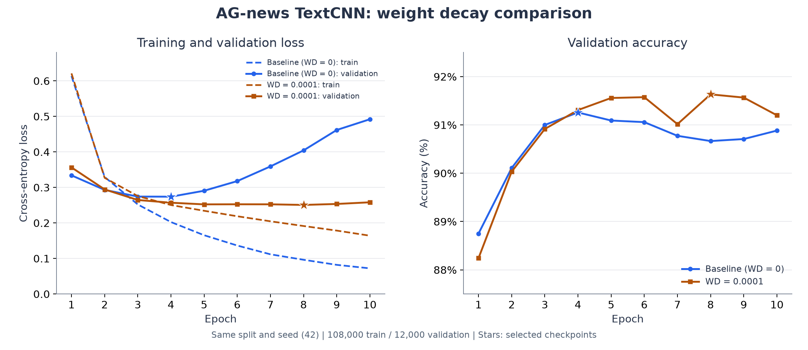
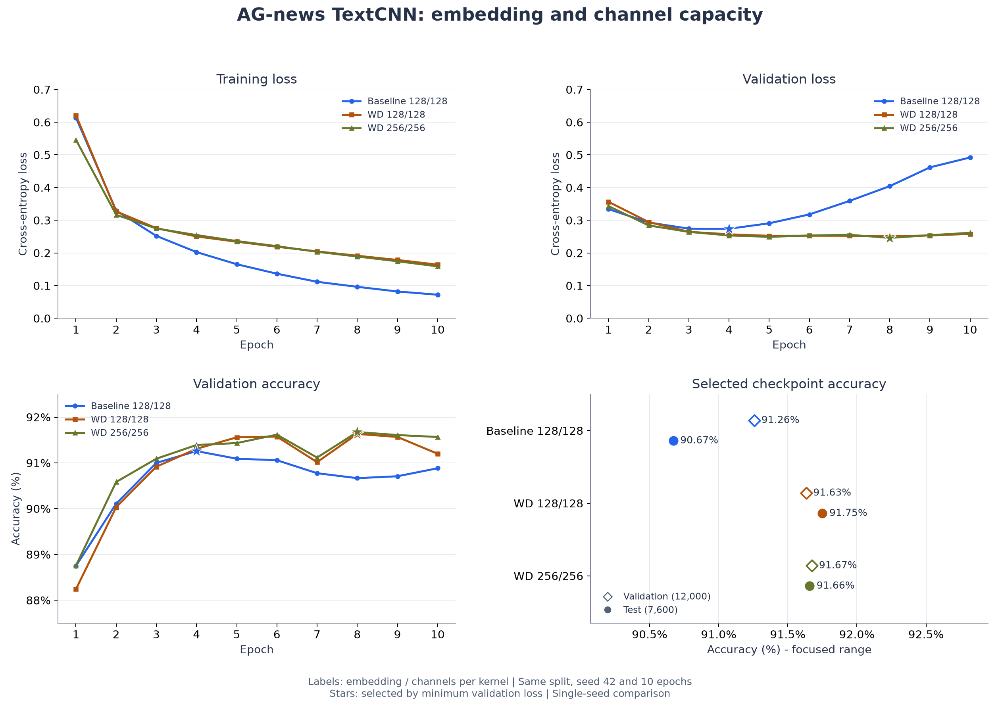
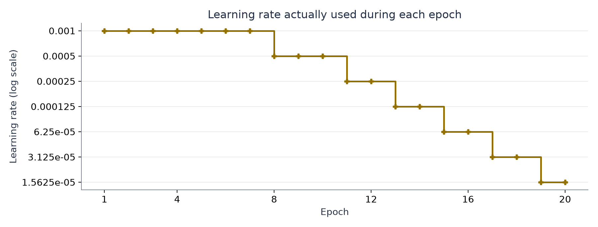
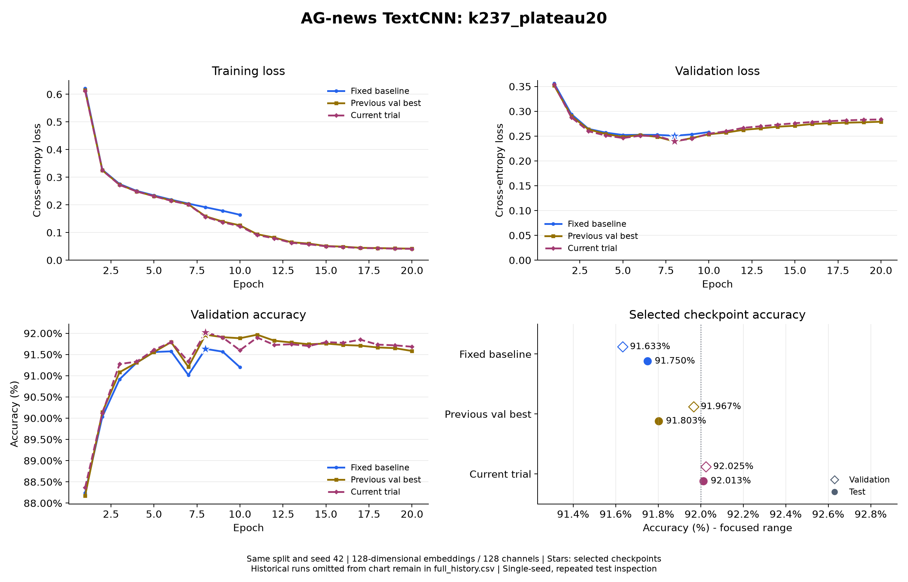

# 2026-11-02 Task 2 新闻分类：项目搭建与调参

以下内容摘自我的[Task 2 新闻分类实验报告](../../task2_简单分类模型设计与实现/docs/report.md)，保留项目搭建、调参过程和学习体会部分。正文和代码保持原文，图片链接按日志位置调整。
如果想看更详细的内容，可以直接看我的实验报告。

## 二、项目架构搭建

### 项目结构

```text
task2_简单分类模型设计与实现/
├── configs/                                    # 数据、模型和训练配置
│   ├── textcnn_ag_news.json                    # 默认配置
│   ├── textcnn_ag_news_smoke.json              # 小规模试跑配置
│   ├── textcnn_ag_news_baseline.json           # 初始基线配置
│   ├── textcnn_ag_news_wd1e4.json              # 加入权重衰减的配置
│   ├── textcnn_ag_news_plateau20.json          # 学习率衰减与 20 轮训练配置
│   ├── textcnn_ag_news_k237_plateau20.json     # 最终卷积核 2/3/7 方案
│   └── ...                                     # 其余学习率、Dropout、容量等对照配置
├── news_classifier/                            # 数据处理、模型与训练源码
│   ├── __init__.py
│   ├── config.py                               # 读取配置、检查参数并解析路径
│   ├── data.py                                 # 数据读取、划分、分词、词表和批次填充
│   ├── model.py                                # TextCNN 模型定义与前向计算
│   ├── engine.py                               # 单轮训练与评估，统计损失和准确率
│   ├── train.py                                # 组织训练、调整学习率并保存日志和模型
│   ├── evaluate.py                             # 加载模型和词表，评估测试集
│   └── predict.py                              # 加载模型和词表，预测单条新闻
├── docs/
│   └── report.md                               # 实验报告
├── experiments/                                # 实验过程与结果记录
│   ├── README.md                               # 实验记录索引与记录约定
│   ├── textcnn_smoke.md                        # 单轮试跑记录
│   ├── 2026-11-01_weight_decay.md              # 基线与权重衰减对比
│   ├── 2026-11-01_k237_plateau20.md            # 最终方案与达标结果
│   ├── ...                                     # 其余调参实验记录
│   └── assets/                                 # 损失、准确率和学习率等对比图
└── tests/                                      # 训练与评估流程测试
    ├── test_train.py                           # 模型保存、学习率调度和日志记录测试
    └── test_evaluate.py                        # 词表恢复与测试指标输出测试
```

### 1. 先把完整流程连接起来

我把项目分成几个职责比较清楚的文件。数据处理负责把新闻变成模型能接收的输入，模型负责给出四个类别的分数，训练部分负责不断更新参数。测试和单条预测使用保存好的模型，沿用训练时的词表和配置。

| 文件或目录 | 负责的内容 |
| --- | --- |
| `configs/` | 保存每轮实验的数据、模型和训练设置 |
| `data.py` | 读取新闻、划分数据、建立词表并整理批次 |
| `model.py` | 定义 TextCNN 的各层和前向计算 |
| `engine.py` | 完成一轮训练或评估，统计损失和准确率 |
| `train.py` | 读取配置，组织训练，记录指标并保存模型 |
| `evaluate.py / predict.py` | 评估测试集，或预测一条新闻的类别 |

实际运行时，流程是“新闻文本 → 词编号 → 词向量 → 多组卷积与最大池化 → 拼接特征 → Dropout → 四分类输出”。我把词向量理解为词的数字表示，卷积则是在句子中观察一段段相邻的词，从中提取对分类有帮助的内容。

### 2. 为什么选择 TextCNN，以及怎样组合模型

我之前已经练习过 TextCNN，有一份学习代码可以参考，继续使用它比较容易把完整项目搭建起来。它的结构也比较直观：用不同宽度的卷积核观察词组，再把提取到的特征交给分类层。对于刚开始做调参实验的我，这种结构便于理解，也方便比较维度、通道数和卷积核组合的影响。

下面是 `model.py` 中创建卷积分支的代码节选，省略了前后的词嵌入层和分类层。

```python
        self.convs = nn.ModuleList([
            nn.Conv1d(
                in_channels = embed_dim,
                out_channels = num_filters,
                kernel_size = kernel_size,
            )
            for kernel_size in self.kernel_sizes
        ])
```

这里会根据配置创建多组卷积，每组观察的连续词数可以不同。例如最终的 2/3/7，表示分别观察相邻的 2 个、3 个和 7 个词。卷积结果经过 ReLU 和最大池化，保留各组中响应较强的特征，再拼接起来用于分类。补齐部分对应的无效窗口会被屏蔽，避免它们影响池化结果。

相比 Task 1，这次我可以直接使用现成的层，自动求导也由 PyTorch 完成。搭建过程中，我更需要弄清楚每一层的作用，以及上一层的输出能不能接到下一层。最终模型中，词向量维度和每组卷积的通道数都是 128，三个分支拼接后得到 384 维特征，再输出四个类别的分数。

### 3. 把超参数集中放进 config 文件

这次我还学到了把模型和训练的超参数统一放进 config 文件管理。学习率、WD、Dropout、卷积核大小等设置不用散落在不同代码里。想试一个新方案时，我可以复制一份配置，修改要比较的值，再设置一个新的实验输出目录。

下面节选自最终配置 `textcnn_ag_news_k237_plateau20.json`，仅展示 training 部分，其余内容省略。

```json
  "training": {
    "batch_size": 64,
    "epochs": 20,
    "learning_rate": 0.001,
    "weight_decay": 0.0001,
    "device": "auto",
    "num_workers": 0,
    "scheduler": {
      "name": "reduce_on_plateau",
      "factor": 0.5,
      "patience": 1,
      "min_lr": 1e-05
    }
  },
```

配置中还分开保存 data、model 和 output。这样的安排在反复调参时很实用：我能回头查看某次结果到底用了什么设置，也能确认两轮实验之间改了哪些地方。保存模型时，程序会把配置和词表一并保存，之后测试时可以恢复同样的处理方式。

### 4. 训练过程也比之前简洁

`engine.py` 中每个批次更新参数的核心代码如下，省略了前后的数据搬运和指标统计。

```python
        optimizer.zero_grad(set_to_none = True)

        #进行前向传播，计算预测分数和损失
        logits = model.forward(input_ids,lengths)
        loss = criterion(logits,labels)

        loss.backward()
        optimizer.step()
```

我需要做的是清空上一批的梯度，让模型计算预测结果，用真实标签计算损失，再进行反向传播和参数更新。训练完成一轮后，程序在验证集上评估，将结果写入 `metrics.csv`，并按验证指标保存模型。这样下一次调整参数时，就有上一轮的记录可以对照。

训练使用交叉熵损失，我把它理解为衡量模型预测和真实类别之间的差距；评估时取四个类别中得分最高的一类，与真实标签比较。准确率就是预测正确的新闻数除以总新闻数。损失和准确率需要一起观察，后面有些实验损失略有下降，正确分类的数量却没有增加。

## 三、反复调参的过程

### 1. 先跑基线，再尝试权重衰减

最初的配置使用 128 维词向量，每个卷积分支有 128 个通道，卷积核为 3/4/5，Dropout 为 0.5，Adam 学习率为 0.001，训练 10 轮。这组实验没有加入权重衰减，测试准确率为 90.67%。它让我有了一个可以比较的起点。

看训练记录时，我开始注意到训练集和验证集的表现并不总是一起变好。基线到了后期，训练损失还在下降，验证损失却从第 4 轮之后逐渐上升。我把这种现象理解为模型越来越适应训练过的新闻，但面对验证集时没有继续进步，已经出现了过拟合。

接下来，我把 WD，也就是 weight_decay，设为 0.0001，其余设置保持一致。我目前对它的理解比较直观：在训练时对过大的权重加一些约束，尝试减轻过拟合。这次调整后，验证损失的后期走势平稳了不少，测试准确率提高到了 91.75%。



*图 1：蓝色是没有 WD 的基线，棕色是 WD=0.0001。左图虚线为训练损失、实线为验证损失，右图为验证准确率。星号表示按最低验证损失选出的模型。最明显的变化是蓝色验证损失后期不断上升，而棕色曲线相对平稳。*

| 方案 | 选定轮次 | 验证准确率 | 测试准确率 |
| --- | --- | --- | --- |
| 不加 WD | 第 4 轮 | 91.258% | 90.671% |
| WD=0.0001 | 第 8 轮 | 91.633% | 91.750% |

这是一次比较明确的改善，也让我开始学着同时看训练和验证两边的曲线。后面我保留了 WD=0.0001，继续尝试其他设置。

### 2. 直接把模型放大，效果没有想象中好

我尝试过一个比较直觉的方向：把词向量维度和卷积通道数都从 128 加到 256。我当时觉得，模型能表示的内容更多，分类也许就会更准确。实际改动是扩大维度和通道数，模型总参数量从约 563 万增加到了约 1164 万。



*图 2：棕色表示加入 WD 的 128/128 模型，绿色表示 256/256 模型，蓝色仍为最初基线。上方两图是训练和验证损失，左下是验证准确率，右下空心点为验证结果、实心点为测试结果。棕色和绿色的大部分曲线很接近。*

扩大之后，选定模型的验证准确率从 91.633% 小幅变为 91.675%，测试准确率却从 91.750% 变为 91.658%。参数量增加了一倍多，准确率没有得到相应的改善。我因此暂时回到 128 维模型，继续寻找其他调整方向。

### 3. 同时加强 WD 和 Dropout，也没有提高准确率

随后，我又把 Dropout 从 0.5 改为 0.6，同时把 WD 从 0.0001 改为 0.0003。Dropout 可以简单理解为训练时随机停用一部分特征，我希望更强的限制能减轻过拟合。但这组模型训练 10 轮后，选定模型的测试准确率只有 91.25%。

这两次尝试让我发现，参数更大、限制更强，都不能直接换来更高的准确率。这次联合实验同时改了两项设置，也让我难以分清到底是哪一项起了作用。后面的实验中，我开始更多地单独修改一个设置，再看验证结果。

### 4. 让学习率在后期逐步降低

下一步，我回到 128 维、Dropout=0.5、WD=0.0001 的设置，加入按验证损失降低学习率的策略，并把最多训练轮数从 10 轮增加到 20 轮。初始学习率仍是 0.001，验证损失连续没有明显改善时，就把学习率减半。我把它理解为前期先正常学习，后期再尝试用较小的幅度调整参数。



*图 3：横轴是训练轮次，纵轴是学习率，采用对数刻度。本组前 7 轮使用 0.001，第 8 轮开始使用 0.0005。轮末作出的调整会从下一轮生效。*

这组实验选中了第 8 轮模型，验证准确率为 91.833%，测试准确率为 91.868%。之后虽然继续训练，训练损失还在下降，验证表现却没有刷新最好结果。我也因此更清楚地理解了为什么要保存表现较好的模型，而不是直接使用最后一轮。

这一组同时改变了学习率策略和训练轮数，保存模型的规则也增加了按验证准确率选择的方式，所以我只能说这个组合在本次实验中取得了改善，不能把提升全部算在某一个设置上。

### 5. 继续单独尝试学习率、Dropout 和批量大小

| 相对上述 20 轮方案的改动 | 验证准确率 | 测试准确率 |
| --- | --- | --- |
| 作为对照，保持上述设置 | 91.833% | 91.868% |
| Dropout 降到 0.4 | 91.650% | 91.539% |
| 初始学习率降到 0.0005 | 91.692% | 91.645% |
| Dropout 提高到 0.6 | 91.775% | 91.605% |
| batch size 从 64 改为 32 | 91.675% | 91.092% |

这些方案都沿用学习率衰减、最多训练 20 轮，按最高验证准确率选择模型。这几次修改没有超过对照组。学习率一开始就减小，也没有比先用 0.001、后期再降低更好；Dropout 往上或往下调整，也都需要看实际结果。

### 6. 调整卷积核组合，最终达到 92%

之后我尝试改变卷积核的宽度，让模型观察不同长度的连续词组。先把 3/4/5 改成 2/4/6，再尝试 2/3/7。三种组合的宽度之和都是 12，在词向量维度和通道数不变时，模型总参数量也保持不变。



*图 4：蓝色是 WD=0.0001、固定学习率的 10 轮对照，土黄色是此前验证表现最好的 2/4/6 方案，紫色是最终的 2/3/7 方案。右下图比较所选模型的验证和测试准确率；蓝色曲线只画了实际训练的 10 轮。*

| 卷积核与 WD 设置 | 验证准确率 | 测试准确率 |
| --- | --- | --- |
| 2/4/6，WD=0.0001 | 91.967% | 91.803% |
| 2/4/6，WD=0.0002 | 91.892% | 91.789% |
| 2/3/7，WD=0.0001 | 92.025% | 92.013% |

这三组都使用 128 维词向量、每分支 128 通道、Dropout=0.5、batch size=64，以及前面的学习率衰减策略。最终 2/3/7 方案在第 8 轮取得了最好的验证准确率，测试集上正确分类 6993 条新闻，准确率为 92.0132%。

模型结构上的修改不大，结果终于达到了目标。回头看，扩大模型那次并没有带来预想的提升，而保留较小的模型、继续调整训练设置和卷积核组合，反而找到了这次更合适的配置。

## 四、最终结果与体会

### 4. 这次真正学到的东西

Task 1 让我花了很多时间理解神经网络底层怎样计算。这次使用 PyTorch 后，我能更快地搭好一个完整项目，并实际经历从最初结果到不断调整的过程。对于刚开始接触调参的我，这部分收获比多写几个模型层更直接。

我开始知道，训练准确率越来越高时，还要继续看验证结果；一种调整听起来合理，也可能在实际实验中没有效果。和 AI 讨论能帮助我提出下一步的方案，但仍然需要把它跑出来，保存记录，再决定是否保留。

config 文件的使用也是我这次很实用的一项收获。参数集中管理以后，每轮实验更容易组织，回头比较时也有依据。以后再搭建模型，我会继续采用这种方式，把配置、训练记录和保存的模型对应起来。
