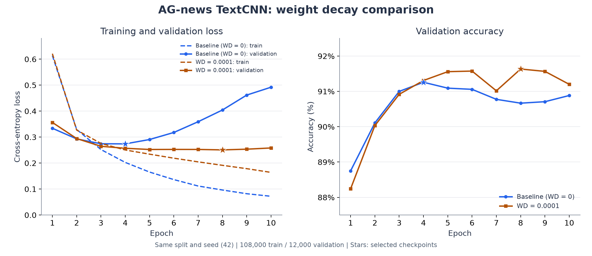
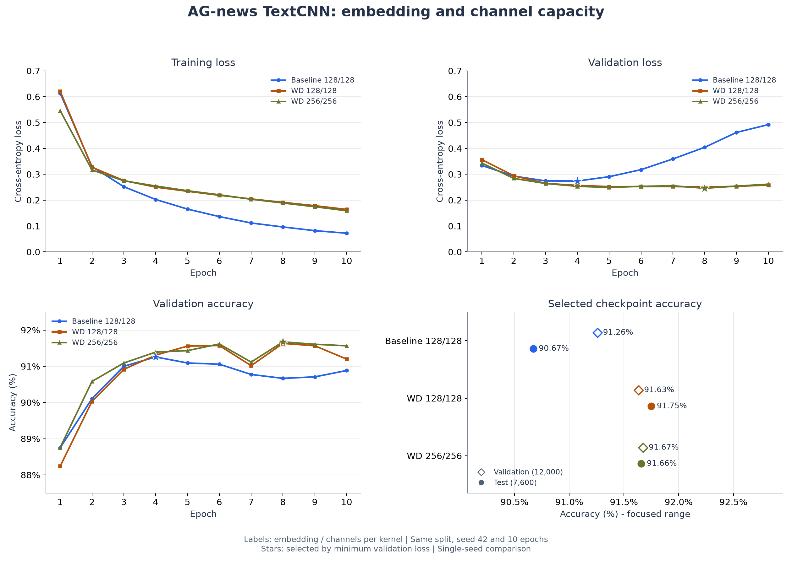
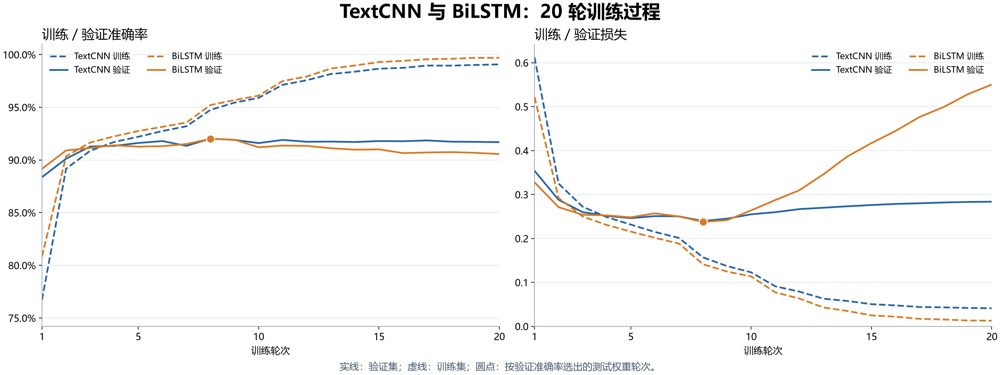
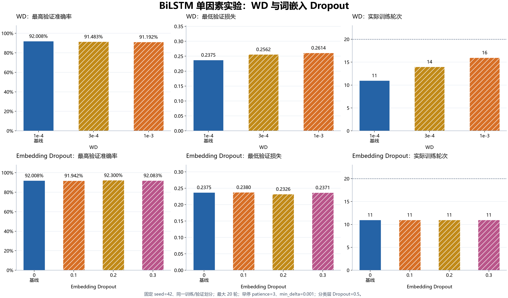
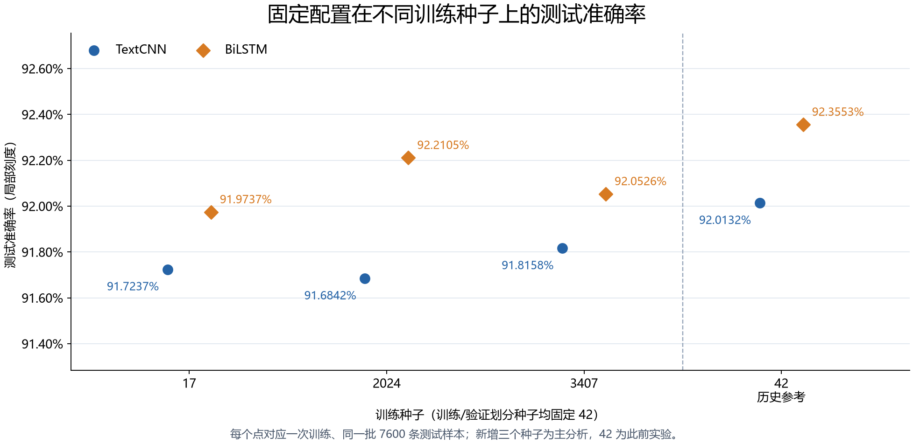
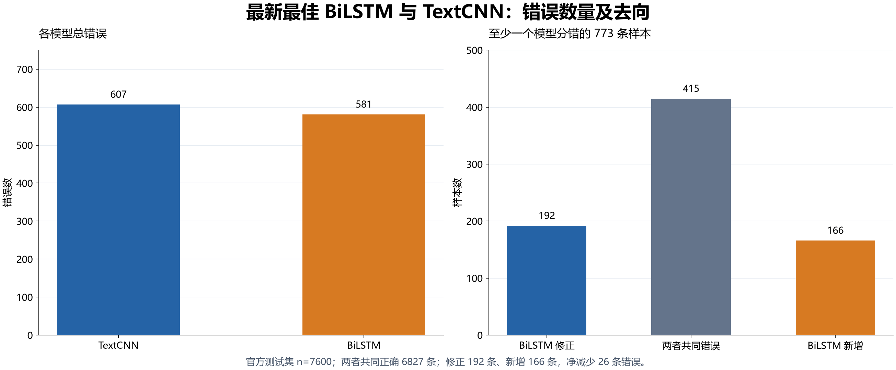
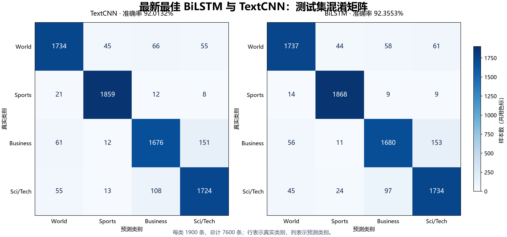
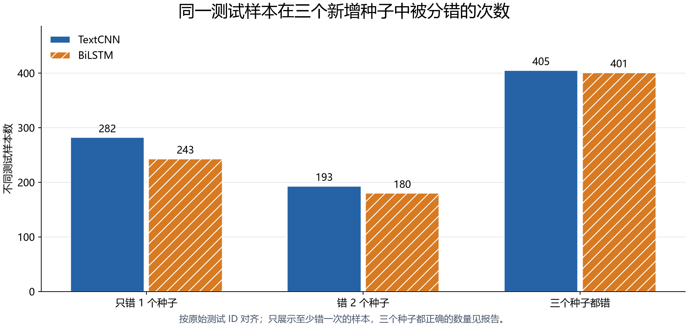

# Task 2 新闻分类实验报告

## 一、实验背景与任务

这次 Task 2 从 TextCNN 项目搭建开始，逐步补充了调参、错误分析、输入改进、BiLSTM 对照和随机种子复现实验。最初搭起训练流程的速度比我原先想象的快。上一次 Task 1 要用 NumPy 搭建神经网络运算框架，我花了将近一个月。因为很多内容都要从底层写起，代码量比较大，我还需要一步一步写测试，确认各个部分能正常工作。

这一次我使用 PyTorch 搭建新闻分类模型。词嵌入层、卷积层、自动求导和优化器都有现成的接口，模型定义和训练过程因此简洁了很多。我终于能把更多时间用在观察训练结果、尝试改善模型上。

实验选择 AG-news 数据集，目标是把英文新闻分到世界、体育、商业、科技四类。我使用此前学习过的 TextCNN 结构，用 PyTorch 提供的基础层把它搭建起来。完成数据处理、训练、测试和单条新闻预测后，我先调整超参数，尝试达到 92% 的参考成绩，再比较两种模型的准确率、运行开销和具体错误。

### 1. 数据如何使用

| 数据部分 | 样本数量 | 在实验中的用途 |
| --- | --- | --- |
| 训练集 | 108000 条 | 让模型学习新闻内容与类别的对应关系 |
| 验证集 | 12000 条 | 观察训练效果，选择保存哪一轮模型 |
| 官方测试集 | 7600 条 | 对选好的模型进行评估 |

验证集从官方训练集中按类别比例划分，划分种子固定为 42。最初调参也使用训练种子 42；后续复现实验只改变训练种子，保持数据划分不变。词表只根据划分后的训练集建立，最终有 42396 项。新闻先转成小写，再拆成词并转换成编号；不认识的词使用统一编号，过长的新闻截到 256 个词，较短的新闻在同一批中补齐。

### 2. 我在这次实验中的侧重点

对于测试代码，以及数据加载中比较流程化、又超出我当前知识范围的部分，我借助了 AI 编码。我主要把精力放在理解项目各部分怎样连接、模型怎样训练，以及结果不好时应该往哪个方向调整。调参期间，我也反复和 AI 讨论下一步的尝试，再通过实际运行看效果。

## 二、项目架构搭建

### 项目结构

```text
task2_简单分类模型设计与实现/
├── configs/                    # TextCNN、BiLSTM 及各组对照配置
├── news_classifier/
│   ├── config.py               # 配置读取、校验与路径解析
│   ├── data/                   # 划分、词表、清洗与词向量导入
│   ├── models/                 # TextCNN 与 BiLSTM
│   ├── training/               # 训练循环、调度、早停与检查点
│   ├── evaluation/             # 评估、预测与错误分析
│   ├── experiments/            # 输入改进与 BiLSTM 正则化实验
│   └── train.py / evaluate.py / predict.py
├── docs/report.md              # 综合实验报告
├── experiments/
│   ├── README.md               # 实验记录索引
│   ├── textcnn/                # 调参、输入改进、错误分析与图表
│   ├── bilstm/                 # 模型对照、正则化与错误分析
│   ├── random_seeds/           # 三个新增种子的完整复现结果
│   └── scripts/                # 数据核验、统计和绘图脚本
└── tests/                      # 模型、训练、早停与评估测试
```

### 1. 先把完整流程连接起来

我把项目分成几个职责比较清楚的文件。数据处理负责把新闻变成模型能接收的输入，模型负责给出四个类别的分数，训练部分负责不断更新参数。测试和单条预测使用保存好的模型，沿用训练时的词表和配置。

| 文件或目录 | 负责的内容 |
| --- | --- |
| `configs/` | 保存每轮实验的数据、模型和训练设置 |
| `data/` | 读取新闻、划分数据、建立词表并整理批次 |
| `models/` | 定义 TextCNN、BiLSTM 及前向计算 |
| `training/engine.py` | 完成一轮训练或评估，统计损失和准确率 |
| `train.py` | 读取配置，组织训练，记录指标并保存模型 |
| `evaluate.py / predict.py` | 评估测试集，或预测一条新闻的类别 |

实际运行时，流程是“新闻文本 → 词编号 → 词向量 → 多组卷积与最大池化 → 拼接特征 → Dropout → 四分类输出”。我把词向量理解为词的数字表示，卷积则是在句子中观察一段段相邻的词，从中提取对分类有帮助的内容。

### 2. 为什么选择 TextCNN，以及怎样组合模型

我之前已经练习过 TextCNN，有一份学习代码可以参考，继续使用它比较容易把完整项目搭建起来。它的结构也比较直观：用不同宽度的卷积核观察词组，再把提取到的特征交给分类层。对于刚开始做调参实验的我，这种结构便于理解，也方便比较维度、通道数和卷积核组合的影响。

下面是 `models/textcnn.py` 中创建卷积分支的代码节选，省略了前后的词嵌入层和分类层。

```python
        self.convs = nn.ModuleList([
            nn.Conv1d(
                in_channels = embed_dim,
                out_channels = num_filters,
                kernel_size = kernel_size,
            )
            for kernel_size in self.kernel_sizes
        ])
```

这里会根据配置创建多组卷积，每组观察的连续词数可以不同。例如最终的 2/3/7，表示分别观察相邻的 2 个、3 个和 7 个词。卷积结果经过 ReLU 和最大池化，保留各组中响应较强的特征，再拼接起来用于分类。补齐部分对应的无效窗口会被屏蔽，避免它们影响池化结果。

相比 Task 1，这次我可以直接使用现成的层，自动求导也由 PyTorch 完成。搭建过程中，我更需要弄清楚每一层的作用，以及上一层的输出能不能接到下一层。最终模型中，词向量维度和每组卷积的通道数都是 128，三个分支拼接后得到 384 维特征，再输出四个类别的分数。

### 3. 把超参数集中放进 config 文件

这次我还学到了把模型和训练的超参数统一放进 config 文件管理。学习率、WD、Dropout、卷积核大小等设置不用散落在不同代码里。想试一个新方案时，我可以复制一份配置，修改要比较的值，再设置一个新的实验输出目录。

下面节选自最终配置 `textcnn_ag_news_k237_plateau20.json`，仅展示 training 部分，其余内容省略。

```json
  "training": {
    "batch_size": 64,
    "epochs": 20,
    "learning_rate": 0.001,
    "weight_decay": 0.0001,
    "device": "auto",
    "num_workers": 0,
    "scheduler": {
      "name": "reduce_on_plateau",
      "factor": 0.5,
      "patience": 1,
      "min_lr": 1e-05
    }
  },
```

配置中还分开保存 data、model 和 output。这样的安排在反复调参时很实用：我能回头查看某次结果到底用了什么设置，也能确认两轮实验之间改了哪些地方。保存模型时，程序会把配置和词表一并保存，之后测试时可以恢复同样的处理方式。

### 4. 训练过程也比之前简洁

`training/engine.py` 中每个批次更新参数的核心代码如下，省略了前后的数据搬运和指标统计。

```python
        optimizer.zero_grad(set_to_none = True)

        #进行前向传播，计算预测分数和损失
        logits = model.forward(input_ids,lengths)
        loss = criterion(logits,labels)

        loss.backward()
        optimizer.step()
```

我需要做的是清空上一批的梯度，让模型计算预测结果，用真实标签计算损失，再进行反向传播和参数更新。训练完成一轮后，程序在验证集上评估，将结果写入 `metrics.csv`，并按验证指标保存模型。这样下一次调整参数时，就有上一轮的记录可以对照。

训练使用交叉熵损失，我把它理解为衡量模型预测和真实类别之间的差距；评估时取四个类别中得分最高的一类，与真实标签比较。准确率就是预测正确的新闻数除以总新闻数。损失和准确率需要一起观察，后面有些实验损失略有下降，正确分类的数量却没有增加。

## 三、实验过程与结果

### 1. 先跑基线，再尝试权重衰减

最初的配置使用 128 维词向量，每个卷积分支有 128 个通道，卷积核为 3/4/5，Dropout 为 0.5，Adam 学习率为 0.001，训练 10 轮。这组实验没有加入权重衰减，测试准确率为 90.67%。它让我有了一个可以比较的起点。

看训练记录时，我开始注意到训练集和验证集的表现并不总是一起变好。基线到了后期，训练损失还在下降，验证损失却从第 4 轮之后逐渐上升。我把这种现象理解为模型越来越适应训练过的新闻，但面对验证集时没有继续进步，已经出现了过拟合。

接下来，我把 WD，也就是 weight_decay，设为 0.0001，其余设置保持一致。我目前对它的理解比较直观：在训练时对过大的权重加一些约束，尝试减轻过拟合。这次调整后，验证损失的后期走势平稳了不少，测试准确率提高到了 91.75%。



*图 1：蓝色是没有 WD 的基线，棕色是 WD=0.0001。左图虚线为训练损失、实线为验证损失，右图为验证准确率。星号表示按最低验证损失选出的模型。最明显的变化是蓝色验证损失后期不断上升，而棕色曲线相对平稳。*

| 方案 | 选定轮次 | 验证准确率 | 测试准确率 |
| --- | --- | --- | --- |
| 不加 WD | 第 4 轮 | 91.258% | 90.671% |
| WD=0.0001 | 第 8 轮 | 91.633% | 91.750% |

这是一次比较明确的改善，也让我开始学着同时看训练和验证两边的曲线。后面我保留了 WD=0.0001，继续尝试其他设置。

### 2. 直接把模型放大，效果没有想象中好

我尝试过一个比较直觉的方向：把词向量维度和卷积通道数都从 128 加到 256。我当时觉得，模型能表示的内容更多，分类也许就会更准确。实际改动是扩大维度和通道数，模型总参数量从约 563 万增加到了约 1164 万。



*图 2：棕色表示加入 WD 的 128/128 模型，绿色表示 256/256 模型，蓝色仍为最初基线。上方两图是训练和验证损失，左下是验证准确率，右下空心点为验证结果、实心点为测试结果。棕色和绿色的大部分曲线很接近。*

扩大之后，选定模型的验证准确率从 91.633% 小幅变为 91.675%，测试准确率却从 91.750% 变为 91.658%。参数量增加了一倍多，准确率没有得到相应的改善。我因此暂时回到 128 维模型，继续寻找其他调整方向。

### 3. 同时加强 WD 和 Dropout，也没有提高准确率

随后，我又把 Dropout 从 0.5 改为 0.6，同时把 WD 从 0.0001 改为 0.0003。Dropout 可以简单理解为训练时随机停用一部分特征，我希望更强的限制能减轻过拟合。但这组模型训练 10 轮后，选定模型的测试准确率只有 91.25%。

这两次尝试让我发现，参数更大、限制更强，都不能直接换来更高的准确率。这次联合实验同时改了两项设置，也让我难以分清到底是哪一项起了作用。后面的实验中，我开始更多地单独修改一个设置，再看验证结果。

### 4. 让学习率在后期逐步降低

下一步，我回到 128 维、Dropout=0.5、WD=0.0001 的设置，加入按验证损失降低学习率的策略，并把最多训练轮数从 10 轮增加到 20 轮。初始学习率仍是 0.001，验证损失连续没有明显改善时，就把学习率减半。我把它理解为前期先正常学习，后期再尝试用较小的幅度调整参数。


*图 3：横轴是训练轮次，纵轴是学习率，采用对数刻度。本组前 7 轮使用 0.001，第 8 轮开始使用 0.0005。轮末作出的调整会从下一轮生效。*

这组实验选中了第 8 轮模型，验证准确率为 91.833%，测试准确率为 91.868%。之后虽然继续训练，训练损失还在下降，验证表现却没有刷新最好结果。我也因此更清楚地理解了为什么要保存表现较好的模型，而不是直接使用最后一轮。

这一组同时改变了学习率策略和训练轮数，保存模型的规则也增加了按验证准确率选择的方式，所以我只能说这个组合在本次实验中取得了改善，不能把提升全部算在某一个设置上。

### 5. 继续单独尝试学习率、Dropout 和批量大小

| 相对上述 20 轮方案的改动 | 验证准确率 | 测试准确率 |
| --- | --- | --- |
| 作为对照，保持上述设置 | 91.833% | 91.868% |
| Dropout 降到 0.4 | 91.650% | 91.539% |
| 初始学习率降到 0.0005 | 91.692% | 91.645% |
| Dropout 提高到 0.6 | 91.775% | 91.605% |
| batch size 从 64 改为 32 | 91.675% | 91.092% |

这些方案都沿用学习率衰减、最多训练 20 轮，按最高验证准确率选择模型。这几次修改没有超过对照组。学习率一开始就减小，也没有比先用 0.001、后期再降低更好；Dropout 往上或往下调整，也都需要看实际结果。

### 6. 调整卷积核组合，TextCNN 达到 92%

之后我尝试改变卷积核的宽度，让模型观察不同长度的连续词组。先把 3/4/5 改成 2/4/6，再尝试 2/3/7。三种组合的宽度之和都是 12，在词向量维度和通道数不变时，模型总参数量也保持不变。


*图 4：蓝色是 WD=0.0001、固定学习率的 10 轮对照，土黄色是此前验证表现最好的 2/4/6 方案，紫色是最终的 2/3/7 方案。右下图比较所选模型的验证和测试准确率；蓝色曲线只画了实际训练的 10 轮。*

| 卷积核与 WD 设置 | 验证准确率 | 测试准确率 |
| --- | --- | --- |
| 2/4/6，WD=0.0001 | 91.967% | 91.803% |
| 2/4/6，WD=0.0002 | 91.892% | 91.789% |
| 2/3/7，WD=0.0001 | 92.025% | 92.013% |

这三组都使用 128 维词向量、每分支 128 通道、Dropout=0.5、batch size=64，以及前面的学习率衰减策略。最终 2/3/7 方案在第 8 轮取得了最好的验证准确率，测试集上正确分类 6993 条新闻，准确率为 92.0132%。

模型结构上的修改不大，结果终于达到了目标。回头看，扩大模型那次并没有带来预想的提升，而保留较小的模型、继续调整训练设置和卷积核组合，反而找到了这次更合适的配置。

### 7. 根据错误分析，尝试清洗与预训练词向量

TextCNN 达到 92.0132% 后，仍有 607 条新闻分错。11 月 3 日，我按照老师的建议提取错误案例，比较不同卷积核的预测，再从输入处理和模型结构两个方向继续实验。具体案例与分组统计统一放在第四章。

我先保留 2/3/7 的 TextCNN，检查改善输入是否有帮助。清洗组修复已知 HTML 实体、去除常见标签并规范空白，保留股票代码等信息；训练和推理使用相同规则，词表和其他设置沿用原方案。

词向量实验分为 GloVe 和 Word2Vec。GloVe 使用外部语料预训练的 100 维向量，因此增加随机 100 维对照。Word2Vec 则只在本项目 108000 条训练新闻上预训练 128 维 Skip-gram，不使用验证集、测试集和分类标签。

GloVe 覆盖训练词表中 40433/42394 个普通词，覆盖率为 95.37%，未覆盖词保留随机初始化。两种预训练词向量在分类训练中都继续更新。各组训练 20 轮，按验证准确率选权重，并列时比较验证损失。

| 方案 | 验证准确率 | 测试准确率 | 测试错误数 | 商业↔科技混淆数 |
| --- | ---: | ---: | ---: | ---: |
| 原始随机 128 维 | 92.0250% | 92.0132% | 607 | 259 |
| 统一清洗 128 维 | 91.7833% | 91.8158% | 622 | 278 |
| 随机 100 维对照 | 92.0000% | 91.8026% | 623 | 270 |
| GloVe 100 维，可训练 | 92.1833% | 91.6842% | 632 | 267 |
| Word2Vec 128 维，可训练 | 92.1083% | 91.8553% | 619 | 272 |

清洗组相对原模型修正 93 条旧错误、新增 108 条；GloVe 相对随机 100 维对照修正 131 条、新增 140 条；Word2Vec 相对随机 128 维对照修正 112 条、新增 124 条。用于核验的随机 128 维重跑，其全部测试预测与原模型一致。

这几组设置都没有提高整体测试准确率。GloVe 的验证准确率虽然高于原模型，测试结果却更低；这也提醒我，不能用一个验证或测试数字解释全部变化，需要保留完整对照。

### 8. 实现 BiLSTM，先与 TextCNN 做基线对照

输入改进没有取得预期效果后，我转向已经学过的 BiLSTM。它从前后两个方向处理词序，再拼接两个方向的末状态用于分类。我希望借此观察，顺序信息能否帮助处理 TextCNN 中出现的语境歧义。

BiLSTM 使用 128 维词向量、单层双向 LSTM，每个方向的隐藏维度为 128，分类层 Dropout 为 0.5。变长序列先打包，避免把补齐位置当作有效词；分类时拼接两个方向的末状态，得到 256 维特征。

基线沿用相同的数据划分、42396 项词表、长度上限 256、训练种子 42，以及 batch size=64、Adam 初始学习率 0.001、WD=0.0001 和验证损失学习率调度。两者都训练 20 轮，按最高验证准确率选择权重。

| 指标 | 已选 TextCNN | BiLSTM 基线 |
| --- | ---: | ---: |
| 选中轮次 | 8 | 8 |
| 测试准确率 | 92.0132% | 92.0789% |
| Macro-F1 | 92.0015% | 92.0769% |
| 测试交叉熵 | 0.249545 | 0.240254 |
| 错误数 / 7600 | 607 | 602 |
| 参数量 | 5,625,220 | 5,691,908 |
| 记录中的 20 轮训练用时 | 2.39 分钟 | 10.88 分钟 |



*图 5：两种模型均训练 20 轮。BiLSTM 在第 8 轮后训练表现继续改善，验证损失却逐渐上升。*

BiLSTM 基线比 TextCNN 多分对 5 条，准确率提高 0.0658 个百分点；背后是修正 187 条错误，同时新增 182 条。结构替换带来的净变化很小，不能直接认定双向建模已经解决了原来的问题。

它也出现了明显过拟合：验证损失从第 8 轮的 0.2375 升到第 20 轮的 0.5504。原记录中的 20 轮用时约为 TextCNN 的 4.6 倍，因此我接着加入早停，并比较不同强度的正则化。

### 9. 用验证集选择 BiLSTM 的正则化与早停方案

六组 BiLSTM 实验固定数据、初始权重和训练种子 42，每次只改变 WD 或词嵌入 Dropout。所有组使用相同的验证损失早停：patience=3、min_delta=0.001，最多 20 轮；分类层 Dropout 固定为 0.5。

| 方案 | WD | 词嵌入 Dropout | 实际轮次 | 最佳准确率轮次 | 最高验证准确率 | 最低验证损失 |
| --- | ---: | ---: | ---: | ---: | ---: | ---: |
| 早停基线 | 0.0001 | 0 | 11 | 8 | 92.0083% | 0.237546 |
| WD=3e-4 | 0.0003 | 0 | 14 | 12 | 91.4833% | 0.256208 |
| WD=1e-3 | 0.001 | 0 | 16 | 14 | 91.1917% | 0.261362 |
| 词嵌入 Dropout=0.1 | 0.0001 | 0.1 | 11 | 8 | 91.9417% | 0.238032 |
| 词嵌入 Dropout=0.2 | 0.0001 | 0.2 | 11 | 8 | 92.3000% | 0.232552 |
| 词嵌入 Dropout=0.3 | 0.0001 | 0.3 | 11 | 7 | 92.0833% | 0.237063 |



*图 6：按验证集比较 WD 和词嵌入 Dropout。表中最高准确率与最低损失可能来自不同轮次，测试统一使用最高验证准确率权重。*

增大 WD 没有改善验证表现。词嵌入 Dropout=0.2 的验证准确率最高，因此我按预先记录的规则选择它，再评估官方测试集；其他新候选未作测试评估。最终方案在第 11 轮停止，保留第 8 轮权重。

| 测试指标 | 原 BiLSTM 基线 | 验证集选定方案 |
| --- | ---: | ---: |
| 准确率 | 92.0789% | 92.3553% |
| Macro-F1 | 92.0769% | 92.3408% |
| 交叉熵 | 0.240254 | 0.233671 |
| 错误数 / 7600 | 602 | 581 |

最终方案相对 BiLSTM 基线提高 0.2763 个百分点，少错 21 条。与 TextCNN 相比则提高 0.3421 个百分点，少错 26 条。

早停基线前 11 轮的指标与原 20 轮基线完全一致，保留的最佳权重相同，只是省去了后续 9 轮训练。早停并没有额外提高这份已保存权重的准确率，他只是省去了后面无效的计算让整体训练的效率得到了较大的提升。

### 10. 固定最终方案，增加三个训练种子

为检查差异是否只是种子 42 的偶然结果，我固定两套已经选好的配置，新增训练种子 17、2024、3407，共重新训练六次。数据划分种子仍为 42，词表和编码结果保持一致，仅改变初始化、批次采样与 Dropout 的训练随机性。

TextCNN 沿用 2/3/7、20 轮；BiLSTM 沿用词嵌入 Dropout=0.2 和验证损失早停。两者都按验证准确率选权重，并列时比较验证损失。全部六次训练完成后再统一测试，保留所有种子，没有按测试成绩删除结果或更换配置。

| 训练种子 | TextCNN 准确率 | BiLSTM 准确率 | 差值（百分点） | TextCNN 错误 | BiLSTM 错误 |
| --- | ---: | ---: | ---: | ---: | ---: |
| 17 | 91.7237% | 91.9737% | +0.2500 | 629 | 610 |
| 2024 | 91.6842% | 92.2105% | +0.5263 | 632 | 592 |
| 3407 | 91.8158% | 92.0526% | +0.2368 | 622 | 604 |
| 42，历史参考 | 92.0132% | 92.3553% | +0.3421 | 607 | 581 |



*图 7：三个新增种子均保留。历史种子 42 用于前期调参与选型，不计入本轮主结果的均值。*

| 指标，仅新增三个种子 | TextCNN 均值 ± 样本标准差 | BiLSTM 均值 ± 样本标准差 |
| --- | ---: | ---: |
| 准确率 | 91.7412% ± 0.0675 pp | 92.0789% ± 0.1206 pp |
| Macro-F1 | 91.7229% ± 0.0754 pp | 92.0572% ± 0.1232 pp |
| 测试交叉熵 | 0.2620 ± 0.0110 | 0.2451 ± 0.0062 |

pp 表示百分点，标准差按 ddof=1 计算，描述三个训练种子之间的波动，不是置信区间。配对准确率差为 +0.3377 ± 0.1635 个百分点，三组分别净增加 19、40、18 条正确预测。

BiLSTM 在新增种子中都取得较高准确率，但标准差也更大。

## 四、错误案例分析与模型局限

### 1. 分析方法与三种卷积核的共同错误

我按官方测试集的行号对齐全部预测，保留原文、真实标签、预测类别和四类概率，再统计混淆矩阵与分组错误率。案例中的 test:139 表示零起始编号，即测试集第 140 条新闻。

11 月 3 日最先比较的是三种 TextCNN 卷积核：3/4/5、2/4/6、2/3/7 分别错 618、623、607 条。它们共同分错 490 条，占最优 TextCNN 错误的 80.72%；其中 468 条连错误类别都相同。

| 卷积核变更 | 修正旧错误 | 新增错误 | 净减少错误 |
| --- | ---: | ---: | ---: |
| 3/4/5 → 2/4/6 | 83 | 88 | -5 |
| 3/4/5 → 2/3/7 | 106 | 95 | 11 |
| 2/4/6 → 2/3/7 | 94 | 78 | 16 |

这些结果说明，三种局部窗口配置面临较多共同困难。不过，共同错误并非无法修正：清洗、GloVe 和 Word2Vec 分别修正了其中 33、53、48 条，同时也引入其他错误，最终整体准确率没有提高。

### 2. BiLSTM 修正了什么，又增加了什么

以下先比较历史种子 42 的两个最终方案。TextCNN 错 607 条，BiLSTM 错 581 条；其中有 192 条从错变对，166 条从对变错，还有 415 条两者都错。6827 条两者都正确，四组共计 7600 条。



*图 8：净减少 26 条错误的同时，存在较多修正与新增。共同错误占 BiLSTM 全部错误的 71.43%。*

415 条共同错误中，378 条的错误类别也一致。换模型确实改变了部分判断，但大量共同困难仍然保留。

| 真实类别，每类 1900 条 | TextCNN 错误 | BiLSTM 错误 | 修正 | 新增 |
| --- | ---: | ---: | ---: | ---: |
| World | 166 | 163 | 35 | 32 |
| Sports | 41 | 32 | 21 | 12 |
| Business | 224 | 220 | 69 | 65 |
| Sci/Tech | 176 | 166 | 67 | 57 |
| 合计 | 607 | 581 | 192 | 166 |



*图 9：商业与科技仍是主要混淆来源。BiLSTM 在这两类真实新闻中共错 386 条，占其错误的 66.44%。*

| 误分方向 | TextCNN | BiLSTM |
| --- | ---: | ---: |
| Business → Sci/Tech | 151 | 153 |
| Sci/Tech → Business | 108 | 97 |
| World → Business | 66 | 58 |
| Sci/Tech → Sports | 13 | 24 |

商业与科技相互误分从 259 条降为 250 条，但两个方向并不同步。科技误分体育还从 13 条增加到 24 条。Sports 的真实样本虽然少错 9 条，精确率却从 96.3712% 降为 95.9425%。

### 3. 错误案例分析：从 West Bank 到 computer，部分语境改善，关键词干扰仍在

test:139 报道以色列在 West Bank 建设住房，官方类别是 World。TextCNN 将它分为 Business，预测概率为 0.5461；Word2Vec 组改为 World，但概率只有 0.5211。最终 BiLSTM 也预测 World，概率为 0.5482，仍接近类别边界。

我用 UNK 替换指定词并保留长度，观察输入扰动后的变化。遮挡两处 bank 后，TextCNN 的 World 概率由 0.4279 升到 0.8055，BiLSTM 由约 0.5481 升到 0.9812；遮挡 west 后，两者却都预测 Business。

这个案例与模型利用地名、政治语境的解释相符，也表明 bank 的金融含义仍可能干扰判断。BiLSTM 在原文上预测正确，还不足以说明它已经稳定掌握多义词消歧。

test:4825 是 Virginia Tech 的体育报道，文中还有失误、比赛机会和球员等线索。TextCNN 预测 Sci/Tech，BiLSTM 正确预测 Sports，概率为 0.9966。遮挡 tech 后，TextCNN 也转为 Sports，BiLSTM 仍保持正确。

这是一条 BiLSTM 更好利用语境的具体案例。但 test:172 出现相反情况：新闻主事件是 Ross Stores 利润下滑，computer system 只是原因说明。TextCNN 正确预测 Business，BiLSTM 却预测 Sci/Tech，概率为 0.5008。

遮挡 computer 后，BiLSTM 的 Business 概率从约 0.3756 升为 0.7636，预测转为正确。这提示它仍可能把技术背景词当作主题线索，没有充分区分新闻的主事件与背景原因。

另一个新增错误是 test:4054。原文有 Red Sox、innings、pitch、winning run 等棒球线索，TextCNN 正确预测 Sports，BiLSTM 却以 0.9686 的概率预测 World。这个错误目前比较奇特，还不能做归因，不能把所有错误都解释为类别模糊。

### 4. 类别边界与近重复新闻的标注问题

科技企业收购、公司财报和产品发布往往同时包含商业活动与技术信息，标签分类模棱两可，这样的交叉可以解释部分混淆。

例如test:4359 与 test:4047 都讨论 Google 桌面搜索工具带来的隐私风险，正文高度相似。前者官方标签为 Business，后者为 Sci/Tech，两种模型却都预测 Sci/Tech。

这组案例提示，部分错误需要结合主题标注口径理解，不能全算成模型没有学会。

### 5. 新增种子中，哪些问题持续存在

| 种子 | BiLSTM 修正 TextCNN 错误 | BiLSTM 新增错误 | 净减少错误 |
| --- | ---: | ---: | ---: |
| 17 | 212 | 193 | 19 |
| 2024 | 211 | 171 | 40 |
| 3407 | 217 | 199 | 18 |

按同一测试 ID 对齐三个新种子后，TextCNN 始终分错的新闻有 405 条，BiLSTM 有 401 条；其中 275 条在两个模型、三个种子下都分错。更高的平均准确率没有消除这些持续错误。



*图 10：按不同新闻计数，展示每条新闻在同一模型的三个种子中分错几次；每个模型四组样本数合计 7600。*

| 真实类别 | TextCNN 平均错误数 | BiLSTM 平均错误数 |
| --- | ---: | ---: |
| World | 159.33 | 147.67 |
| Sports | 43.33 | 35.67 |
| Business | 226.33 | 236.33 |
| Sci/Tech | 198.67 | 182.33 |

由此可见，两个模型的预测能力在不同的随机种子之下都还是趋于稳定，预测的结果都没有大范围的波动。

## 五、实验感想与体会

### 1. 从搭建流程到提出问题

与 Task 1 相比，这次使用 PyTorch 搭建项目的过程顺利了很多。之前用 NumPy 实现神经网络框架时，我花了较多时间理解底层计算和检查各个模块；这次有了现成的层、自动求导和优化器，我终于能把更多精力放在模型训练之后的问题上。

刚开始时，我最在意的是整个流程能否跑通，以及准确率能否达到参考成绩。能完成训练、测试和单条新闻预测，已经让我觉得这个项目比较完整了。但随着实验继续，我发现这些只是起点：模型能正常运行，并不意味着我已经理解了它为什么这样预测。

观察训练曲线时，我开始追问为什么训练表现还在改善，验证表现却停了下来；比较不同方案时，我又想知道为什么一些听起来合理的调整没有效果。这些问题让我逐渐从照着步骤完成任务，转向根据已有结果决定下一步要验证什么。

错误分析是其中变化比较大的一步。以前看到一条预测错误，我更多会把它理解为模型能力不够。真正读过新闻原文之后，我才注意到，标题中的词不一定代表整条新闻的主题，商业活动和科技背景也常常同时出现。对这些内容的理解，单看准确率是得不到的。

### 2. 学会比较，也学会保留没有改善的结果

这次实验也改变了我对调参的认识。最初我会直觉地觉得，模型更大、正则化更强，或者使用预训练词向量，应该能够带来更好的结果。实际运行后才发现，每个方向都有适用条件，不能因为一种方法在原理上有道理，就预先认定它在当前任务中一定有效。

配置文件和实验记录在这个过程中帮助很大。它们让我能回头确认一次实验改了什么，也让我意识到，同时调整多个设置虽然可能得到更好的成绩，却会让原因变得难以判断。后面再做对照时，我开始更注意保留基线，尽量让每次修改对应一个明确的问题。

清洗和词向量实验没有得到预期的整体提升，但我不觉得这些尝试可以直接略过。它们让我区分了词语表示与整条新闻主题判断之间的关系，也提醒我，某个案例被修正后，还需要检查是否有其他新闻因此分错。保留没有改善的结果，才能看清一个方向实际解决了什么。

这种比较方式也让我更愿意回到原文，而不是只盯着排行榜式的结果表。模型之间的小幅差距，背后可能是许多案例的交换。把这些变化对齐之后，我才更容易判断，新的方案是否回应了最初提出的问题，还有哪些困难一直没有解决。

### 3. 对结果和自身理解保持分寸

增加随机种子实验后，我对一次最高成绩的看法更谨慎了。重复运行能够帮助我观察训练随机性，但不能代替对数据和错误的理解。即使整体结果变化不大，同一条新闻的判断、不同类别的表现，也未必完全一致，需要分别查看。

模型对比同样不能只比较名字。这次两个最终方案还包含不同的正则化和停止设置，准确率、训练时间也各有取舍。对我来说，能够说明比较条件、解释选择依据，比简单地说某个模型更好更有收获。前期已经多次查看过测试集，后续改进也需要新的评估数据检验。

这次项目中的数据加载、部分测试代码和分析脚本使用了 AI 辅助。它帮助我补充实现、提出实验方向，但也要求我不断确认自己是否理解了这些建议。一个解释写得流畅，并不代表它已经被实验验证；我仍然需要回到记录和原文，分清观察到的现象与暂时的推测。

完成这些实验后，我也更清楚自己接下来要补哪些知识。现阶段还需要把 TextCNN、BiLSTM 的实现和训练过程理解得更扎实，逐步学懂目前依赖辅助完成的部分。以后再接触新的模型时，我希望自己能够说明为什么尝试它，以及怎样检验它是否有帮助。

详细配置、逐轮日志和复现入口统一保留在[实验记录索引](../experiments/README.md)中；[源码说明](../news_classifier/README.md)记录项目结构与运行方式，正文不再重复展开。

## 六、实验总结与结论

通过对 AG News 新闻分类任务中 TextCNN 和 BiLSTM 两种模型的训练、参数调优及错误案例分析，可以初步得出以下结论。

**1. 两种模型均存在明显的过拟合倾向，但可以通过超参数调优得到有效缓解。**

在初始实验中，TextCNN 和 BiLSTM 均出现了较为明显的过拟合现象，表现为训练集准确率持续提高，而验证集准确率提升有限，甚至出现下降。针对这一问题，通过反复调整学习率（Learning Rate）、权重衰减（Weight Decay）和 Dropout 等超参数，两种模型的过拟合程度均得到有效缓解，最终分类准确率及训练稳定性也获得了明显提升。这说明合理的正则化策略与超参数配置对于提升模型的泛化能力具有重要作用。

**2. 两种模型均存在一定的语义理解局限，尤其容易在类别边界模糊的新闻中产生误判。**

通过对错误案例进行分析发现，TextCNN 和 BiLSTM 在部分语义模糊、类别特征交叉的新闻文本上表现不佳。例如，当新闻中频繁出现“computer”等具有明显类别倾向的词语时，模型可能过度依赖这些局部特征，将实际属于其他类别的新闻错误地归入科技类。

相比 TextCNN，BiLSTM 能够利用双向序列信息，更充分地建模词语之间的上下文依赖关系，因此在部分复杂文本上的分类表现更好。然而，BiLSTM 仍然无法完全避免由关键词干扰、类别语义交叉等因素引起的误判，说明两种模型在深层语义理解与类别边界判别方面仍存在一定局限。

**3. 引入预训练词向量及数据清洗未能带来显著的性能改善。**

在原有模型的基础上，进一步尝试了 Word2Vec、GloVe 预训练词向量以及数据清洗等优化方法，但实验结果均未能显著超越原有最优模型的分类准确率。

这一现象初步表明，当前模型的性能瓶颈可能已不再主要来自词向量初始化方式或数据质量，而更多地与模型自身的特征提取能力、上下文语义建模能力以及新闻类别之间的语义重叠有关。不过，这一判断仍需要通过更深入的错误案例分析和对照实验加以验证。

**4. BiLSTM 在分类性能方面具有一定优势，但训练效率明显低于 TextCNN。**

综合实验结果来看，BiLSTM 在分类准确率及部分复杂文本的语义建模方面表现优于 TextCNN，说明其双向序列建模机制能够在一定程度上增强模型对上下文信息的利用能力。

但与此同时，BiLSTM 需要进行序列化的循环计算，并行计算能力相对有限，导致其训练时间明显长于 TextCNN。因此，在实际训练过程中，可以结合早停机制（Early Stopping），根据验证集性能及时终止训练，以减少不必要的计算开销，同时降低过拟合风险。

**5. 后续研究方向：进一步提升模型的上下文语义建模能力。**

总体而言，本次实验表明，TextCNN 和 BiLSTM 均能够较好地完成 AG News 新闻分类任务，且通过合理的超参数调优，可以有效改善过拟合问题并提升模型的泛化性能。其中，BiLSTM 在分类准确率与上下文信息利用方面表现出一定优势，但需要付出更高的计算成本。

从错误案例来看，两种模型仍存在部分共同的误分类现象，尤其是在关键词具有误导性、新闻类别存在语义交叉的情况下，模型难以准确识别文本的核心语义及其所属类别。这可能是限制当前分类性能进一步提升的重要因素之一。

因此，后续研究第一可以考虑使用更精确的数据标注方法，例如同一条新闻打上多条不同的标注，第二可以考虑引入具有更强上下文建模能力的模型，例如基于注意力机制的模型或预训练 Transformer 模型，并通过统一的数据划分和评估标准开展对照实验，进一步验证模型架构对分类性能、错误类型及运行效率的影响。
