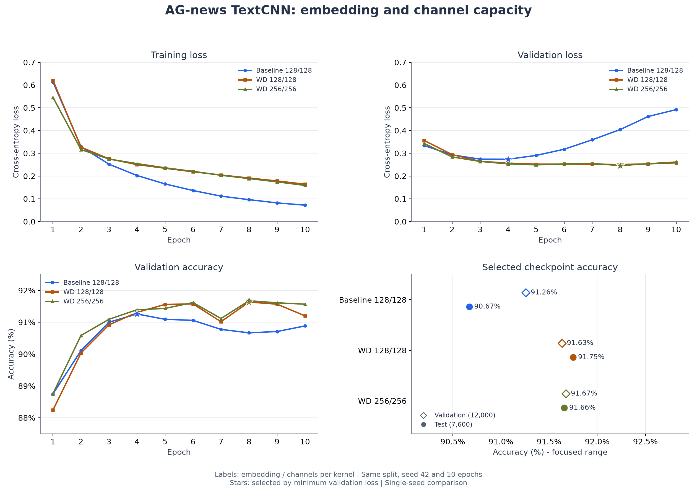

# AG-news TextCNN：词向量与卷积通道同时扩容到 256

日期：2026-11-01。配置文件：[textcnn_ag_news_dim256_filters256_wd1e4.json](../configs/textcnn_ag_news_dim256_filters256_wd1e4.json)。

## 本轮设置

以前一轮 `weight_decay=0.0001` 的模型为对照，同时将 `embed_dim` 和 `num_filters` 从 128 改为 256。三个卷积分支池化后拼接的特征从 384 维增至 768 维，总参数量从 5,625,220 增至 11,643,652，约为原来的 2.07 倍。

其余配置相同：随机种子 42，batch size 64，训练 10 轮，Adam，固定学习率 0.001，weight decay 0.0001，Dropout 0.5，卷积核宽度 3/4/5，文本最大长度 256。

使用相同的训练/验证划分（108,000 / 12,000 条）和官方测试集（7,600 条）。三组保存的词表一致，大小为 42,396；通过权重文件内的配置核对本轮仅改变两项模型维度及实验名称、输出目录。

环境为 Python 3.12.13、PyTorch 2.13.0+cu130、datasets 5.1.0，使用 NVIDIA GeForce RTX 5070 Ti Laptop GPU。

## 本轮完整逐轮输出

以下数值来自本次实际训练的终端输出，最佳模型按最低验证损失保存。

```text
随机种子:42
训练设备:cuda
词表大小：42396
训练样本：108000
验证样本：12000
测试样本：7600

Epoch 01/10 | train loss: 0.5459 | train acc: 79.82% | val loss: 0.3434 | val acc: 88.76%
  已保存最佳模型：第 1 轮，验证损失 0.3434
Epoch 02/10 | train loss: 0.3166 | train acc: 89.37% | val loss: 0.2841 | val acc: 90.58%
  已保存最佳模型：第 2 轮，验证损失 0.2841
Epoch 03/10 | train loss: 0.2748 | train acc: 90.77% | val loss: 0.2644 | val acc: 91.09%
  已保存最佳模型：第 3 轮，验证损失 0.2644
Epoch 04/10 | train loss: 0.2547 | train acc: 91.52% | val loss: 0.2535 | val acc: 91.39%
  已保存最佳模型：第 4 轮，验证损失 0.2535
Epoch 05/10 | train loss: 0.2363 | train acc: 92.09% | val loss: 0.2492 | val acc: 91.43%
  已保存最佳模型：第 5 轮，验证损失 0.2492
Epoch 06/10 | train loss: 0.2207 | train acc: 92.57% | val loss: 0.2534 | val acc: 91.62%
Epoch 07/10 | train loss: 0.2035 | train acc: 93.11% | val loss: 0.2555 | val acc: 91.12%
Epoch 08/10 | train loss: 0.1890 | train acc: 93.63% | val loss: 0.2460 | val acc: 91.67%
  已保存最佳模型：第 8 轮，验证损失 0.2460
Epoch 09/10 | train loss: 0.1745 | train acc: 94.12% | val loss: 0.2542 | val acc: 91.61%
Epoch 10/10 | train loss: 0.1590 | train acc: 94.58% | val loss: 0.2616 | val acc: 91.57%
```

## 最佳模型效果对比

| 模型 | 词向量维度 | 每分支通道数 | weight_decay | 参数量 | 最佳轮次 | 验证损失 | 验证准确率 | 测试损失 | 测试准确率 |
| --- | --- | --- | --- | --- | --- | --- | --- | --- | --- |
| 原始基线 | 128 | 128 | 0 | 5,625,220 | 4 | 0.273998 | 91.26% | 0.303767 | 90.67% |
| 上轮正则化 | 128 | 128 | 0.0001 | 5,625,220 | 8 | 0.250798 | 91.63% | 0.262044 | 91.75% |
| 本轮扩容 | 256 | 256 | 0.0001 | 11,643,652 | 8 | 0.245977 | 91.67% | 0.257659 | 91.66% |



图中 `128/128` 或 `256/256` 表示“词向量维度 / 每分支卷积通道数”。左上为训练损失、右上为验证损失、左下为验证准确率，星号标记按验证损失选择的最佳模型。右下展示这些模型的验证与测试准确率，使用明确标注的局部横轴范围和精确数值标签。

## 结果分析

本轮最低验证损失在第 8 轮，为 0.245977，比上轮下降约 0.004821；对应验证准确率提高约 0.042 个百分点，即 12,000 条验证样本中多正确分类 5 条。

固定第 8 轮模型后评估官方测试集，损失为 0.257659，准确率为 91.6579%，正确分类 6,966 / 7,600 条。相比上轮，测试损失下降约 0.004385，但准确率下降约 0.092 个百分点，少正确分类 7 条。交叉熵与准确率衡量的内容不同，所以损失下降并不保证类别判断正确数增加。

本次联合扩容带来了略好的验证损失，但参数量增加到约 2.07 倍，没有观察到测试准确率提升。只有一个固定随机种子的结果，不能据此断定 256 维模型普遍更差；两项模型维度同时变化，也不能把结果单独归因于词向量维度或卷积通道数。

所有轮次和超参数选择依据验证集；本轮测试集评估发生在训练结束并固定最佳模型之后。

## 复现与产物

在 Task 2 项目目录、`d2l-pytorch` 环境中运行：

```powershell
$env:HF_HOME = "D:\code\DeepLearning\.build\task2\huggingface"
python -m news_classifier.train --config configs/textcnn_ag_news_dim256_filters256_wd1e4.json
python -m news_classifier.evaluate --checkpoint ../.build/task2/runs/textcnn_dim256_filters256_wd1e4/best.pt
```

重新训练时使用新的 `output.run_dir`，以保留现有记录。

本轮产物目录为 `.build/task2/runs/textcnn_dim256_filters256_wd1e4/`，含 `metrics.csv`、`best.pt`、`test_metrics.json`、`config.json`、`environment.txt` 和 `epoch_output.txt`。其中 `config.json`、环境信息及 `epoch_output.txt` 由本次核对流程补充；`epoch_output.txt` 根据完整精度的 CSV 按训练入口打印格式整理，并非逐字保存的原始终端日志。

对比表与检查点 SHA-256 保存在 `.build/task2/comparisons/capacity256/summary.csv`、`summary.json`。重算与绘图脚本为 `.build/task2/summarize_capacity_experiment.py`。旧实验的权重文件 SHA-256 与本轮训练前一致。

已验证新模型的 CUDA 前向与反向传播、三组各 10 轮日志、最佳轮次和验证指标、保存配置、模型结构恢复、词表一致性、测试样本数量，并检查最终对比图的坐标、图例、数值标签和标记显示。
