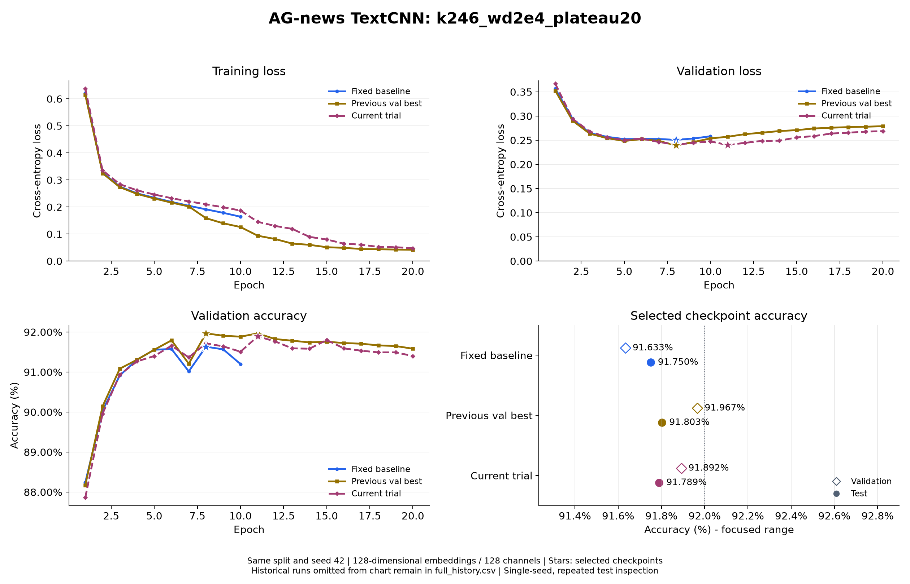

# AG-news TextCNN：k246_wd2e4_plateau20

日期：2026-11-01。配置：[textcnn_ag_news_k246_wd2e4_plateau20.json](../configs/textcnn_ag_news_k246_wd2e4_plateau20.json)。

相对于此前验证最佳 `textcnn_k246_plateau20`，实际配置变化（不计实验名和输出路径）：`training.weight_decay`：`0.0001` → `0.0002`。

## 设置

词向量和每个卷积分支通道数均为 128，卷积核 2/4/6，参数量 5,625,220。
Dropout=0.5，weight decay=0.0002，初始学习率=0.001，batch size=64，训练 20 轮。
ReduceLROnPlateau 监控验证损失，factor=0.5、patience=1、min_lr=0.00001。随机种子 42，训练/验证/测试样本 108000/12000/7600，词表 42396。
训练进程耗时 142.3 秒。`best_accuracy.pt` 按最高验证准确率选择，同准确率选更低验证损失；`best_loss.pt` 独立保留。每次只评估本轮按验证指标选出的模型。
最低损失模型选中第 11 轮（验证损失 0.240207，准确率 91.892%）；测试结果来自最高准确率模型，不混用两份检查点的数据。

## 完整逐轮输出

```text
Epoch 01/20 | train loss: 0.6375 | train acc: 75.62% | val loss: 0.3668 | val acc: 87.87% | lr: 0.001
Epoch 02/20 | train loss: 0.3356 | train acc: 88.85% | val loss: 0.2943 | val acc: 89.96% | lr: 0.001
Epoch 03/20 | train loss: 0.2843 | train acc: 90.48% | val loss: 0.2681 | val acc: 90.93% | lr: 0.001
Epoch 04/20 | train loss: 0.2618 | train acc: 91.29% | val loss: 0.2561 | val acc: 91.27% | lr: 0.001
Epoch 05/20 | train loss: 0.2462 | train acc: 91.80% | val loss: 0.2503 | val acc: 91.40% | lr: 0.001
Epoch 06/20 | train loss: 0.2327 | train acc: 92.15% | val loss: 0.2533 | val acc: 91.66% | lr: 0.001
Epoch 07/20 | train loss: 0.2208 | train acc: 92.61% | val loss: 0.2464 | val acc: 91.37% | lr: 0.001
Epoch 08/20 | train loss: 0.2102 | train acc: 92.95% | val loss: 0.2408 | val acc: 91.72% | lr: 0.001
Epoch 09/20 | train loss: 0.1991 | train acc: 93.31% | val loss: 0.2446 | val acc: 91.64% | lr: 0.001
Epoch 10/20 | train loss: 0.1870 | train acc: 93.74% | val loss: 0.2475 | val acc: 91.51% | lr: 0.001
Epoch 11/20 | train loss: 0.1454 | train acc: 95.15% | val loss: 0.2402 | val acc: 91.89% | lr: 0.0005
Epoch 12/20 | train loss: 0.1302 | train acc: 95.72% | val loss: 0.2446 | val acc: 91.77% | lr: 0.0005
Epoch 13/20 | train loss: 0.1192 | train acc: 96.10% | val loss: 0.2487 | val acc: 91.59% | lr: 0.0005
Epoch 14/20 | train loss: 0.0896 | train acc: 97.32% | val loss: 0.2491 | val acc: 91.58% | lr: 0.00025
Epoch 15/20 | train loss: 0.0799 | train acc: 97.63% | val loss: 0.2558 | val acc: 91.80% | lr: 0.00025
Epoch 16/20 | train loss: 0.0646 | train acc: 98.27% | val loss: 0.2586 | val acc: 91.59% | lr: 0.000125
Epoch 17/20 | train loss: 0.0608 | train acc: 98.42% | val loss: 0.2638 | val acc: 91.53% | lr: 0.000125
Epoch 18/20 | train loss: 0.0525 | train acc: 98.76% | val loss: 0.2656 | val acc: 91.49% | lr: 6.25e-05
Epoch 19/20 | train loss: 0.0514 | train acc: 98.81% | val loss: 0.2678 | val acc: 91.49% | lr: 6.25e-05
Epoch 20/20 | train loss: 0.0475 | train acc: 98.92% | val loss: 0.2688 | val acc: 91.40% | lr: 3.125e-05
```

## 结果与精简对比图

| 对照 | 选定轮次 | 验证损失 | 验证准确率 | 测试准确率 | 测试正确数 |
| --- | --- | --- | --- | --- | --- |
| Fixed baseline (`textcnn_wd1e4`) | 8 | 0.250798 | 91.633% | 91.750% | 6973 / 7600 |
| Previous val best (`textcnn_k246_plateau20`) | 8 | 0.239227 | 91.967% | 91.803% | 6977 / 7600 |
| Current trial (`textcnn_k246_wd2e4_plateau20`) | 11 | 0.240207 | 91.892% | 91.789% | 6976 / 7600 |



每张图最多三组：固定基线、此前最佳、本轮实验，重合时合并；更早实验保留在各自记录和 `.build/task2/comparisons/full_history.csv`，不继续叠加曲线。
固定基线按最低验证损失选择，另外两组按验证准确率选择；固定基线两种指标同在第 8 轮最优。旧 10 轮实验曲线只画实际轮次。

测试准确率为 91.789474%，正确 6976 / 7600；92% 对应至少 6992 条正确，尚差 16 条，未达到目标。
本轮验证准确率与此前最佳相比变化 -0.075 个百分点。
这里只运行一个随机种子；测试集已在多轮实验中查看，不能把多轮调参后的成绩视为一次完全未见的最终评估。

## 产物与核对

原始完整控制台（含保存及调度提示）、配置、环境、逐轮全精度 CSV、两种模型和测试指标保存在 `.build/task2/runs/textcnn_k246_wd2e4_plateau20/`。
本轮汇总与 SHA-256 保存在 `.build/task2/comparisons/k246_wd2e4_plateau20/summary.json`、`summary.csv`；完整历史位于 `.build/task2/comparisons/full_history.csv`。
已核对全部 epoch 行、两种检查点选择、参数量、实际配置、调度器逐轮重放、7600 条测试样本，以及本轮开始前 17 份历史模型的权重哈希未变。

复现时在项目目录运行，使用新的输出目录保留现有结果：

```powershell
python -m news_classifier.train --config configs/textcnn_ag_news_k246_wd2e4_plateau20.json
python -m news_classifier.evaluate --checkpoint ../.build/task2/runs/textcnn_k246_wd2e4_plateau20/best_accuracy.pt
```
