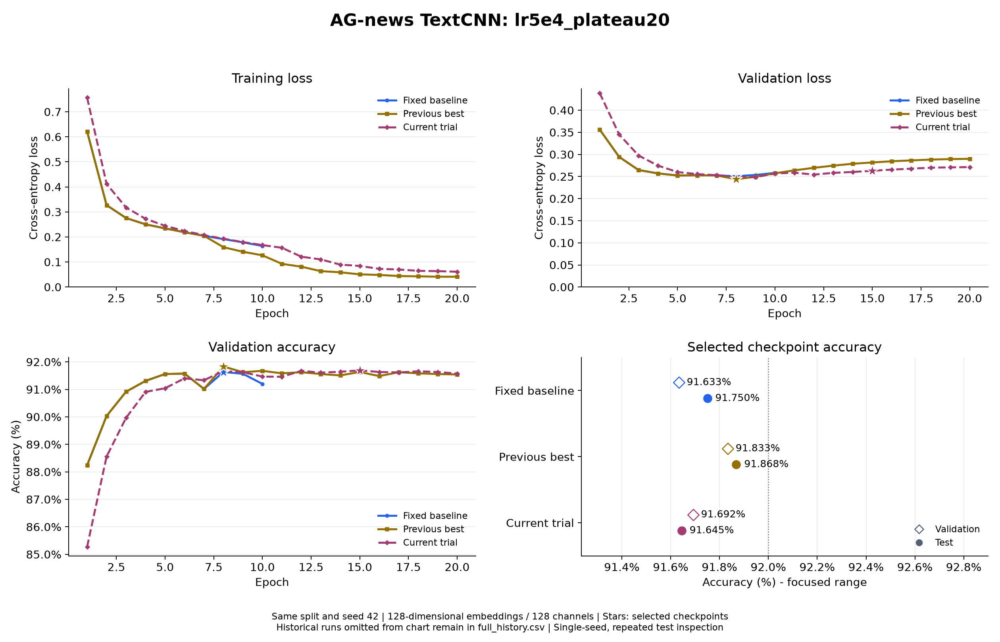

# AG-news TextCNN：lr5e4_plateau20

日期：2026-11-01。配置：[textcnn_ag_news_lr5e4_plateau20.json](../configs/textcnn_ag_news_lr5e4_plateau20.json)。

## 设置

词向量和每个卷积分支通道数均为 128，卷积核 3/4/5，参数量 5,625,220。
Dropout=0.5，weight decay=0.0001，初始学习率=0.0005，batch size=64，训练 20 轮。
ReduceLROnPlateau 监控验证损失，factor=0.5、patience=1、min_lr=0.00001。随机种子 42，训练/验证/测试样本 108000/12000/7600，词表 42396。
训练进程耗时 144.9 秒。`best_accuracy.pt` 按最高验证准确率选择，同准确率选更低验证损失；`best_loss.pt` 独立保留。每次只评估本轮按验证指标选出的模型。
最低损失模型选中第 9 轮（验证损失 0.248527，准确率 91.625%）；测试结果来自最高准确率模型，不混用两份检查点的数据。

## 完整逐轮输出

```text
Epoch 01/20 | train loss: 0.7565 | train acc: 69.97% | val loss: 0.4390 | val acc: 85.28% | lr: 0.0005
Epoch 02/20 | train loss: 0.4121 | train acc: 85.85% | val loss: 0.3452 | val acc: 88.56% | lr: 0.0005
Epoch 03/20 | train loss: 0.3175 | train acc: 89.33% | val loss: 0.2974 | val acc: 89.97% | lr: 0.0005
Epoch 04/20 | train loss: 0.2727 | train acc: 90.95% | val loss: 0.2746 | val acc: 90.91% | lr: 0.0005
Epoch 05/20 | train loss: 0.2446 | train acc: 91.86% | val loss: 0.2601 | val acc: 91.04% | lr: 0.0005
Epoch 06/20 | train loss: 0.2241 | train acc: 92.51% | val loss: 0.2555 | val acc: 91.40% | lr: 0.0005
Epoch 07/20 | train loss: 0.2073 | train acc: 93.11% | val loss: 0.2530 | val acc: 91.33% | lr: 0.0005
Epoch 08/20 | train loss: 0.1930 | train acc: 93.57% | val loss: 0.2503 | val acc: 91.67% | lr: 0.0005
Epoch 09/20 | train loss: 0.1794 | train acc: 93.96% | val loss: 0.2485 | val acc: 91.62% | lr: 0.0005
Epoch 10/20 | train loss: 0.1676 | train acc: 94.35% | val loss: 0.2569 | val acc: 91.47% | lr: 0.0005
Epoch 11/20 | train loss: 0.1569 | train acc: 94.63% | val loss: 0.2587 | val acc: 91.46% | lr: 0.0005
Epoch 12/20 | train loss: 0.1212 | train acc: 96.00% | val loss: 0.2544 | val acc: 91.67% | lr: 0.00025
Epoch 13/20 | train loss: 0.1103 | train acc: 96.44% | val loss: 0.2583 | val acc: 91.61% | lr: 0.00025
Epoch 14/20 | train loss: 0.0895 | train acc: 97.20% | val loss: 0.2604 | val acc: 91.64% | lr: 0.000125
Epoch 15/20 | train loss: 0.0844 | train acc: 97.39% | val loss: 0.2629 | val acc: 91.69% | lr: 0.000125
Epoch 16/20 | train loss: 0.0726 | train acc: 97.86% | val loss: 0.2657 | val acc: 91.63% | lr: 6.25e-05
Epoch 17/20 | train loss: 0.0700 | train acc: 97.92% | val loss: 0.2678 | val acc: 91.62% | lr: 6.25e-05
Epoch 18/20 | train loss: 0.0647 | train acc: 98.18% | val loss: 0.2700 | val acc: 91.66% | lr: 3.125e-05
Epoch 19/20 | train loss: 0.0636 | train acc: 98.25% | val loss: 0.2708 | val acc: 91.63% | lr: 3.125e-05
Epoch 20/20 | train loss: 0.0611 | train acc: 98.33% | val loss: 0.2714 | val acc: 91.57% | lr: 1.5625e-05
```

## 结果与精简对比图

| 对照 | 选定轮次 | 验证损失 | 验证准确率 | 测试准确率 | 测试正确数 |
| --- | --- | --- | --- | --- | --- |
| Fixed baseline (`textcnn_wd1e4`) | 8 | 0.250798 | 91.633% | 91.750% | 6973 / 7600 |
| Previous best (`textcnn_plateau20`) | 8 | 0.244026 | 91.833% | 91.868% | 6982 / 7600 |
| Current trial (`textcnn_lr5e4_plateau20`) | 15 | 0.262931 | 91.692% | 91.645% | 6965 / 7600 |



每张图最多三组：固定基线、此前最佳、本轮实验，重合时合并；更早实验保留在各自记录和 `.build/task2/comparisons/full_history.csv`，不继续叠加曲线。
固定基线按最低验证损失选择，另外两组按验证准确率选择；固定基线两种指标同在第 8 轮最优。旧 10 轮实验曲线只画实际轮次。

测试准确率为 91.644737%，正确 6965 / 7600；92% 对应至少 6992 条正确，尚差 27 条，未达到目标。
本轮验证准确率与此前最佳相比变化 -0.142 个百分点。
这里只运行一个随机种子；测试集已在多轮实验中查看，不能把多轮调参后的成绩视为一次完全未见的最终评估。

## 产物与核对

原始完整控制台（含保存及调度提示）、配置、环境、逐轮全精度 CSV、两种模型和测试指标保存在 `.build/task2/runs/textcnn_lr5e4_plateau20/`。
本轮汇总与 SHA-256 保存在 `.build/task2/comparisons/lr5e4_plateau20/summary.json`、`summary.csv`；完整历史位于 `.build/task2/comparisons/full_history.csv`。
已核对全部 epoch 行、两种检查点选择、参数量、实际配置、调度器逐轮重放、7600 条测试样本，以及本轮开始前 9 份历史模型的权重哈希未变。

复现时在项目目录运行，使用新的输出目录保留现有结果：

```powershell
python -m news_classifier.train --config configs/textcnn_ag_news_lr5e4_plateau20.json
python -m news_classifier.evaluate --checkpoint ../.build/task2/runs/textcnn_lr5e4_plateau20/best_accuracy.pt
```
