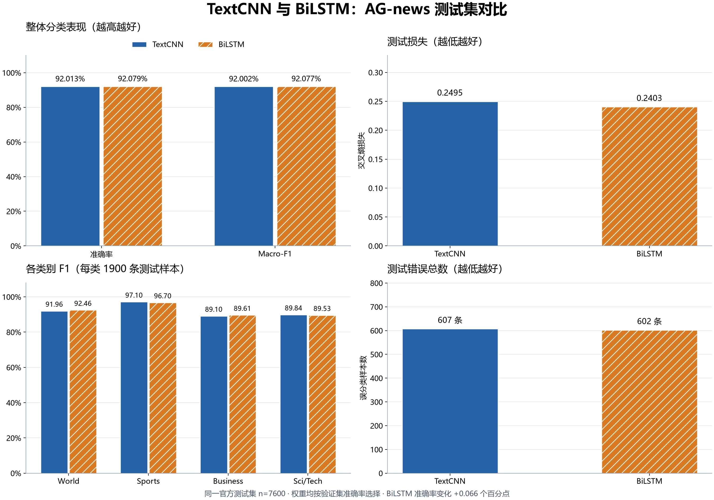
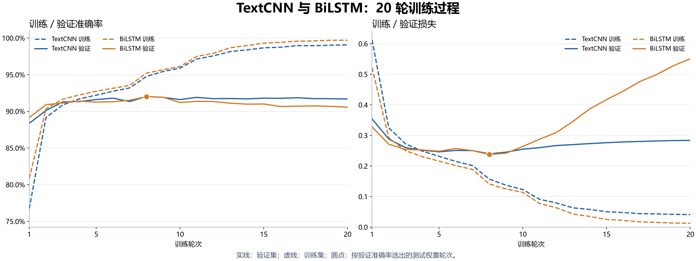
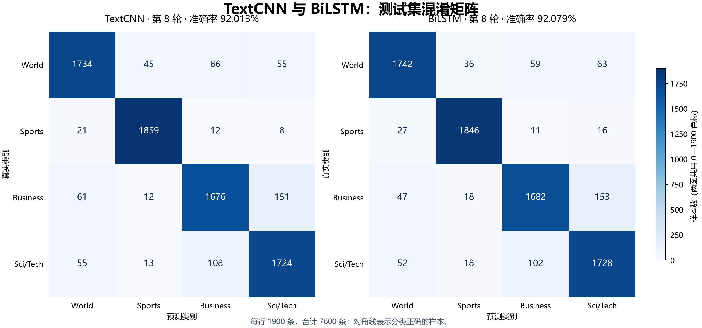

# TextCNN 与 BiLSTM 正式实验对比

两者使用相同的 AG-news 数据划分、词表、随机种子和训练超参数；均训练 20 轮，按验证准确率选权重后报告测试集结果。

| 指标 | 原最佳 TextCNN | 本次 BiLSTM |
| --- | ---: | ---: |
| 选中轮次 | 8 | 8 |
| 测试准确率 | 92.0132% | 92.0789% |
| Macro-F1 | 92.0015% | 92.0769% |
| 测试损失 | 0.249545 | 0.240254 |
| 错误数 / 7600 | 607 | 602 |
| 参数量 | 5,625,220 | 5,691,908 |
| 记录中的 20 轮训练用时 | 2.39 分钟 | 10.88 分钟 |

本次 BiLSTM 的测试准确率变化为 **+0.0658 个百分点**，Macro-F1 变化为 +0.0753 个百分点。它修正了 TextCNN 的 187 条错误，同时新增 182 条错误，错误总数由 607 条变为 602 条。

BiLSTM 的 World、Business 类 F1 高于 TextCNN，Sports、Sci/Tech 类 F1 略低；Business 与 Sci/Tech 的双向混淆从 259 条变为 255 条，仍是两者主要的错误来源。

两者选中的权重都来自第 8 轮。BiLSTM 后续训练准确率继续升高，但验证损失从第 8 轮的 0.2375 升至第 20 轮的 0.5504，呈现过拟合。更晚的轮次没有带来更好的验证表现。

## 对比图

图表提供 PNG 和 SVG；原始汇总和对齐后的逐样本预测在 `data/`。

## 结果范围

这是单个随机种子的两次运行对比，尚不能据此推断 BiLSTM 在所有训练条件下都更好或更差。原 TextCNN 已经做过多组调参，本次 BiLSTM 是首个基线；历史调参期间查看过测试结果，这里保留这一限制，不把差异解释为严格的模型架构因果结论。

BiLSTM 正式训练耗时 10.88 分钟。训练全过程未用测试集选择轮次。模型权重和执行记录保存在 `.build/task2/runs/bilstm_baseline_20261103/`。
