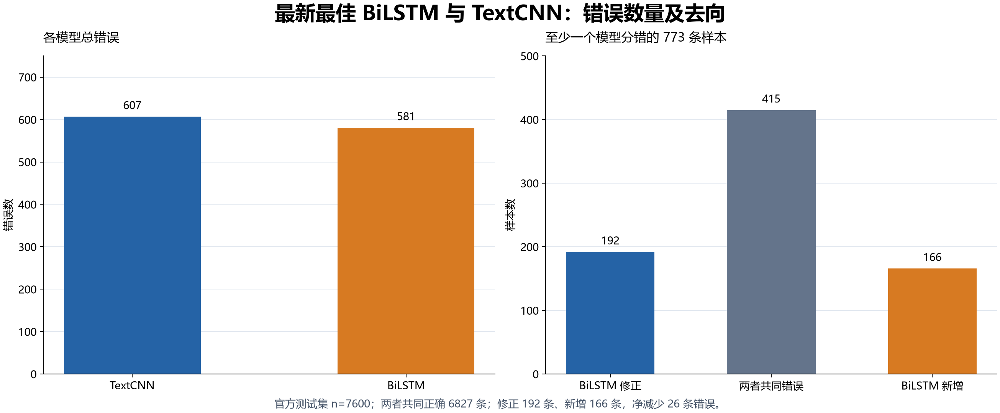
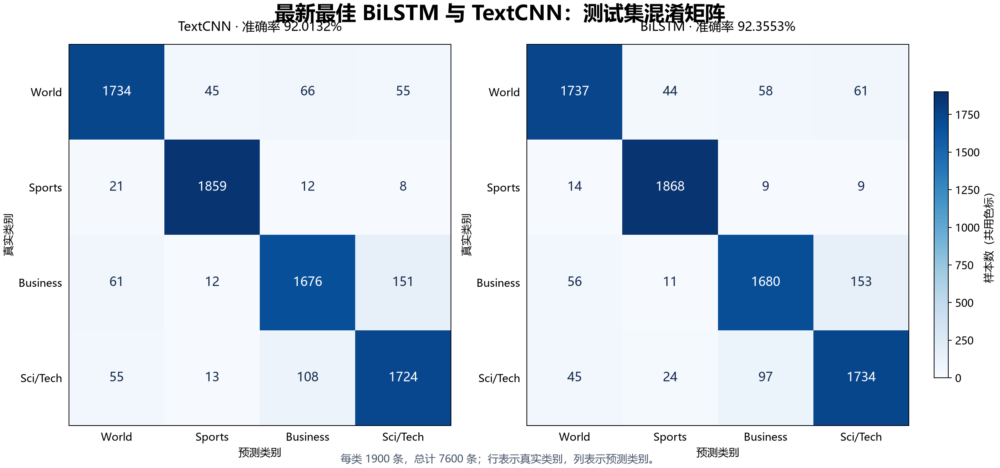
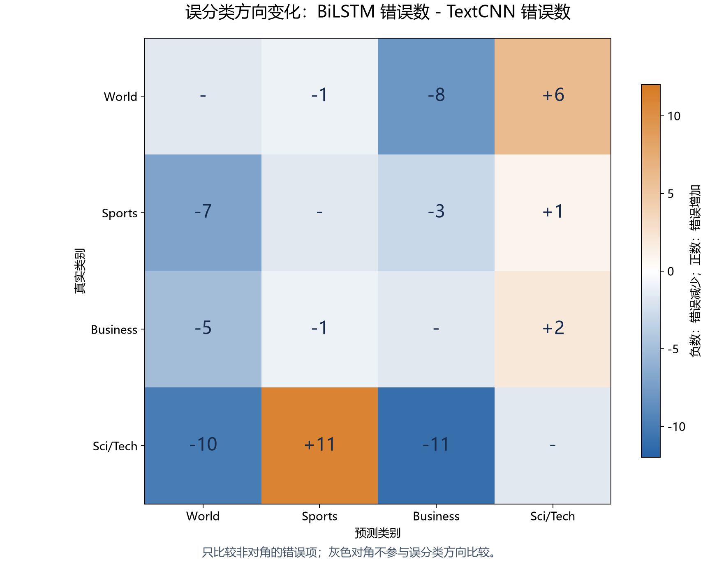
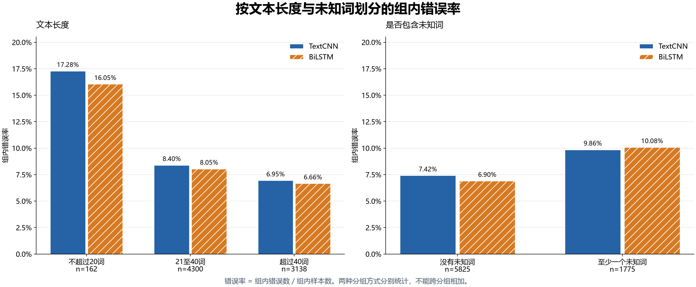

# 最新最佳 BiLSTM 错误分析与 TextCNN 对比

邱圣清｜班级：2025211317｜学号：2025211701｜2026-11-03

## 1. 本次结果与分析范围

本次我选取早停与正则化实验中由验证集选出的 BiLSTM，与原最佳 TextCNN 在同一批 7600 条官方测试样本上逐条比较。BiLSTM 准确率为 **92.3553%**，比 TextCNN 的 **92.0132%** 高 **0.3421 个百分点**，错误从 607 条降至 581 条。

这一变化包含较多样本间的交换：BiLSTM 修正 192 条旧错误，同时新增 166 条错误，最终净减少 26 条。剩余错误中有 415 条两个模型都会分错，占 BiLSTM 错误的 71.43%。商业与科技的边界仍是主要问题；部分含歧义词的案例有所改善，但序列建模没有消除关键词干扰和高置信度误判。

本报告只诊断已有权重，不重新训练、不改测试标签。全部 581 条错误的原文、标签、两模型预测与置信度保存在[完整错误附录](data/bilstm_all_errors.md)，以下案例用于解释具体行为，不作为全体错误原因的人工标注统计。

## 2. 模型选择与比较条件

| 项目 | 原最佳 TextCNN | 最新最佳 BiLSTM |
|---|---|---|
| 运行目录 | `textcnn_k237_plateau20` | `bilstm_es_dropout02_20261103` |
| 使用权重 | `best_accuracy.pt`，第 8 轮 | `best_accuracy.pt`，第 8 轮 |
| 主要结构 | 卷积核 2/3/7，池化后分类 | 单层双向 LSTM，每方向隐藏维度 128，拼接末状态分类 |
| 词嵌入 | 随机初始化，128 维 | 随机初始化，128 维 |
| 词嵌入 Dropout | 无 | 0.2 |
| 分类层 Dropout | 0.5 | 0.5 |
| Weight decay | 1e-4 | 1e-4 |
| 早停 | 正式训练 20 轮后选最佳权重 | 验证损失监控，patience=3、min_delta=0.001，第 11 轮停止 |
| 验证准确率 | 92.0250% | 92.3000% |
| 参数量 | 5,625,220 | 5,691,908 |

两者均使用随机种子 42、108000/12000/7600 条训练/验证/测试数据、同一分词器及完全一致的 42396 项词表，最大序列长度均为 256。分析脚本逐行核对官方原文、标签、预测编号、概率与权重哈希，未采用清洗或预训练词向量分支。

BiLSTM 的选型依据是六组实验的验证准确率，平局时比较验证损失；[选择记录](../regularization/data/selection.json)记录 `selected_run_id=dropout02`、`test_used_for_selection=false`。具体配置见 [`bilstm_es_dropout02_20261103.json`](../../../configs/bilstm_es_dropout02_20261103.json)，选型过程见[正则化实验报告](../regularization/README.md)。

这次比较的是两个最终方案，差异同时包含模型结构与词嵌入正则化，不能把全部提升归因于双向 LSTM。原始 BiLSTM 基线为 6998/7600，只比 TextCNN 多答对 5 条；当前方案在其基础上又多答对 21 条。早停也不等同于提高已选权重的性能：基线早停保留的最佳权重与原 20 轮基线一致，主要作用是省去后续无改善的训练。

## 3. 整体指标与错误交换

| 指标 | TextCNN | BiLSTM | BiLSTM 相对变化 |
|---|---:|---:|---:|
| 正确数 | 6993 | 7019 | +26 |
| 错误数 | 607 | 581 | −26 |
| 准确率 | 92.0132% | 92.3553% | +0.3421 个百分点 |
| Macro-F1 | 92.0015% | 92.3408% | +0.3393 个百分点 |
| 测试交叉熵 | 0.249545 | 0.233671 | −0.015874 |

相对错误减少率为 `(607−581)/607=4.28%`。测试交叉熵降低说明整体概率分配的平均损失改善，但不代表每个置信度区间都更可靠。

| 同一条测试样本的结果 | 数量 | 数据 |
|---|---:|---|
| 两者都正确 | 6827 | [全部配对预测](data/paired_predictions.csv)中的 `both_correct` |
| TextCNN 错、BiLSTM 对 | 192 | [修正清单](data/fixed.csv) |
| 两者都错 | 415 | [共同错误清单](data/both_wrong.csv) |
| TextCNN 对、BiLSTM 错 | 166 | [新增错误清单](data/new_errors.csv) |



192 条修正覆盖了 TextCNN 原有错误的 31.63%，但新增错误抵消了大部分收益。415 条共同错误中，378 条连错误类别都一致，另 37 条分到了不同的错误类别。这说明仅替换当前模型结构，仍会保留较多相同的判断偏差。

我对 192 与 166 条配对不一致结果计算精确双侧 McNemar 检验，等价于在 358 条不一致结果中检验修正方向概率是否为 0.5，得到 **p=0.1863**，未达到常用的 0.05 阈值。方法依据见 [statsmodels 的 McNemar 文档](https://www.statsmodels.org/dev/generated/statsmodels.stats.contingency_tables.mcnemar.html)与 [SciPy 精确二项检验文档](https://docs.scipy.org/doc/scipy/reference/generated/scipy.stats.binomtest.html)。这不证明两个模型性能相同；它提示当前小幅差距还不足以支持稳定优势的结论。

现有结果只有一个随机种子，历史调参又多次查看过测试结果，测试新闻之间也存在近重复。因此该检验仅作探索性参考，不能作为全新独立测试集上的确认性结论。

## 4. 哪些类别改善，哪些方向恶化

以下按真实类别统计，每类测试样本均为 1900 条。“修正”和“新增”是配对样本数，不是混淆矩阵单元格的变化。

| 真实类别 | TextCNN 错误 | BiLSTM 错误 | 修正 | 新增 | 共同错误 | TextCNN F1 | BiLSTM F1 |
|---|---:|---:|---:|---:|---:|---:|---:|
| World | 166 | 163 | 35 | 32 | 131 | 91.9650% | 92.5906% |
| Sports | 41 | 32 | 21 | 12 | 20 | 97.1011% | 97.1146% |
| Business | 224 | 220 | 69 | 65 | 155 | 89.1015% | 89.7436% |
| Sci/Tech | 176 | 166 | 67 | 57 | 109 | 89.8385% | 89.9144% |
| 合计 | 607 | 581 | 192 | 166 | 415 | — | — |



商业与科技两类仍贡献 **386/581=66.44%** 的 BiLSTM 错误。其中两类相互误分有 250 条，占全部错误的 43.03%，原 TextCNN 对应为 259 条。改善主要来自科技新闻误分商业的减少，反方向略有恶化。

| 真实类别 → 错误预测 | TextCNN | BiLSTM | 变化 |
|---|---:|---:|---:|
| Business → Sci/Tech | 151 | 153 | +2 |
| Sci/Tech → Business | 108 | 97 | −11 |
| World → Business | 66 | 58 | −8 |
| World → Sci/Tech | 55 | 61 | +6 |
| Sci/Tech → World | 55 | 45 | −10 |
| Sci/Tech → Sports | 13 | 24 | +11 |



Sports 的真实样本少错了 9 条，但其 F1 几乎不变，因为其他类别被分到 Sports 的情况增加：Sports 精确率由 96.3712% 降到 95.9425%。Sci/Tech 同样呈现召回率上升、精确率下降。因此，不能仅凭某一行错误减少，就认定该类别的分类能力全面提高。

## 5. 具体案例与遮挡诊断

样本 ID 沿用官方测试集的零起始行号，例如 `test:139` 表示第 140 条测试样本。表中的置信度是预测类别的 softmax 最大值，不是经过校准的正确概率。案例包含修正、新增和共同错误，完整原文可按 ID 在[配对预测](data/paired_predictions.csv)中查找。

### 5.1 修正：West Bank 的语境被保留，但判断仍不稳

`test:139`，真实类别 **World**：

> Sharon orders 1,000 homes in West Bank Israel announced plans for 1,000 houses in the West Bank yesterday, accelerating the expansion of the settlements.

TextCNN 预测 Business，置信度 0.5461；BiLSTM 改为 World，置信度 0.5482。不过，BiLSTM 的 Business 概率仍约 0.4415，正确类别领先幅度有限。

我把指定词的全部出现位置替换为 `UNK`，保持序列长度和其他词不变。下表统一采用 CPU 重新推理结果，原始输入已与原全量预测核对，微小数值差异来自执行设备与批次。

| 输入变化 | TextCNN 的 P(World) | BiLSTM 的 P(World) | 两者预测 |
|---|---:|---:|---|
| 原文 | 0.4279 | 0.5481 | Business / World |
| 遮挡两处 `bank` | 0.8055 | 0.9812 | World / World |
| 遮挡两处 `west` | 0.3114 | 0.1803 | Business / Business |

进一步遮挡 `sharon/israel/settlements` 后，BiLSTM 的 Business 概率升至 0.9677。这些变化与模型利用地名及政治语境线索的解释相符，同时说明 `bank` 的干扰仍存在。一次预测正确不足以说明模型已经稳定掌握多义词消歧。

### 5.2 修正：Virginia Tech 体育报道

`test:4825`，真实类别 **Sports**：

> Not quite high Tech Virginia Tech just couldn't seem to get going. There were turnovers. There were botched plays. There were missed opportunities. Then, in the last 5 1/2 minutes, Bryan Randall and the Hokies turned it all around.

TextCNN 预测 Sci/Tech，置信度 0.5637；BiLSTM 预测 Sports，置信度 0.9966。遮挡两处 `tech` 后，TextCNN 的 Sports 概率由 0.3449 升到 0.7172，转为正确；BiLSTM 仍预测 Sports，概率为 0.9990。

在这条新闻中，BiLSTM 对包含 `Tech` 的体育语境更稳健。这是一个具体成功案例，不能据此推断它在所有含歧义词的新闻上都优于 TextCNN。

### 5.3 新增：利润报道被计算机线索带偏

`test:172`，真实类别 **Business**：

> Ross Stores Profit Plummets 40 Percent (AP) AP - Discount retailer Ross Stores Inc. Wednesday said its profit fell about 40 percent in the latest quarter due to problems with a new computer system that limited the company's ability to respond to changes in customer demand.

TextCNN 预测 Business，置信度 0.5310；BiLSTM 预测 Sci/Tech，置信度 0.5008。新闻的主事件是零售商利润下滑，计算机系统是原因说明。

| 输入变化 | TextCNN 的 P(Business) | BiLSTM 的 P(Business) | 两者预测 |
|---|---:|---:|---|
| 原文，CPU 复核 | 0.5308 | 0.3756 | Business / Sci/Tech |
| 遮挡 `computer` | 0.8854 | 0.7636 | Business / Business |
| 遮挡 `profit/retailer/quarter/demand` | 0.0198 | 0.0164 | Sci/Tech / Sci/Tech |

这条新增错误表明，BiLSTM 仍会对科技相关词敏感，且可能没有把主事件与背景原因区分清楚。遮挡试验支持该案例的敏感性判断；它没有证明所有 166 条新增错误都由相同因素造成。

### 5.4 新增：线索明确的体育新闻也会高置信度分错

`test:4054`，真实类别 **Sports**：

> Even Longer: Red Sox Win in 14 Innings Boston's David Ortiz drilled a pitch into center field, a clean single that brought home Johnny Damon with the winning run in a marathon Game 5 in the A.L.C.S.

TextCNN 正确预测 Sports，置信度 0.9056；BiLSTM 错误预测 World，置信度 **0.9686**。文本有 Red Sox、innings、pitch、winning run 等棒球线索，不能把全部新增错误都解释为类别本来就模糊。本次没有对该条做归因试验，具体触发因素仍需后续验证。

### 5.5 共同错误：近重复新闻的官方标签存在分歧

`test:4359` 的标题为 “Google #39;s New PC Search Tool Poses Risks”，官方类别是 **Business**；两者均预测 Sci/Tech，置信度分别为 0.7654、0.8632。

与它高度相似的 `test:4047` 标题为 “Google's New PC Search Tool Poses Risks (AP)”，官方类别却是 **Sci/Tech**；两者均预测 Sci/Tech，置信度分别为 0.9168、0.9678。两条正文都讨论公共或办公电脑上的邮件、即时通信与 Google 本地搜索工具引入的隐私风险，主要内容近似，存在实体编码和来源前缀差异。

这对样本适合纳入标注边界复核，但目前不能直接断言哪条标签错误。我保留官方标签及全部错误计数。它提示共同错误可能同时包含主题交叉与标注粒度问题，不能全部归结为模型结构不足。

上述三条遮挡案例共保存 20 条原始/变体推理记录，见[遮挡结果](data/masking_probes.json)。`UNK` 替换会改变短语完整性，属于人工输入扰动；结果反映模型对这些变化的敏感程度，不是严格的因果归因，也不能据此估计某类错误的总体占比。

## 6. 长度、未知词与置信度

### 6.1 短文本更难，但本次没有截断问题

| 分词后长度 | 样本数 | TextCNN 错误数/错误率 | BiLSTM 错误数/错误率 |
|---|---:|---:|---:|
| 不超过 20 词 | 162 | 28 / 17.28% | 26 / 16.05% |
| 21–40 词 | 4300 | 361 / 8.40% | 346 / 8.05% |
| 超过 40 词 | 3138 | 218 / 6.95% | 209 / 6.66% |

两者在短文本组中的错误率都更高，可能与可用语境较少有关，但该组只有 162 条，且文本长度与主题构成可能相关。三个长度组均有小幅改善，现有分组不足以证明提升主要来自长距离依赖建模。

测试集最长实际序列为 **145 词**，小于最大长度 256，**截断样本为 0**。因此，当前错误不能归因于最大长度过小而丢失尾部内容。

### 6.2 含未知词的样本没有改善

| 按训练词表划分 | 样本数 | TextCNN 错误数/错误率 | BiLSTM 错误数/错误率 | 修正 / 新增 |
|---|---:|---:|---:|---:|
| 没有未知词 | 5825 | 432 / 7.42% | 402 / 6.90% | 141 / 111 |
| 至少一个未知词 | 1775 | 175 / 9.86% | 179 / 10.08% | 51 / 55 |



净收益来自没有未知词的组：少错 30 条；含未知词的组反而多错 4 条。两者使用同一个词表，BiLSTM 的顺序建模无法自动恢复已经映射为 `UNK` 的词身份。不过，BiLSTM 仍有 402 条错误不含未知词，占全部错误的 69.19%，所以扩充词表也不能解释或解决大多数现有错误。

### 6.3 输出更自信，不代表高置信度错误更少

| 模型 | 预测置信度区间 | 样本数 | 错误数 | 区间内错误率 |
|---|---|---:|---:|---:|
| TextCNN | <0.6 | 371 | 165 | 44.47% |
| BiLSTM | <0.6 | 291 | 140 | 48.11% |
| TextCNN | ≥0.9 | 6095 | 170 | 2.79% |
| BiLSTM | ≥0.9 | 6225 | 175 | 2.81% |

这些区间按各模型自己的置信度筛选，包含的样本不同，不能当成固定样本组直接比较。这里只展示两个诊断区间，中间区间未列出。

BiLSTM 高置信度预测更多，但其中错误从 170 条增至 175 条；这 175 条占其全部错误的 30.12%。低置信度复核可以集中发现一部分错误，却会遗漏不少高置信度误判。当前数据不足以宣称概率校准变好；若后续需要置信度阈值或人工复核，应另用验证集确定校准参数和阈值。

## 7. 后续实验建议与本次判断

我会保留当前 BiLSTM 作为本轮验证集选出的方案。它在这次测试中整体略优，但收益较小，商业与科技混淆、未知词组以及高置信度错误仍值得优先处理。

| 优先级 | 建议 | 对应证据 | 后续如何验证 |
|---|---|---|---|
| 1 | 固定两套配置，至少运行 3–5 个随机种子 | 当前净差 26 条，单次配对检验不足以支持稳定优势 | 报告跨种子的均值与标准差；继续按验证集选权重，完成后统一评估 |
| 2 | 在训练集和验证集建立商业/科技、科技/体育诊断子集 | 商业/科技相互误分仍有 250 条，科技→体育从 13 增至 24 条 | 记录双向混淆及整体指标，避免只改善一个方向而增加另一个方向错误 |
| 3 | 做子词或字符信息的单因素对照 | 含未知词组错误率 10.08%，且未优于 TextCNN | 固定划分与训练预算，按验证集评估含未知词组和整体表现 |
| 4 | 复核近重复新闻的主题标注边界 | Google 搜索工具两条近似新闻分属不同官方类别 | 建立独立复核记录；官方测试成绩保留原标签，不删除难例 |
| 5 | 在验证集尝试温度缩放与复核阈值 | BiLSTM 仍有 175 条置信度 ≥0.9 的错误 | 比较校准误差、复核覆盖率与漏检率；阈值确定后再作最终评估 |

后续不宜继续围绕这批测试错误逐条调参。测试集已经用于本轮诊断，再据此设计新方案时，应把新结论放到独立保留数据上检验。当前能够确认的是：**最新 BiLSTM 在本次固定测试上净减少了 26 条错误；它对部分语境歧义案例更有效，但仍保留多数共同错误，并引入了新的错误模式。**

## 8. 数据、复现与核验

| 文件 | 内容 |
|---|---|
| [summary.json](data/summary.json) | 模型指标、权重哈希、配对分组、分层统计与检验结果 |
| [paired_predictions.csv](data/paired_predictions.csv) | 全部 7600 条原文、真实标签、两模型预测与置信度、长度与未知词数 |
| [bilstm_all_errors.md](data/bilstm_all_errors.md) / [CSV](data/bilstm_all_errors.csv) | BiLSTM 全部 581 条错误 |
| [fixed.csv](data/fixed.csv) / [new_errors.csv](data/new_errors.csv) / [both_wrong.csv](data/both_wrong.csv) | 192 条修正、166 条新增、415 条共同错误 |
| [per_class.csv](data/per_class.csv) | 各类精确率、召回率、F1 与配对错误数 |
| [feature_segments.csv](data/feature_segments.csv) / [confidence_segments.csv](data/confidence_segments.csv) | 长度、未知词与置信度分层统计 |
| [masking_probes.json](data/masking_probes.json) | 三个案例在两个模型上的原始/遮挡推理结果 |
| [verification.json](data/verification.json) | 数据计数、图片、Markdown 链接、编码及权重哈希的复核记录 |

权重位于仓库根目录 `.build/task2/runs/` 下，完整 SHA-256 为：

```text
TextCNN: textcnn_k237_plateau20/best_accuracy.pt
1d4ddd8cb68a8462577b9b35519c454513176843ed6b295ddb3e65682441f712

BiLSTM: bilstm_es_dropout02_20261103/best_accuracy.pt
db43028c8d110035a95144dbb7c17855b0b1cd6a3fafe893c6d11c4b4bac9c6a
```

在仓库根目录激活已有 `d2l-pytorch` 环境后，可依次复现分析与图表，不会重新训练：

```powershell
python task2_简单分类模型设计与实现/experiments/scripts/analyze_bilstm_errors.py
python task2_简单分类模型设计与实现/experiments/scripts/probe_bilstm_errors.py
python task2_简单分类模型设计与实现/experiments/scripts/plot_bilstm_errors.py
```

第一个脚本读取两模型已有的全量评估输出并核对官方测试数据；第二个加载原始权重做少量 CPU 遮挡推理；第三个生成本报告的四组 PNG/SVG 图表。TextCNN 的输入数据保存在 `experiments/textcnn/error_analysis/data/kernel_comparison/k237/`，BiLSTM 的输入数据保存在 `.build/task2/runs/bilstm_es_dropout02_20261103/final_evaluation/`。图表的 SVG 版本与 PNG 同名，位于本目录 `assets/`。
