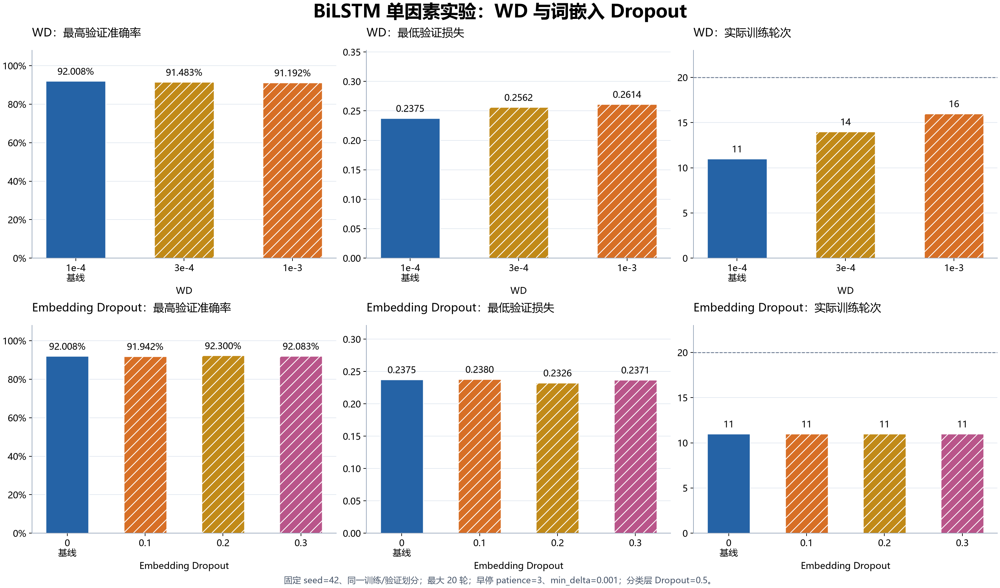
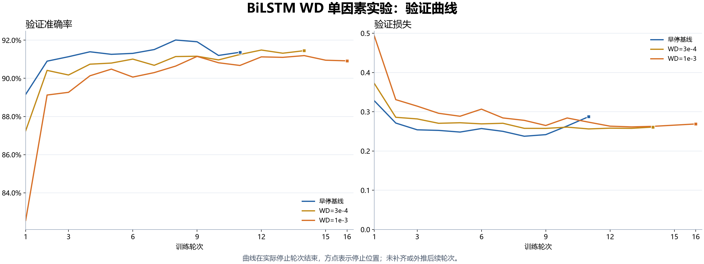
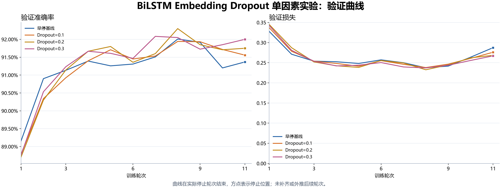
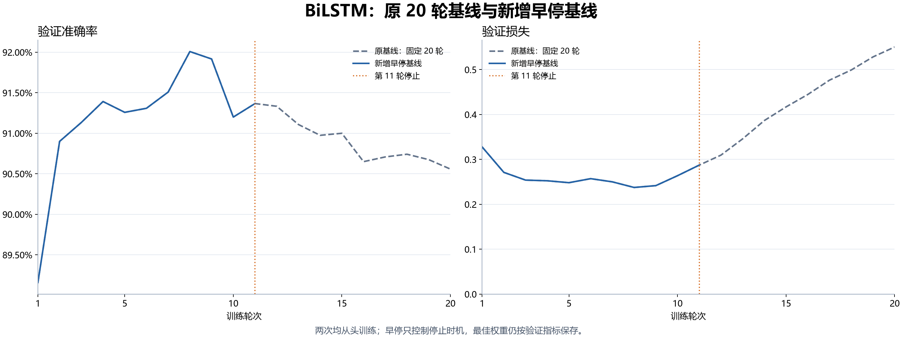

# BiLSTM：早停、WD 与词嵌入 Dropout 实验

固定原 AG-news 划分、词表、初始权重和随机种子 42，每次只改变一个正则化因素。所有组采用相同的验证损失早停规则：patience=3、min_delta=0.001，最多 20 轮。分类层 Dropout 固定为 0.5。

| 实验 | WD | 词嵌入 Dropout | 实际轮次 | 最佳准确率轮次 | 最高验证准确率 | 最低验证损失 |
| --- | ---: | ---: | ---: | ---: | ---: | ---: |
| 早停基线 | 0.0001 | 0 | 11 | 8 | 92.0083% | 0.237546 |
| WD=3e-4 | 0.0003 | 0 | 14 | 12 | 91.4833% | 0.256208 |
| WD=1e-3 | 0.001 | 0 | 16 | 14 | 91.1917% | 0.261362 |
| Embedding Dropout=0.1 | 0.0001 | 0.1 | 11 | 8 | 91.9417% | 0.238032 |
| Embedding Dropout=0.2 | 0.0001 | 0.2 | 11 | 8 | 92.3000% | 0.232552 |
| Embedding Dropout=0.3 | 0.0001 | 0.3 | 11 | 7 | 92.0833% | 0.237063 |

WD 单因素比较中，验证集最优设置为 **0.0001**；词嵌入 Dropout 单因素比较中，最优设置为 **0.2**，最高验证准确率相对早停基线变化 +0.2917 个百分点。

依据验证准确率、同准确率时的验证损失，最终选中 **Embedding Dropout=0.2**。选择规则和方案先写入 `data/selection.json`，之后才评估该方案的官方测试集；其他新配置不评估测试集。

早停基线实际训练 11 轮，保留第 8 轮权重。与原始 20 轮基线的共同轮次相比，各项指标最大绝对差为 0，用于核对新增早停没有改变停止前的训练过程。

| 测试指标 | 原始 BiLSTM 基线 | 本次验证集选定方案 |
| --- | ---: | ---: |
| 准确率 | 92.0789% | 92.3553% |
| Macro-F1 | 92.0769% | 92.3408% |
| 损失 | 0.240254 | 0.233671 |
| 错误数 / 7600 | 602 | 581 |

本次测试准确率相对原 BiLSTM 变化 **+0.2763 个百分点**。结果来自单个随机种子；验证集上的调参收益需要多种子复核，测试结果不用于反向调整本次选择。

## 对比图

## 复现与来源

在 Task 2 目录运行 `python -m news_classifier.experiments.bilstm_regularization --run-id baseline`；其他 run-id 为 `wd3e4`、`wd1e3`、`dropout01`、`dropout02`、`dropout03`。已有输出会拒绝覆盖，复现实验需修改对应配置的输出目录。

原始运行记录位于 `.build/task2/runs/bilstm_es_<run-id>_20261103/`，含 config.json、metrics.csv、两种最佳权重、training_summary.json、execution.json 和 console.log。执行记录保留代码哈希，六组初始化参数摘要一致。

训练最多同时运行两个独立 GPU 进程，因此记录的用时受并发影响，不作为各组计算效率的比较依据。早停仅影响何时结束训练，最小改善量不影响真实最佳权重的保存。

本表的最低验证损失与最高验证准确率可能来自不同轮次；最终测试使用最高验证准确率权重。图中曲线只到实际停止位置，不对缺失轮次补零或外推。
