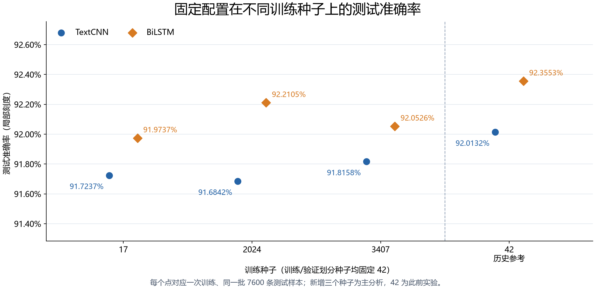
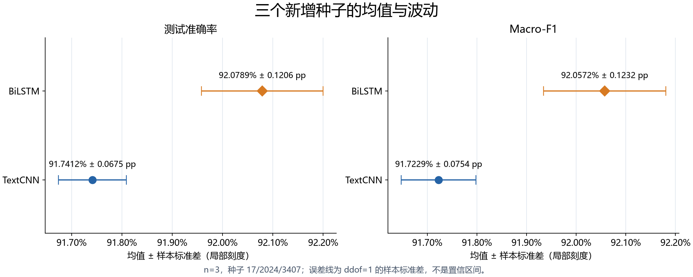
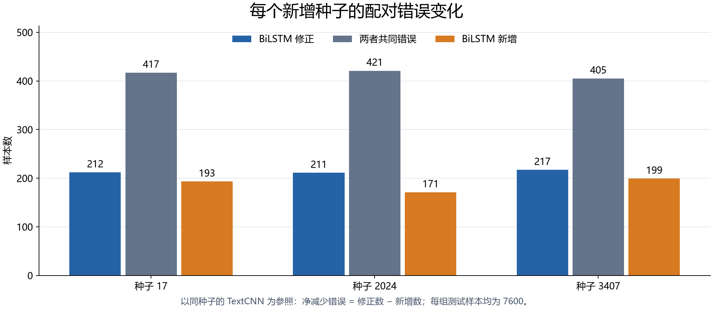
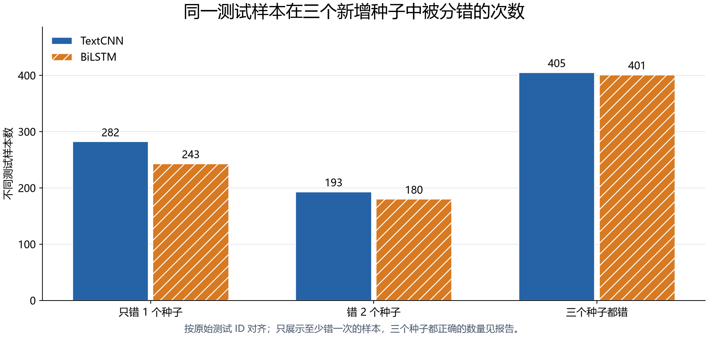

# 三组新增随机种子：TextCNN 与 BiLSTM 复现实验分析

实验日期：2026-11-03。新增训练种子 17、2024、3407；数据划分种子固定 42。

固定此前选定的两个方案后，BiLSTM 在三个新增种子中均取得更高准确率。其平均准确率为 **92.0789% ± 0.1206 个百分点**，TextCNN 为 **91.7412% ± 0.0675 个百分点**，配对平均差为 **+0.3377 个百分点**。± 表示三个种子间的样本标准差。

本轮完成六次重新训练和六次固定权重测试评估，未按测试成绩删除种子或另选配置。三个种子共享同一测试集，主要用于观察训练随机性；不能把它们当作三个独立数据集，也不能凭三个点宣称已经证明架构具有普遍优势。

## 1. 每个种子的实际结果

| 训练种子 | TextCNN 准确率 | BiLSTM 准确率 | 差值（百分点） | TextCNN 错误 | BiLSTM 错误 | BiLSTM 修正 / 新增 |
|---|---:|---:|---:|---:|---:|---:|
| [17](seed_17/2026-11-03_textcnn_vs_bilstm.md) | 91.7237% | 91.9737% | +0.2500 | 629 | 610 | 212 / 193 |
| [2024](seed_2024/2026-11-03_textcnn_vs_bilstm.md) | 91.6842% | 92.2105% | +0.5263 | 632 | 592 | 211 / 171 |
| [3407](seed_3407/2026-11-03_textcnn_vs_bilstm.md) | 91.8158% | 92.0526% | +0.2368 | 622 | 604 | 217 / 199 |
| 42（历史参考） | 92.0132% | 92.3553% | +0.3421 | 607 | 581 | 192 / 166 |



新增三组的准确率差值范围为 **+0.2368 至 +0.5263 个百分点**，配对差值的样本标准差为 **0.1635 个百分点**。平均值与每组差值一起解释，避免单个最高结果代表整个方案。

## 2. 跨种子的均值与波动

| 指标（仅新增三种子） | TextCNN 均值 ± 样本标准差 | BiLSTM 均值 ± 样本标准差 |
|---|---:|---:|
| 准确率 | 91.7412% ± 0.0675 pp | 92.0789% ± 0.1206 pp |
| Macro-F1 | 91.7229% ± 0.0754 pp | 92.0572% ± 0.1232 pp |
| 测试交叉熵 | 0.2620 ± 0.0110 | 0.2451 ± 0.0062 |
| 每次测试错误数 | 627.6667 ± 5.1316 | 602.0000 ± 9.1652 |



标准差采用 `ddof=1`，描述训练种子之间的波动，**不是置信区间**。本次仅三个新增种子，不给出精确的总体稳定性保证，也不将逐样本配对检验当作跨种子重复实验的替代。

补充加入历史种子 42 后，四种子的描述统计为：

| 模型 | 四种子准确率均值 | 样本标准差（百分点） |
|---|---:|---:|
| TextCNN | 91.8092% | 0.1467 |
| BiLSTM | 92.1480% | 0.1697 |

种子 42 是此前调参与方案选择所在的历史实验，本轮没有重跑；其结果作为次要参考。主结果始终是三个预先指定的新种子，避免把历史选型结果和新增复现结果混为同一批确认性证据。

## 3. 净改善之外，错误是否持续出现



修正数大于新增数表示本组净改善；两者共同错误则反映当前两个方案都未解决的样本。详细清单与混淆矩阵分别放在各随机种子文件夹。

按测试 ID 对齐三个新增种子后，同一条新闻的错误重复情况如下。每一列均按不同新闻计数，四行合计 7600；不是将三个种子的错误条数直接累加。

| 同一模型在三个新增种子中的错误次数 | TextCNN 样本数 | BiLSTM 样本数 |
|---|---:|---:|
| 0 | 6720 | 6776 |
| 1 | 282 | 243 |
| 2 | 193 | 180 |
| 3 | 405 | 401 |



两个模型均在三个新增种子上持续分错的新闻有 **275 条**。这些样本可作为后续主题边界与标注一致性复核的候选，但不能据此直接删除样本或修改官方测试标签。重复错误也不自动等于标注有误。

## 4. 各类别与主要混淆方向

下表为三个新增种子的每次测试平均错误数，每类每次均有 1900 条；平均错误数可能为小数。

| 真实类别 | TextCNN 平均错误 | BiLSTM 平均错误 | BiLSTM − TextCNN |
|---|---:|---:|---:|
| World | 159.33 | 147.67 | -11.67 |
| Sports | 43.33 | 35.67 | -7.67 |
| Business | 226.33 | 236.33 | +10.00 |
| Sci/Tech | 198.67 | 182.33 | -16.33 |

| 误分方向 | TextCNN 三种子平均次数 | BiLSTM 三种子平均次数 |
|---|---:|---:|
| Business → Sci/Tech | 144.00 | 158.00 |
| Sci/Tech → Business | 126.67 | 102.33 |
| Sci/Tech → Sports | 17.00 | 19.67 |
| World → Business | 54.00 | 52.00 |

这里保留相反方向的商业/科技误分，以及此前发现可能恶化的科技/体育方向；结论应结合方向变化，而非仅看总准确率。每组报告还保留精确率、召回率对应的原始指标文件。

商业类错误的逐种子变化为：**种子 17：+42 条、种子 2024：-16 条、种子 3407：+4 条**。本轮均值恶化主要受种子 17 影响，不能解读为每个种子都发生相同程度的商业类退化。种子 3407 的科技类错误也由 200 增至 205，即使整体准确率上升，个别类别仍可能受损。

## 5. 本轮结果的含义

三个新增种子的整体准确率均高于各自 TextCNN，净增加正确数分别为 19, 40, 18 条。其平均优势 0.3377 个百分点与历史种子 42 的 0.3421 个百分点接近，说明本轮观察到的提升方向在新增种子中得到重复。Macro-F1 平均也提高 0.3344 个百分点，且三组交叉熵均更低。

BiLSTM 的准确率标准差为 0.1206 个百分点，高于 TextCNN 的 0.0675 个百分点，因此本轮较高的平均准确率没有伴随更小的种子间波动。三个新增种子始终分错的样本数为 TextCNN 405 条、BiLSTM 401 条，数量仍然接近；主题边界和持续错误没有随着均值提升而消失。

逐种子的 McNemar 检验未做多重比较校正，且都是同一测试集上的探索性诊断；不能挑出种子 2024 的 p<0.05，就宣称跨种子的整体优势已经具有统计显著性。结合重复方向与小样本限制，本轮支持保留当前 BiLSTM 方案继续使用，但仍应把优势描述为本数据划分上的小幅提升。

后续若继续改进，应优先在训练/验证数据上检查商业新闻中的科技背景词，以及两个模型持续分错的主题边界案例；保留整体和逐类指标，避免用单个平均准确率掩盖类别退化。本轮不根据测试成绩替换当前权重，也不据此修改官方测试标签。

## 6. 训练条件、限制与复现

- 固定官方数据、训练/验证划分种子 42、42396 项训练词表、最大长度 256；仅改变初始化、批次采样与 Dropout 使用的训练种子。新配置增加 `data.split_seed=42`；旧配置不带该字段时仍按原 `seed` 划分，兼容性已测试。
- 两个方案的其余参数完全沿用之前选定的配置：TextCNN 卷积核 2/3/7、20 轮；BiLSTM 词嵌入 Dropout=0.2、验证损失早停，最大 20 轮。两者均按验证准确率选择权重，同准确率比较验证损失。
- 这是最终方案的复现比较，结构与正则化、停止策略的作用混合存在，不能把差距全部解释为架构收益。训练时最多两个进程共享一张 GPU，因此执行时长受并发负载影响，不用于证明模型推理速度优劣。
- 沿用现有 PyTorch/CUDA 默认执行设置，没有额外启用严格确定性算法。固定种子控制了主要随机源，但不承诺不同设备或软件版本下逐位一致。
- 六次训练完成后才开始本轮测试评估；保留全部种子。当前测试集此前已用于错误分析，新增种子没有消除测试集反复使用与选型带来的偏差，新的泛化结论仍需独立保留数据。

原始配置、各组完整训练日志、最佳轮次、源码/数据/权重哈希均有记录。跨六次训练的编码序列与词表哈希一致，同一模型的三个初始参数哈希互不相同。

| 证据 | 位置 |
|---|---|
| 预先固定的种子、方案与原配置哈希 | [protocol.json](protocol.json) |
| 训练完成、数据一致性与初始化差异检查 | [training_verification.json](training_verification.json) |
| 六次训练/测试的指标表 | [results.csv](data/results.csv) |
| 完整统计与各组配对结果 | [summary.json](data/summary.json) |
| 7600 条新闻的跨种子错误频率 | [error_frequency.csv](data/error_frequency.csv) |
| 最终独立核验记录 | [verification.json](verification.json) |

在仓库根目录、激活 `d2l-pytorch` 环境后，结果汇总与报告可复现：

```powershell
python task2_简单分类模型设计与实现/experiments/scripts/analyze_random_seeds.py --evaluate
python task2_简单分类模型设计与实现/experiments/scripts/report_random_seeds.py
python task2_简单分类模型设计与实现/experiments/scripts/verify_random_seeds.py
```

分析脚本在评估前检查全部六次训练；已有完整测试评估会被核验并复用。图表 PNG 与同名 SVG 保存在汇总或各组 `assets/` 中。训练目录不允许覆盖，重新训练应另设新的输出目录。
