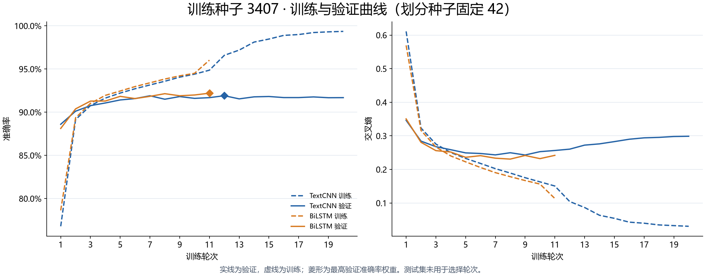
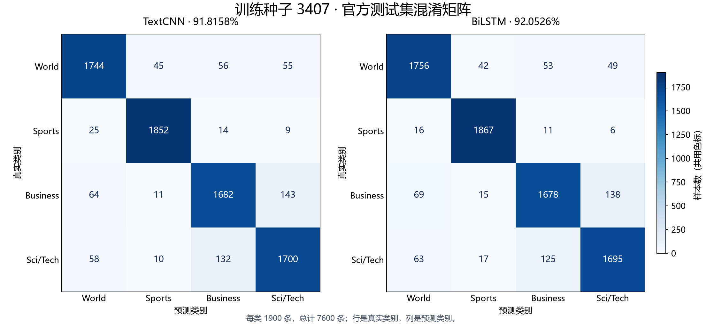

# 训练种子 3407：TextCNN 与 BiLSTM 重新实验

实验日期：2026-11-03；训练/验证划分种子固定为 42。

本组 BiLSTM 测试准确率为 **92.0526%**，TextCNN 为 **91.8158%**，BiLSTM 更高，差值为 **+0.2368 个百分点**。以 TextCNN 为参照，BiLSTM 修正 217 条、增加 199 条错误，净减少 18 条。此处是一个种子的结果，最终判断见[三组汇总报告](../2026-11-03_random_seed_summary.md)。

## 训练设置与权重选择

本轮沿用之前已确定的两个最终方案。TextCNN 使用卷积核 2/3/7、分类 Dropout=0.5；BiLSTM 使用单层双向 LSTM，每方向隐藏维度 128、词嵌入 Dropout=0.2、分类 Dropout=0.5。两者词嵌入均为随机初始化 128 维，Adam 学习率 0.001、WD=1e-4、batch size=64、验证损失驱动降学习率。

训练/验证/测试样本数为 108000/12000/7600，分词、42396 项词表、最大长度 256 与历史实验一致。固定划分种子 42，仅改变模型初始化、训练批次顺序及 Dropout 的随机种子。数据编码和词表哈希已跨六次训练核对，详见[训练核验](../training_verification.json)。

| 模型 | 实际轮次 | 选中轮次 | 验证准确率 | 测试准确率 | Macro-F1 | 测试错误 | 测试交叉熵 |
|---|---:|---:|---:|---:|---:|---:|---:|
| TextCNN | 20 | 12 | 91.9083% | 91.8158% | 91.8078% | 622 | 0.274668 |
| BiLSTM | 11 | 11 | 92.2000% | 92.0526% | 92.0302% | 604 | 0.251153 |

TextCNN 保留原 20 轮训练流程；BiLSTM 保留验证损失早停（patience=3、min_delta=0.001），最大 20 轮。两者分别保存最高验证准确率权重，同准确率时选验证损失更低者。六次训练全部完成并核验后才统一评估固定权重，测试集不参与选种子或选轮次。



曲线展示拟合过程，两个模型的训练策略不同，本次结果反映最终方案的比较。不能把差值全部归因于模型结构或早停。

## 配对错误与类别表现

| 结果 | 数量 |
|---|---:|
| 两者正确 | 6779 |
| BiLSTM 修正 | 217 |
| 两者错误 | 405 |
| BiLSTM 新增 | 199 |

精确双侧 McNemar 检验 p=0.404595，仅作本组配对诊断；本轮三个逐种子检验未作多重比较校正，单组较小的 p 值不能代表跨种子整体显著。三个种子不是三个独立测试集，不能合并为 22800 条独立样本来夸大证据。



| 真实类别（每类 1900 条） | TextCNN 错误 | BiLSTM 错误 | TextCNN F1 | BiLSTM F1 |
|---|---:|---:|---:|---:|
| World | 156 | 144 | 92.0074% | 92.3239% |
| Sports | 48 | 33 | 97.0141% | 97.2143% |
| Business | 218 | 222 | 88.9006% | 89.0895% |
| Sci/Tech | 200 | 205 | 89.3092% | 89.4931% |

商业→科技误分为 143→138 条，科技→商业为 132→125 条；科技→体育为 10→17 条。方向性差异需要结合三组结果判断，不能只挑选改善的一侧。

## 数据与复现

- 配置：[TextCNN](configs/textcnn.json)、[BiLSTM](configs/bilstm.json)。
- 指标和原始概率：[TextCNN 指标](data/textcnn/metrics.json)、[BiLSTM 指标](data/bilstm/metrics.json)，同目录保留 `predictions.npz` 与全量预测 CSV。
- 配对清单：[全部样本](data/paired_predictions.csv)、[修正](data/fixed.csv)、[新增](data/new_errors.csv)、[共同错误](data/both_wrong.csv)。
- [本组汇总 JSON](data/summary.json)、[预先固定的实验方案](../protocol.json)。

权重及逐轮日志位于仓库根目录 `.build/task2/runs/random_seeds_20261103/seed_3407/textcnn/` 和 `.../bilstm/`；`execution.json` 记录源码、数据编码、初始化与最终权重哈希。图表均有同名 SVG。

```powershell
# 在仓库根目录、尚无同名训练目录时运行；已有结果不会覆盖
python task2_简单分类模型设计与实现/experiments/scripts/run_random_seeds.py --seed 3407 --model textcnn
python task2_简单分类模型设计与实现/experiments/scripts/run_random_seeds.py --seed 3407 --model bilstm
```
