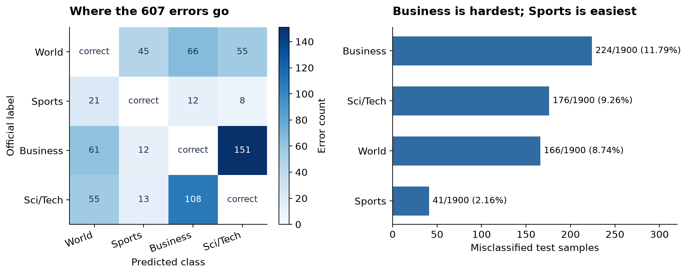

# Task 2 误分类分析：分析方法与结论

邱圣清 | 2025211317 | 2025211701 | 2026-11-03

调参结束后，最优 TextCNN 在测试集上的准确率是 92.0132%，还有 607 条新闻被分错。这次我想进一步弄清楚：错误集中在哪些类别，换一种卷积核是否仍会错在同一批新闻上，以及清洗文本、使用预训练词向量能否改善这些问题。

这份分析按“错误案例与卷积核对比、问题判断、输入改进、下一步模型选择”的顺序展开。最突出的是商业与科技的类别边界，West Bank 案例则提示了局部词特征的影响。随后进行的清洗、GloVe 和 Word2Vec 实验都没有超过原模型，因此我下一步准备比较 BiLSTM。

## 1. 我是怎样分析这些错误的

我先加载最优 2/3/7 模型保存的第 8 轮权重，沿用训练时的词表和分词规则，对 7600 条官方测试新闻逐条预测。每条记录保留原文、真实类别、预测类别和四类概率，再将预测与原始标签不同的 607 条全部提取出来。后续比较都使用相同的测试行号，避免把不同新闻的结果混在一起。

第一步是按类别统计混淆矩阵，再按文本长度、未知词比例和预测置信度分组。我同时保留每组的样本数和错误率。例如，短文本里有多少条分错，需要除以全部短文本数量，才能判断它们是否更容易出错。

对于具体案例，我结合原文做了两项检查。一项是检索内容相近的新闻，比较它们的原始标签；另一项是逐词遮挡，每次把一个位置替换为 UNK，观察预测怎样变化。前者帮助检查类别边界，后者用来寻找模型敏感的词或片段。

接着，我对齐已有的 3/4/5、2/4/6、2/3/7 三组卷积核模型，将新闻分为共同正确、共同错误、改动后修正和改动后新增错误几种情况。这样既能看到哪些样本反复出错，也能看清一次准确率变化背后发生了多少案例替换。

最后补做清洗和预训练词向量对照。新实验沿用原来的 108000 条训练数据和 12000 条验证数据，随机种子为 42，各训练 20 轮。权重按验证准确率选择，并列时取验证损失较低的一轮，再评估固定的 7600 条测试数据。

## 2. 错误主要集中在哪些新闻上

四个类别的测试样本数都是 1900 条，商业类最容易出错，体育类相对容易识别。商业与科技两类一共错了 400 条，占全部错误的 65.90%。

| 真实类别 | 最优模型错误数 | 错误率 | F1 | 三种卷积核共同错误数 |
| --- | --- | --- | --- | --- |
| World | 166 | 8.74% | 91.96% | 139 |
| Sports | 41 | 2.16% | 97.10% | 29 |
| Business | 224 | 11.79% | 89.10% | 185 |
| Sci/Tech | 176 | 9.26% | 89.84% | 137 |

最集中的混淆是商业与科技：151 条商业新闻被分到科技，108 条科技新闻被分到商业，合计 259 条，占全部错误的 42.67%。世界与商业之间的双向混淆还有 127 条，占 20.92%。

回到原文后，这些交叉就比较容易理解了。比如，Intel 推迟发布显示芯片的新闻既涉及科技产品，也涉及企业经营；IBM 收购 IT 服务公司的新闻同时包含技术行业和商业交易信息。这些例子说明类别之间确实存在交叉，但还不足以把全部 259 条错误都归为同一种原因。

我还找到了 7 组内容高度相似、原始标签却不同的新闻。test:4359 和 test:4047 都在讨论 Google 桌面搜索工具的隐私风险，前者标为 Business，后者标为 Sci/Tech，模型都预测为 Sci/Tech。这类案例需要结合标注口径复核。本次保留原始标签，没有把它们直接认定为错标，也没有从错误数里扣除。

### 文本长度、未知词和编码痕迹能解释多少错误

| 文本或预测特征 | 样本数 | 错误数 | 组内错误率 |
| --- | --- | --- | --- |
| 不超过 20 词 | 162 | 28 | 17.28% |
| 超过 20 词 | 7438 | 579 | 7.78% |
| 没有未知词 | 5825 | 432 | 7.42% |
| 至少有一个未知词 | 1775 | 175 | 9.86% |
| 未知词比例至少 10% | 84 | 8 | 9.52% |
| 置信度低于 0.6 | 371 | 165 | 44.47% |
| 置信度至少为 0.9 | 6095 | 170 | 2.79% |
| 前两类概率差小于 0.2 | 264 | 121 | 45.83% |
| 含编码痕迹 | 2430 | 149 | 6.13% |
| 无编码痕迹 | 5170 | 458 | 8.86% |

短文本的错误率较高。一些评论式摘要只出现人物姓名或泛泛的描述，缺少明确的主题词，模型可用的信息比较少。不过，不超过 20 词的文本只贡献了 28 条错误，不能用它解释大多数误分类。

未知词也不是主要原因。607 条错误中有 432 条完全没有未知词，占 71.17%。所有测试文本都没有超过 256 词，本次没有任何输入被截断。这些统计不支持把主要错误归因于未知词或输入截断。

编码痕迹的情况与最初的直觉也不完全一致。含有 #39、quot 或 HTML 实体的文本，错误率是 6.13%，低于没有这些痕迹的文本。这些分组的主题和类别构成不同，不能据此说编码痕迹有益，但也不能只凭少数案例就认定它是主要错误来源。

预测概率需要结合原文来看。170 条错误的置信度仍不低于 0.9，占错误总数的 28.01%；前两类概率接近的分组虽然更容易错，却只覆盖了 121 条错误。只复核低置信度样本，会漏掉一部分问题。

### 逐词遮挡能帮助理解什么

我对全部 607 条错误做了 22910 次单词遮挡。test:139 是一条约旦河西岸的新闻，真实标签为 World，模型却预测 Business。遮挡 West Bank 中的 bank 后，预测变回了 World。这为地名与金融词义混淆提供了具体线索。

共有 261 条错误存在至少一个位置，遮挡后能恢复为原始真实类。这个结果说明部分预测对局部输入很敏感。遮挡会改变词组和卷积窗口，而且寻找“能改对的位置”时已经使用了真实标签，所以这 261 条不能视为实际能够挽回的错误数。

## 3. 换卷积核以后，还是同一批新闻分错吗

比较三组模型时，我核对了训练设置、词表和参数量，保持这些条件一致，只比较卷积核宽度变化后的预测。

| 卷积核 | 测试准确率 | 错误数 | macro-F1 | 仅该组出错的样本数 |
| --- | --- | --- | --- | --- |
| 3/4/5 | 91.8684% | 618 | 91.8524% | 61 |
| 2/4/6 | 91.8026% | 623 | 91.7880% | 49 |
| 2/3/7 | 92.0132% | 607 | 92.0015% | 56 |

三组模型至少有一组分错的新闻共 762 条。其中，490 条三组都错，106 条恰好两组错，166 条只在一组出错，另有 6838 条三组都正确。490 条共同错误中，有 468 条连预测出的错误类别都相同。

这回答了老师提出的一个问题：在本次比较的 TextCNN 变体中，大多数错误有共性。三组共同出错的样本占最优模型错误的 80.72%，单纯更换卷积核宽度能解决的部分比较有限。这个范围只包括三种卷积核组合，还不能推广到所有模型结构。

| 卷积核变更 | 修正旧错误 | 仍然错误 | 新增错误 | 净减少错误 |
| --- | --- | --- | --- | --- |
| 3/4/5 → 2/4/6 | 83 | 535 | 88 | -5 |
| 3/4/5 → 2/3/7 | 106 | 512 | 95 | 11 |
| 2/4/6 → 2/3/7 | 94 | 529 | 78 | 16 |

只看准确率时，3/4/5 换成 2/3/7 好像只是多分对了 11 条。逐条对齐后才发现，它修正了 106 条旧错误，同时新增了 95 条错误。后续比较模型时，我需要同时看这两部分，才能知道改动具体改善了什么，又损失了什么。

## 4. 根据案例判断问题，再做两类输入改进

从共同错误与 West Bank 案例来看，我更倾向于认为当前模型容易过度依赖局部词特征，对新闻主题和词义所需的上下文利用还不充分。这是结合案例提出的判断，尚不能说明全部错误都由结构造成，也没有单独测量模型的长文本能力。

为了先检查输入能否改善，我保持 TextCNN 结构不变，做了两类实验：清洗文本，减少可能干扰特征提取的编码噪声；使用 GloVe 和 Word2Vec 初始化词向量，改善词语表示。后者本身没有增加新的上下文编码机制。

### 统一清洗没有提高整体准确率

清洗实验固定使用 2/3/7 结构、原来的 42396 项词表和相同的随机初始化，其他训练设置也沿用原配置。处理只涉及已知实体修复、常见 HTML 标签去除和空白规范化，保留股票代码等有意义的内容。训练和推理使用同一版本的规则，共有 2393 条测试文本的分词序列发生了变化。

清洗后，测试准确率从 92.0132% 变为 91.8158%，错误数从 607 条增加到 622 条。它修正了 93 条旧错误，也新增了 108 条错误。含编码痕迹的 2430 条新闻，错误数从 149 条变为 167 条，错误率从 6.13% 变为 6.87%，没有出现预期的改善。

这次结果没有支持“去掉编码痕迹就能提高准确率”的判断。清洗既改变了输入，也影响了重新训练后的参数，具体哪部分导致了变化还不能单独确定。我保留了原来的处理方式作为当前最优方案。

### GloVe 能修正部分案例，整体仍未超过随机初始化

GloVe 使用 100 维向量，原模型使用 128 维向量。为了分清维度变化和预训练的影响，我增加了一组随机 100 维对照，再与 GloVe 100 维比较。两组都不清洗文本，其他设置相同，词向量都继续参与训练。

官方 GloVe 6B 覆盖了训练词表中 40433/42394 个普通词，覆盖率为 95.37%。未覆盖词保留随机初始化，两组非嵌入参数的初始值相同。这个对照主要比较向量初始化方式；GloVe 使用了额外的外部语料，与只在当前训练集上学习的模型仍有数据来源上的差别。

| 方案 | 验证准确率 | 测试准确率 | 错误数 | macro-F1 | 商业↔科技混淆数 |
| --- | --- | --- | --- | --- | --- |
| 原始随机 128 维 | 92.0250% | 92.0132% | 607 | 92.0015% | 259 |
| 统一清洗 128 维 | 91.7833% | 91.8158% | 622 | 91.8071% | 278 |
| 随机 100 维 | 92.0000% | 91.8026% | 623 | 91.7926% | 270 |
| GloVe 100 维，可训练 | 92.1833% | 91.6842% | 632 | 91.6754% | 267 |

GloVe 相对随机 100 维对照修正了 131 条旧错误，也新增了 140 条错误，净增加 9 条。商业与科技的双向混淆从 270 条略降到 267 条，整体准确率却从 91.8026% 降到 91.6842%。因此，局部混淆的改善也需要放回全部类别中评估。

在三种卷积核共同分错的 490 条新闻中，清洗修正了 33 条，GloVe 修正了 53 条。比如，三种卷积核都把 test:5467 的足球新闻误分为科技，GloVe 将它分回了体育。这说明“共同困难样本”仍可能被其他训练方式修正，但不能据此推断整体性能一定提升。

### Word2Vec 修正了部分共同错误，整体仍未提高

随后我保持 TextCNN 的 2/3/7 结构和 128 维词向量不变，只用固定的 108000 条训练新闻预训练 Skip-gram。为核对流程，另用同一入口重新训练随机 128 维对照，其全部测试预测与原模型一致。

Word2Vec 组测试准确率为 91.8553%，错误 619 条；随机对照为 92.0132%，错误 607 条。它修正了 112 条旧错误，也新增了 124 条错误。商业与科技的双向混淆从 259 条增加到 272 条，三种卷积核共同分错的 490 条中有 48 条被修正。

West Bank 案例这次被分回 World，但 World 概率仅为 0.5211，Business 仍为 0.4583。这个改正值得保留，尚不能证明词义歧义已解决。Word2Vec 改善了分类训练前期的验证表现，最终测试结果没有提高；原始随机 128 维模型仍是当前已验证的最佳方案。

详细方法与结论见[Word2Vec 实验报告](2026-11-03_word2vec_textcnn.md)，全部 619 条新模型错误保留在[案例附件](data/word2vec128/all_errors.md)中。该结果同样来自 seed 42 单次实验。

## 5. 从这些结果出发，下一步比较 BiLSTM

我读到的不少困难案例都存在主题交叉或类别归属不明确的情况，商业与科技的混淆尤其集中。West Bank 的遮挡结果又提供了另一条线索：即使句子并不长，模型也可能让局部词特征盖过整条新闻的主题。类别边界、词义和上下文利用，是我接下来最想继续检验的问题。

清洗、GloVe 和 Word2Vec 都修正了一些案例，也带来了新的错误，整体准确率没有超过原始 128 维 TextCNN。静态词向量提供了词语之间的关联，仍需分类模型结合语境判断。当前结果支持继续检查上下文编码方式，还不足以把所有错误都归因于 TextCNN 的结构。

所以我下一步打算先实现已经学过的 BiLSTM，比较从前后两个方向处理词序后，那 490 条共同错误和商业↔科技混淆是否改善。BiLSTM 目前尚未在本项目中训练，这是一项待验证的改进方向。

AI 也建议过 [BERT](https://aclanthology.org/N19-1423/)。我目前只知道它是基于 Transformer 的预训练模型，对内部结构和训练方法还不熟悉，基础学习也尚未涉及。因此先完成 BiLSTM 对照，再把 BERT 留作后续学习与实验的方向。

方法上，我会继续把整体指标与逐条错误放在一起看。混淆矩阵定位集中出错的类别，对齐错误集合区分共同困难与结构差异，逐词遮挡辅助检查个例；这些方法提供的线索，仍要通过新的对照实验检验。

现有结果来自 seed 42 单次实验，测试集此前也已多次查看。后续配置选择应依靠训练、验证数据，并补充重复实验和更独立的评估。输入改进未见提升，不等于所有预处理方法都无效，也不保证换模型后一定提高准确率。

## 6. 指标明细与完整记录

下面保留各类 F1，便于查看整体变化分别落在哪些类别上。

| 方案 | World | Sports | Business | Sci/Tech |
| --- | --- | --- | --- | --- |
| 原始随机 128 维 | 91.9650% | 97.1011% | 89.1015% | 89.8385% |
| 统一清洗 128 维 | 92.0871% | 96.9175% | 88.8066% | 89.4173% |
| 随机 100 维 | 92.0074% | 96.8316% | 88.8414% | 89.4901% |
| GloVe 100 维，可训练 | 91.6754% | 96.8824% | 88.8535% | 89.2904% |
| Word2Vec 128 维，可训练 | 92.0518% | 96.9126% | 88.9536% | 89.4654% |

| 对照 → 实验 | 修正旧错误 | 仍然错误 | 新增错误 | 净减少错误 |
| --- | --- | --- | --- | --- |
| 原始 128 维 → 清洗 128 维 | 93 | 514 | 108 | -15 |
| 原始 128 维 → 随机 100 维 | 92 | 515 | 108 | -16 |
| 随机 100 维 → GloVe 100 维 | 131 | 492 | 140 | -9 |
| 原始 128 维 → GloVe 100 维 | 113 | 494 | 138 | -25 |
| 随机 128 维 → Word2Vec 128 维 | 112 | 495 | 124 | -12 |

全部案例的原文、概率与原始测试行号保留在附件中，正文只选取能说明问题的例子。

- 最优模型：[607 条错误的完整原文](data/baseline/all_errors.md)、[CSV 清单](data/baseline/all_errors.csv)、[混淆矩阵与特征统计](data/baseline/summary.json)。

- 类别边界与局部诊断：[相似新闻及原始标签](data/baseline/similar_test_cases.json)。22910 次遮挡的逐位置结果保存在仓库根目录 `.build/task2/error_analysis/2026-11-03/token_occlusion.jsonl`。

- 卷积核比较：[共同错误](data/kernel_comparison/common_errors.csv)、[错误并集](data/kernel_comparison/error_union.csv)、[完整统计](data/kernel_comparison/summary.json)。各组独有错误与两两转换清单也保存在同一目录。

- 后续对照：[清洗组](data/cleaning/)、[随机 100 维组](data/random100/)、[GloVe 100 维组](data/glove100/)、[汇总结果](data/followup_summary.json)。各组均保留全部 7600 条预测和修正、新增错误的原文。

- 实验核验：[核验结果](data/verification.json)、[核验脚本](../../scripts/verify_followups.py)。核对内容包括测试原文与标签、训练和验证划分、验证集选模、混淆矩阵，以及原有权重未被覆盖。

清洗组采用 `known_html_tags_v2`，正式权重和训练记录位于 `.build/task2/runs/textcnn_k237_cleaning_v2_20261103/`；其余两组位于同级的 `textcnn_k237_random100_20261103/` 和 `textcnn_k237_glove100_20261103/`。初版清洗记录仍保留，本文使用修正后的版本。

预训练向量来自[Stanford 官方 GloVe 6B](https://nlp.stanford.edu/projects/glove/)，模型使用思路参考[TextCNN 原论文](https://aclanthology.org/D14-1181/)。运行入口见[源码说明](../../../news_classifier/README.md)，前期调参结果见[调参报告索引](../tuning/README.md)。

