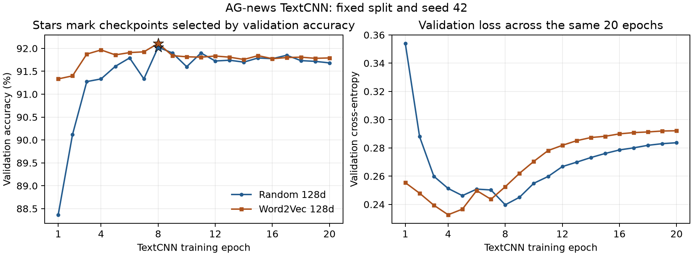

# Word2Vec 预训练后，TextCNN 的错误发生了什么变化

邱圣清 | 2025211317 | 2025211701 | 2026-11-03

这轮我保持 TextCNN 结构不变，只把随机词向量换成在训练新闻上预训练的 Word2Vec。结果是：测试准确率从 92.0132% 变为 91.8553%，错误从 607 条增加到 619 条。它修正了 112 条旧错误，也新增了 124 条错误，暂时没有超过原模型。

比较具体案例后，我发现词向量初始化确实能改变一部分判断，但商业与科技的类别边界仍然是主要困难。下面先说明实验怎样控制变量，再看哪些新闻被改对、哪些又分错了。

## 1. 这次只改变词向量的初始化方式

Word2Vec 有 CBOW 和 Skip-gram 两种常用训练方式。本次选用 Skip-gram，通过一个词预测它附近的词。预训练不使用新闻类别，也没有下载外部语料，只读取原来划分好的 108000 条训练新闻；12000 条验证新闻和 7600 条测试新闻都不参与预训练。

分词沿用原规则：转小写，再提取 `[a-z0-9]+`。每条新闻作为一段词序列，不把相邻新闻拼接起来。语料共 4285153 词，Word2Vec 得到 42394 个普通词的向量，恰好覆盖原分类词表中的全部普通词。PAD 和 UNK 继续保留原来的初始化规则。

| Word2Vec 设置 | 本次取值 |
| --- | --- |
| 方法 | Skip-gram，负采样 |
| 向量维度 | 128 |
| 最大上下文窗口 | 左右各最多 5 词，动态缩短窗口 |
| 最小词频 | 2 |
| 每个正样本的负采样数 | 5 |
| 高频词下采样阈值 | 0.001 |
| 预训练学习率 | 0.025 → 0.0001 |
| 预训练轮数 | 10 |
| 随机种子、线程数 | 42、1 |

分类阶段仍使用 2/3/7 卷积核，每个分支 128 个通道、最大池化、Dropout 0.5 和原来的四分类层。词向量仍是 128 维，因此两组参数量都为 5625220，没有额外增加网络层。

我通过同一个实验入口重新训练了随机 128 维对照。两组的词表、训练行号、初始卷积层与分类层参数一致，只在 Word2Vec 组开始训练前替换词向量。两组都不清洗文本，词向量均继续参与训练，没有冻结或单独调整嵌入层学习率。

两组都使用 Adam，学习率 0.001，weight decay 0.0001，batch size 64，训练 20 轮。调度器按验证损失降低学习率，factor 为 0.5、patience 为 1、最低学习率为 0.00001。调度规则相同，实际调整时点会随各组验证损失变化。

模型按最高验证准确率选择，并列时取验证损失较低的一轮。两组最终都选中第 8 轮，然后分别评估测试集。重新训练的随机对照与原模型在全部 7600 条新闻上的预测完全一致。

## 2. 分类训练起步更快，最终测试结果没有提高

| 方案 | 验证准确率 | 测试正确数 | 测试准确率 | macro-F1 | 商业↔科技混淆数 |
| --- | --- | --- | --- | --- | --- |
| 随机 128 维对照 | 92.0250% | 6993/7600 | 92.0132% | 92.0015% | 259 |
| Word2Vec 128 维 | 92.1083% | 6981/7600 | 91.8553% | 91.8459% | 272 |

Word2Vec 组第一轮的验证准确率为 91.3333%，随机对照为 88.3667%。在分类训练的前几轮，预训练组更快达到较高准确率。不过，它此前已经做了 10 轮词向量预训练，不能据此说整个流程更省计算。



图中星号表示按验证准确率选中的权重。Word2Vec 的最佳验证准确率高了 0.0833 个百分点，测试准确率却低了 0.1579 个百分点。后期两组验证损失都有回升，继续训练没有带来持续改善。一次验证分数的小幅领先，还不足以说明泛化能力更好。

## 3. 商业与科技的边界没有改善

| 真实类别 | 随机对照错误数 | Word2Vec 错误数 | 随机对照 F1 | Word2Vec F1 |
| --- | --- | --- | --- | --- |
| World | 166 | 157 | 91.9650% | 92.0518% |
| Sports | 41 | 48 | 97.1011% | 96.9126% |
| Business | 224 | 221 | 89.1015% | 88.9536% |
| Sci/Tech | 176 | 193 | 89.8385% | 89.4654% |

World 类少错了 9 条，Business 类少错了 3 条，Sports 和 Sci/Tech 则分别多错 7 条和 17 条。Business 的错误数略降，F1 却下降，因为 F1 还计入其他类别被误判为 Business 的情况。

商业→科技的错误从 151 条变为 152 条，科技→商业从 108 条变为 120 条，双向混淆合计增加 13 条。这次实验没有支持“加入 Word2Vec 就能让商业与科技更容易区分”的判断。

Word2Vec 学到了一些符合直觉的词语关联。例如，`profit` 与 `earnings` 的余弦相似度约为 0.839，`chip` 与 `chips` 约为 0.820。但商业新闻和科技新闻经常共同使用公司名、产品名及交易词，词语关联更接近，并不等于新闻类别更容易区分。这里的近邻只是预训练向量的局部检查，不能代表分类能力的总体提升。

## 4. 哪些案例被修正，哪些仍然困难

| 与随机对照逐条比较 | 数量 |
| --- | --- |
| 两组都正确 | 6869 |
| 原来错误、Word2Vec 正确 | 112 |
| 两组都错误 | 495 |
| 原来正确、Word2Vec 错误 | 124 |

原来三种卷积核共同分错的 490 条新闻中，Word2Vec 修正了 48 条，还有 442 条仍然错误。共同错误并非完全无法修正，但本次改变初始化只解决了其中约 9.80%，同时也影响了原来正确的样本。

下面同时保留修正、未解决和新增错误，避免只挑表现好的案例。test:139、test:4359 等是上轮已分析的新闻；新增错误示例按测试行号取前两条。

| 测试编号 | 新闻内容简述 | 原始标签 | 随机对照预测 | Word2Vec 预测 |
| --- | --- | --- | --- | --- |
| test:139 | 以色列计划在约旦河西岸建设住房 | World | Business | World |
| test:5467 | Andreas Herzog 宣布从职业足球退役 | Sports | Sci/Tech | Sports |
| test:4359 | Google 桌面搜索工具带来隐私风险 | Business | Sci/Tech | Sci/Tech |
| test:1840 | “Icing call”，摘要主要描述缺钱和停业 | Sports | Business | Business |
| test:20 | IBM 扩大招聘、员工数将创多年新高 | Sci/Tech | Sci/Tech | Business |
| test:23 | 部分人无法参与 Google IPO | Sci/Tech | Sci/Tech | Business |

test:139 是此前定位到的 West Bank 案例。Word2Vec 将完整原文分回 World，但 World 概率只有 0.5211，Business 仍有 0.4583。分别遮挡原文中两处 bank 后，World 概率升至约 0.6789 和 0.7077。它在这个案例上改对了，判断仍对 bank 敏感，不能据此说词义歧义已经解决。

test:20 和 test:23 则暴露出另一面：新闻分别涉及科技企业招聘和 Google 上市，按数据集标签都属于 Sci/Tech，Word2Vec 却将它们改判为 Business。这些内容同时包含行业身份和商业活动线索，仅靠更好的词语关联，仍可能与数据集的分类口径不一致。本次没有修改原始标签。

短文本也没有明显改善。不超过 20 词的 162 条新闻，错误从 28 条变为 27 条；没有未知词的 5825 条新闻，错误从 432 条变为 442 条。词向量覆盖原训练词表，并不意味着能覆盖测试中所有新词，固定词表之外的词仍按 UNK 处理。

## 5. 这轮实验能说明什么

这次我得到了一个比较明确的结果：在当前语料、128 维向量和这套微调配置下，Word2Vec 可以让分类训练更快起步，也能改对一部分原来反复出错的新闻，但最终没有超过随机初始化的 TextCNN。当前保留原模型作为已验证的最佳方案。

它也没有解决最关心的商业与科技边界问题。Word2Vec 用上下文共现来预训练词向量，分类时同一个词在嵌入层仍查找同一份向量；它不会直接为不同句子中的 bank 生成不同的输入表示。后续的 TextCNN 可以利用局部词组，但本次没有增加新的上下文编码机制。

结合此前的清洗和 GloVe 结果，我下一步准备先比较已经学过的 BiLSTM，检验更充分地结合前后文后，共同错误和类别混淆是否减少。冻结词向量或降低嵌入层学习率仍可作为后续对照，但目前还没有验证它们是否有效。

AI 也建议尝试 [BERT](https://aclanthology.org/N19-1423/)。我目前只知道它是基于 Transformer 的预训练模型，基础学习还没有覆盖具体结构与训练方法，因此先完成 BiLSTM，再考虑后续学习和实验。这里是下一步安排，两种模型都尚未在本项目中验证。

这些结论来自 seed 42 的单次实验，尚未比较多次运行的波动，不能把相差 12 条样本解释成稳定的性能差异。测试集此前已多次用于分析，后续配置选择应依靠训练集和验证集，并尽可能使用更独立的评估。训练内预训练与此前使用外部语料的 GloVe，数据来源及维度都不同，不能直接按总分归因于哪种词向量方法更好。

## 6. 完整记录与复现

- [全部 619 条错误原文](data/word2vec128/all_errors.md)、[全部错误 CSV](data/word2vec128/all_errors.csv)、[7600 条完整预测](data/word2vec128/all_predictions.csv)。
- [修正的 112 条旧错误](data/word2vec128/random128_to_word2vec128_fixed.csv)、[新增的 124 条错误](data/word2vec128/random128_to_word2vec128_new_errors.csv)、[仍然错误的 495 条](data/word2vec128/random128_to_word2vec128_both_wrong.csv)。
- [完整指标及案例汇总](data/word2vec128/summary.json)、[特征分组](data/word2vec128/feature_segments.csv)、[预训练词语近邻](data/word2vec128/word_neighbors.json)、[词向量来源与覆盖率](data/word2vec128/embedding_initialization.json)。
- [独立核验结果](data/word2vec128/verification.json)、[随机对照结果](data/random128/metrics.json)、[前一轮错误分析](2026-11-03_error_analysis.md)。

预训练文件保存在仓库 `.build/task2/pretrained/word2vec_ag_news128_20261103/`。`vectors.txt` 是分类器实际导入的向量；`word2vec_portable.model` 可直接用 Gensim 加载。初次序列化的文件也保留，便携副本只修正函数引用，词向量没有变化。来源清单保留了原文件、便携副本及向量文件的 SHA-256。

两组分类权重、20 轮日志、划分行号、初始化哈希和复现源码分别位于 `.build/task2/runs/textcnn_k237_random128_20261103/` 与 `.build/task2/runs/textcnn_k237_word2vec128_20261103/`。单独预测或测试只需要分类权重，不需要再次读取 Word2Vec 文件。

在 Task 2 目录、原 `d2l-pytorch` 环境下复现。以下使用新目录，避免覆盖本次实验：

```powershell
python -m pip install gensim==4.4.0
$env:PYTHONHASHSEED = '0'
python -m news_classifier.experiments.word2vec --output-dir ../.build/task2/pretrained/word2vec_repro --epochs 10
python -m news_classifier.experiments.controlled --mode random128 --run-dir ../.build/task2/runs/random128_repro
python -m news_classifier.experiments.controlled --mode word2vec128 --vectors ../.build/task2/pretrained/word2vec_repro/vectors.txt --run-dir ../.build/task2/runs/word2vec128_repro
```

自定义输出目录的测试导出保存在对应运行目录的 `evaluation/`，不会覆盖本次报告的数据。核验与分析入口见 [verify_word2vec.py](../../scripts/verify_word2vec.py) 和 [summarize_word2vec.py](../../scripts/summarize_word2vec.py)。本轮沿用 TextCNN，没有引入 BERT，也没有生成 PDF。

方法参考：[Word2Vec 原论文](https://arxiv.org/abs/1301.3781)、[负采样与词表示论文](https://arxiv.org/abs/1310.4546)、[Gensim Word2Vec 参数与复现说明](https://radimrehurek.com/gensim/models/word2vec.html)。
