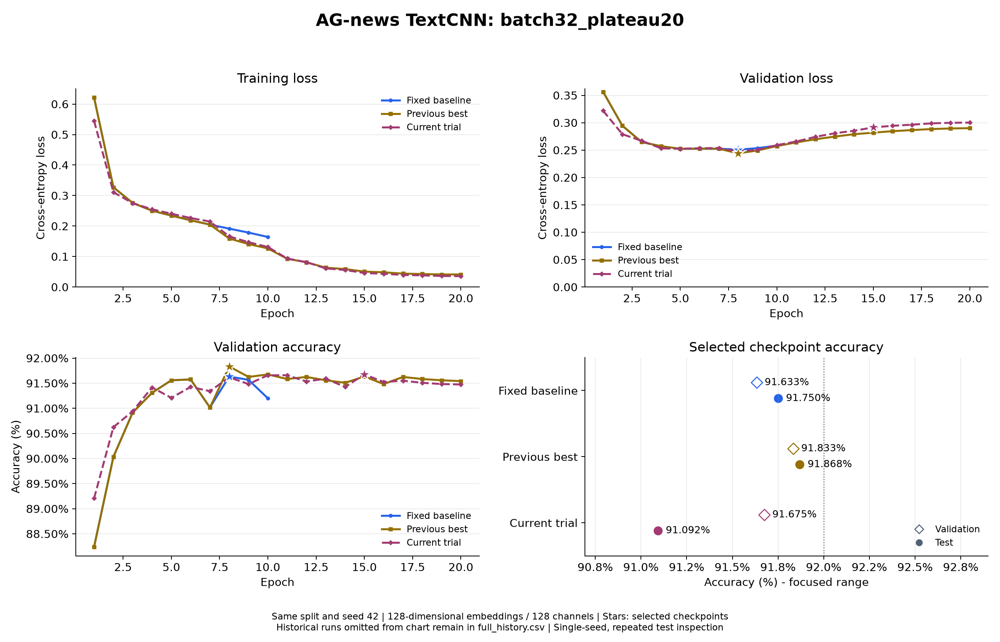

# AG-news TextCNN：batch32_plateau20

日期：2026-11-01。配置：[textcnn_ag_news_batch32_plateau20.json](../../../configs/textcnn_ag_news_batch32_plateau20.json)。

## 设置

词向量和每个卷积分支通道数均为 128，卷积核 3/4/5，参数量 5,625,220。
Dropout=0.5，weight decay=0.0001，初始学习率=0.001，batch size=32，训练 20 轮。
ReduceLROnPlateau 监控验证损失，factor=0.5、patience=1、min_lr=0.00001。随机种子 42，训练/验证/测试样本 108000/12000/7600，词表 42396。
训练进程耗时 241.2 秒。`best_accuracy.pt` 按最高验证准确率选择，同准确率选更低验证损失；`best_loss.pt` 独立保留。每次只评估本轮按验证指标选出的模型。
最低损失模型选中第 8 轮（验证损失 0.247486，准确率 91.617%）；测试结果来自最高准确率模型，不混用两份检查点的数据。

## 完整逐轮输出

```text
Epoch 01/20 | train loss: 0.5447 | train acc: 79.74% | val loss: 0.3219 | val acc: 89.21% | lr: 0.001
Epoch 02/20 | train loss: 0.3108 | train acc: 89.61% | val loss: 0.2790 | val acc: 90.62% | lr: 0.001
Epoch 03/20 | train loss: 0.2751 | train acc: 90.86% | val loss: 0.2670 | val acc: 90.94% | lr: 0.001
Epoch 04/20 | train loss: 0.2550 | train acc: 91.55% | val loss: 0.2533 | val acc: 91.42% | lr: 0.001
Epoch 05/20 | train loss: 0.2405 | train acc: 91.93% | val loss: 0.2523 | val acc: 91.21% | lr: 0.001
Epoch 06/20 | train loss: 0.2264 | train acc: 92.41% | val loss: 0.2535 | val acc: 91.42% | lr: 0.001
Epoch 07/20 | train loss: 0.2148 | train acc: 92.78% | val loss: 0.2536 | val acc: 91.34% | lr: 0.001
Epoch 08/20 | train loss: 0.1661 | train acc: 94.49% | val loss: 0.2475 | val acc: 91.62% | lr: 0.0005
Epoch 09/20 | train loss: 0.1470 | train acc: 95.09% | val loss: 0.2507 | val acc: 91.48% | lr: 0.0005
Epoch 10/20 | train loss: 0.1313 | train acc: 95.59% | val loss: 0.2591 | val acc: 91.66% | lr: 0.0005
Epoch 11/20 | train loss: 0.0936 | train acc: 97.02% | val loss: 0.2656 | val acc: 91.66% | lr: 0.00025
Epoch 12/20 | train loss: 0.0816 | train acc: 97.47% | val loss: 0.2742 | val acc: 91.53% | lr: 0.00025
Epoch 13/20 | train loss: 0.0611 | train acc: 98.26% | val loss: 0.2807 | val acc: 91.59% | lr: 0.000125
Epoch 14/20 | train loss: 0.0558 | train acc: 98.43% | val loss: 0.2853 | val acc: 91.42% | lr: 0.000125
Epoch 15/20 | train loss: 0.0460 | train acc: 98.82% | val loss: 0.2914 | val acc: 91.67% | lr: 6.25e-05
Epoch 16/20 | train loss: 0.0434 | train acc: 98.93% | val loss: 0.2944 | val acc: 91.53% | lr: 6.25e-05
Epoch 17/20 | train loss: 0.0396 | train acc: 99.06% | val loss: 0.2964 | val acc: 91.55% | lr: 3.125e-05
Epoch 18/20 | train loss: 0.0382 | train acc: 99.12% | val loss: 0.2988 | val acc: 91.51% | lr: 3.125e-05
Epoch 19/20 | train loss: 0.0362 | train acc: 99.21% | val loss: 0.2998 | val acc: 91.48% | lr: 1.5625e-05
Epoch 20/20 | train loss: 0.0357 | train acc: 99.19% | val loss: 0.3002 | val acc: 91.47% | lr: 1.5625e-05
```

## 结果与精简对比图

| 对照 | 选定轮次 | 验证损失 | 验证准确率 | 测试准确率 | 测试正确数 |
| --- | --- | --- | --- | --- | --- |
| Fixed baseline (`textcnn_wd1e4`) | 8 | 0.250798 | 91.633% | 91.750% | 6973 / 7600 |
| Previous best (`textcnn_plateau20`) | 8 | 0.244026 | 91.833% | 91.868% | 6982 / 7600 |
| Current trial (`textcnn_batch32_plateau20`) | 15 | 0.291405 | 91.675% | 91.092% | 6923 / 7600 |



每张图最多三组：固定基线、此前最佳、本轮实验，重合时合并；更早实验保留在各自记录和 `.build/task2/comparisons/full_history.csv`，不继续叠加曲线。
固定基线按最低验证损失选择，另外两组按验证准确率选择；固定基线两种指标同在第 8 轮最优。旧 10 轮实验曲线只画实际轮次。

测试准确率为 91.092105%，正确 6923 / 7600；92% 对应至少 6992 条正确，尚差 69 条，未达到目标。
本轮验证准确率与此前最佳相比变化 -0.158 个百分点。
这里只运行一个随机种子；测试集已在多轮实验中查看，不能把多轮调参后的成绩视为一次完全未见的最终评估。

## 产物与核对

原始完整控制台（含保存及调度提示）、配置、环境、逐轮全精度 CSV、两种模型和测试指标保存在 `.build/task2/runs/textcnn_batch32_plateau20/`。
本轮汇总与 SHA-256 保存在 `.build/task2/comparisons/batch32_plateau20/summary.json`、`summary.csv`；完整历史位于 `.build/task2/comparisons/full_history.csv`。
已核对全部 epoch 行、两种检查点选择、参数量、实际配置、调度器逐轮重放、7600 条测试样本，以及本轮开始前 13 份历史模型的权重哈希未变。

复现时在项目目录运行，使用新的输出目录保留现有结果：

```powershell
python -m news_classifier.train --config configs/textcnn_ag_news_batch32_plateau20.json
python -m news_classifier.evaluate --checkpoint ../.build/task2/runs/textcnn_batch32_plateau20/best_accuracy.pt
```
