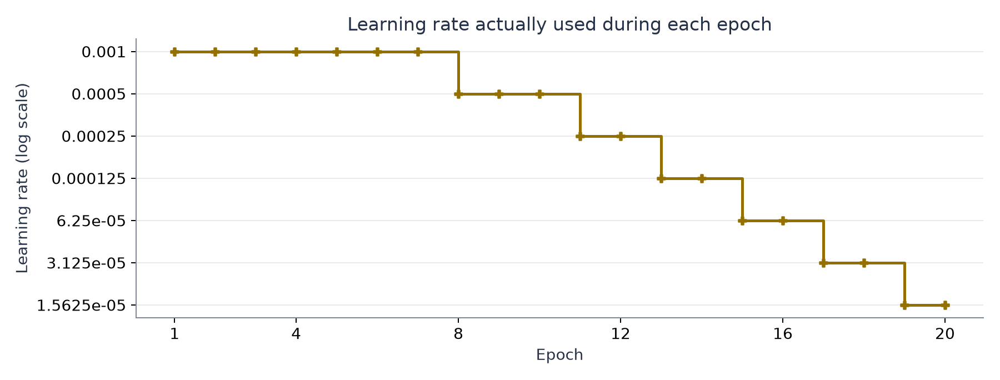
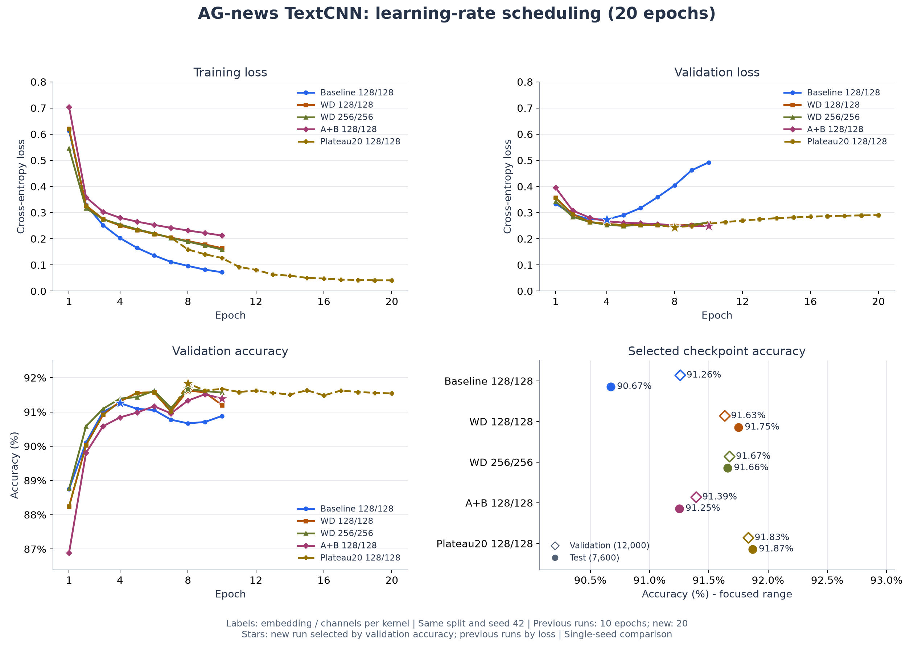

# AG-news TextCNN：学习率衰减与 20 轮训练

日期：2026-11-01。配置：[textcnn_ag_news_plateau20.json](../../../configs/textcnn_ag_news_plateau20.json)。

## 设置与代码改动

从原 128 维正则化配置开始：词向量维度 128、每个卷积分支 128 通道、卷积核 3/4/5、Dropout 0.5、Adam、weight decay 0.0001、batch size 64、随机种子 42，模型参数量保持 5,625,220。

本轮训练 20 轮，初始学习率 0.001。接入 `ReduceLROnPlateau(mode="min", factor=0.5, patience=1, min_lr=0.00001)`，监控验证损失；允许 1 轮未改善，超过后降低学习率。改善判断使用 PyTorch 默认相对阈值 0.0001。每轮 CSV 和控制台记录本轮实际使用的学习率，轮末调整从下一轮生效。

新增两种独立检查点：`best_loss.pt` 按最低验证损失保存，`best_accuracy.pt` 按最高验证准确率保存，准确率相同时比较验证损失。本轮预先约定使用 `best_accuracy.pt` 做测试集评估，不根据测试成绩选择轮次。

训练/验证/测试仍为相同的 108,000 / 12,000 / 7,600 条样本，词表大小 42,396。环境为 Python 3.12.13、PyTorch 2.13.0+cu130、datasets 5.1.0、NVIDIA GeForce RTX 5070 Ti Laptop GPU。训练命令进程耗时约 146.6 秒，包含数据准备。

## 完整逐轮输出

以下 epoch 行来自实际控制台日志。包含启动信息、两种模型的保存提示及学习率调整提示的原始完整日志保存在 `.build/task2/runs/textcnn_plateau20/training_console.txt`。

```text
Epoch 01/20 | train loss: 0.6211 | train acc: 76.25% | val loss: 0.3565 | val acc: 88.24% | lr: 0.001
Epoch 02/20 | train loss: 0.3271 | train acc: 89.03% | val loss: 0.2945 | val acc: 90.03% | lr: 0.001
Epoch 03/20 | train loss: 0.2757 | train acc: 90.73% | val loss: 0.2646 | val acc: 90.92% | lr: 0.001
Epoch 04/20 | train loss: 0.2505 | train acc: 91.70% | val loss: 0.2571 | val acc: 91.31% | lr: 0.001
Epoch 05/20 | train loss: 0.2343 | train acc: 92.17% | val loss: 0.2524 | val acc: 91.56% | lr: 0.001
Epoch 06/20 | train loss: 0.2189 | train acc: 92.70% | val loss: 0.2526 | val acc: 91.57% | lr: 0.001
Epoch 07/20 | train loss: 0.2047 | train acc: 93.13% | val loss: 0.2525 | val acc: 91.02% | lr: 0.001
Epoch 08/20 | train loss: 0.1592 | train acc: 94.74% | val loss: 0.2440 | val acc: 91.83% | lr: 0.0005
Epoch 09/20 | train loss: 0.1409 | train acc: 95.32% | val loss: 0.2494 | val acc: 91.62% | lr: 0.0005
Epoch 10/20 | train loss: 0.1267 | train acc: 95.78% | val loss: 0.2574 | val acc: 91.67% | lr: 0.0005
Epoch 11/20 | train loss: 0.0927 | train acc: 97.10% | val loss: 0.2640 | val acc: 91.58% | lr: 0.00025
Epoch 12/20 | train loss: 0.0812 | train acc: 97.50% | val loss: 0.2697 | val acc: 91.62% | lr: 0.00025
Epoch 13/20 | train loss: 0.0635 | train acc: 98.21% | val loss: 0.2747 | val acc: 91.56% | lr: 0.000125
Epoch 14/20 | train loss: 0.0590 | train acc: 98.33% | val loss: 0.2790 | val acc: 91.51% | lr: 0.000125
Epoch 15/20 | train loss: 0.0506 | train acc: 98.68% | val loss: 0.2818 | val acc: 91.63% | lr: 6.25e-05
Epoch 16/20 | train loss: 0.0483 | train acc: 98.76% | val loss: 0.2845 | val acc: 91.48% | lr: 6.25e-05
Epoch 17/20 | train loss: 0.0440 | train acc: 98.92% | val loss: 0.2866 | val acc: 91.62% | lr: 3.125e-05
Epoch 18/20 | train loss: 0.0426 | train acc: 98.97% | val loss: 0.2884 | val acc: 91.58% | lr: 3.125e-05
Epoch 19/20 | train loss: 0.0412 | train acc: 99.03% | val loss: 0.2895 | val acc: 91.56% | lr: 1.5625e-05
Epoch 20/20 | train loss: 0.0412 | train acc: 99.04% | val loss: 0.2900 | val acc: 91.54% | lr: 1.5625e-05
```

第 7、10、12、14、16、18 轮结束后，学习率依次降低，作用于后续轮次。第 20 轮结束时又降至下限 0.00001，但本次没有第 21 轮，所以该值未用于实际训练。



## 检查点与测试结果

两份检查点都选中第 8 轮，模型参数逐项相同，文件中记录的选择指标不同。第 8 轮验证损失为 0.244026，准确率为 91.83%。只对按预先约定选出的 `best_accuracy.pt` 进行本轮测试评估。

| 实验 | 训练轮数 | 选定轮次 | 验证损失 | 验证准确率 | 测试损失 | 测试准确率 |
| --- | --- | --- | --- | --- | --- | --- |
| 原始基线 | 10 | 4 | 0.273998 | 91.26% | 0.303767 | 90.67% |
| 原 128 维正则化 | 10 | 8 | 0.250798 | 91.63% | 0.262044 | 91.75% |
| 256 维扩容 | 10 | 8 | 0.245977 | 91.67% | 0.257659 | 91.66% |
| A+B 联合正则化 | 10 | 10 | 0.249014 | 91.39% | 0.260043 | 91.25% |
| 本轮学习率衰减 | 20 | 8 | 0.244026 | 91.83% | 0.257735 | 91.87% |



旧实验曲线只画到第 10 轮，本轮画到第 20 轮，没有补齐或外推旧实验数据。旧模型按最低验证损失选择，本轮按最高验证准确率选择，图中星号遵循各自记录的规则。原 128 维正则化模型的两种指标同样在第 8 轮达到最优，因此主要对照的选定轮次不受规则变化影响。

## 分析与目标进度

与原 128 维正则化模型相比，本轮验证准确率提高 0.20 个百分点，测试准确率提高约 0.118 个百分点，测试正确数从 6,973 增至 6,982。距离 92% 所需的 6,992 / 7,600 条正确分类还差 10 条，尚未达到目标。

前 7 轮的完整精度指标与原固定学习率实验一致；第一次衰减后，第 8 轮取得更好的验证结果。但之后训练损失持续下降、验证损失持续上升，多次降低学习率仍未消除过拟合，训练到第 20 轮没有刷新最佳模型。

本轮将学习率调度、训练预算和检查点选择方式作为组合方案验证。没有同样训练 20 轮的固定学习率新对照，因此不能把全部变化归因于某一个因素。这里只使用一个随机种子，没有多种子重复实验的不确定性估计。

## 复现与验证

在 Task 2 项目目录、`d2l-pytorch` 环境中运行；重跑时使用新的 `output.run_dir`，以保留现有产物：

```powershell
$env:HF_HOME = "D:\code\DeepLearning\.build\task2\huggingface"
python -m news_classifier.train --config configs/textcnn_ag_news_plateau20.json
python -m news_classifier.evaluate --checkpoint ../.build/task2/runs/textcnn_plateau20/best_accuracy.pt
python -m news_classifier.predict --checkpoint ../.build/task2/runs/textcnn_plateau20/best_accuracy.pt --text "The team won the championship game."
```

实验目录 `.build/task2/runs/textcnn_plateau20/` 保存 `best_loss.pt`、`best_accuracy.pt`、`metrics.csv`、`test_metrics.json`、`config.json`、`environment.txt`、`training_console.txt`、`training_execution.json`。

运行记录脚本为 `.build/task2/run_plateau20.py`，比较与绘图脚本为 `.build/task2/summarize_plateau20.py`，完整精度汇总与检查点 SHA-256 位于 `.build/task2/comparisons/plateau20/summary.csv` 和 `summary.json`。旧四组模型的权重哈希与本轮开始前一致。

3 项离线测试通过，覆盖[学习率生效时机、独立检查点与同准确率选择](../../../tests/test_train.py)，以及[加载保存词表进行独立评估](../../../tests/test_evaluate.py)。额外通过两轮真实小样本训练检查、完整 AG-news 训练和独立测试集评估，并按 CSV 独立重放调度器验证了实际学习率序列。原始训练日志及最终两张图均已核对。
