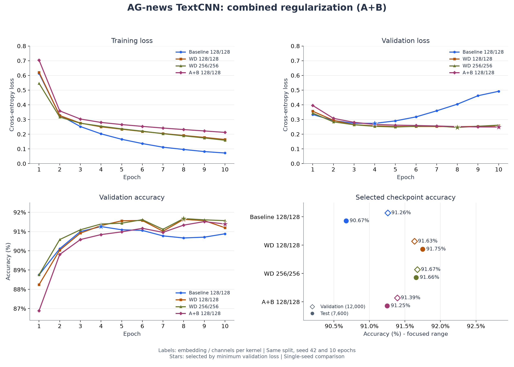

# AG-news TextCNN：A+B 联合正则化实验

日期：2026-11-01。配置：[textcnn_ag_news_dropout06_wd3e4.json](../../../configs/textcnn_ag_news_dropout06_wd3e4.json)。

## 本轮配置

按联合方案 A+B，在 128 维词向量、每分支 128 通道的模型上，同时将 Dropout 从 0.5 提高到 0.6，将 Adam 的 `weight_decay` 从 0.0001 提高到 0.0003。模型参数量仍为 5,625,220，拼接后的特征维度为 384。

其余设置与原 128 维正则化实验一致：随机种子 42，训练 10 轮，batch size 64，固定学习率 0.001，卷积核宽度 3/4/5，文本最大长度 256。训练/验证/测试样本数为 108,000 / 12,000 / 7,600，词表大小为 42,396，保存的词表与旧模型一致。

环境：Python 3.12.13，PyTorch 2.13.0+cu130，datasets 5.1.0，NVIDIA GeForce RTX 5070 Ti Laptop GPU。训练命令进程耗时约 81.5 秒，包含数据准备，不作为与旧实验的训练速度对比。

## 逐轮实际输出

以下 epoch 行来自本次原始控制台日志。每轮验证损失都刷新了最低值，因此每轮均触发最佳模型保存。

```text
Epoch 01/10 | train loss: 0.7038 | train acc: 72.58% | val loss: 0.3953 | val acc: 86.89%
Epoch 02/10 | train loss: 0.3587 | train acc: 88.13% | val loss: 0.3079 | val acc: 89.81%
Epoch 03/10 | train loss: 0.3034 | train acc: 90.00% | val loss: 0.2808 | val acc: 90.58%
Epoch 04/10 | train loss: 0.2802 | train acc: 90.82% | val loss: 0.2669 | val acc: 90.84%
Epoch 05/10 | train loss: 0.2656 | train acc: 91.19% | val loss: 0.2618 | val acc: 90.98%
Epoch 06/10 | train loss: 0.2533 | train acc: 91.58% | val loss: 0.2593 | val acc: 91.17%
Epoch 07/10 | train loss: 0.2420 | train acc: 92.06% | val loss: 0.2561 | val acc: 90.96%
Epoch 08/10 | train loss: 0.2317 | train acc: 92.29% | val loss: 0.2518 | val acc: 91.33%
Epoch 09/10 | train loss: 0.2223 | train acc: 92.69% | val loss: 0.2497 | val acc: 91.52%
Epoch 10/10 | train loss: 0.2125 | train acc: 93.00% | val loss: 0.2490 | val acc: 91.39%
```

完整的原始日志（含启动信息、缓存提示、每轮指标和权重保存提示）已保存至 `.build/task2/runs/textcnn_dropout06_wd3e4/training_console.txt`。该文件由训练子进程的标准输出和标准错误合并记录，未使用 CSV 重建。

## 模型选择与效果对比

保持既定规则：按最低验证损失保存 `best.pt`。本轮保存第 10 轮，其验证损失为 0.249014；验证准确率最高的一轮是第 9 轮（91.52%），两者需分别记录。测试结果来自已选定的第 10 轮权重，未按测试成绩选择模型。

| 实验 | 词向量/通道 | Dropout | weight_decay | 最佳轮次 | 验证损失 | 验证准确率 | 测试损失 | 测试准确率 |
| --- | --- | --- | --- | --- | --- | --- | --- | --- |
| 原始基线 | 128/128 | 0.5 | 0 | 4 | 0.273998 | 91.26% | 0.303767 | 90.67% |
| 原 128 维正则化 | 128/128 | 0.5 | 0.0001 | 8 | 0.250798 | 91.63% | 0.262044 | 91.75% |
| 256 维扩容 | 256/256 | 0.5 | 0.0001 | 8 | 0.245977 | 91.67% | 0.257659 | 91.66% |
| 本轮 A+B | 128/128 | 0.6 | 0.0003 | 10 | 0.249014 | 91.39% | 0.260043 | 91.25% |



左上为训练交叉熵，右上为验证交叉熵，左下为验证准确率。星号标记按最低验证损失选出的检查点；右下比较这些检查点的验证及测试准确率，横轴为明确标注的局部范围。四组曲线的每一轮均完整显示。

## 结论与限制

相对原 128 维正则化模型，本轮最佳验证损失下降约 0.001783，测试损失下降约 0.002001；但对应验证准确率下降约 0.242 个百分点，测试准确率下降 0.50 个百分点，测试正确数从 6,973 降至 6,935，少正确分类 38 条新闻。损失略有改善并不保证正确分类数量增加。

本轮在 10 轮内没有出现后期验证损失回升，前期拟合也更慢，符合更强正则化抑制拟合的预期。由于 Dropout 概率改变，训练时随机丢弃程度也改变，不能仅凭训练准确率降低判断泛化能力改善。第 10 轮验证损失仍在下降，说明本次训练预算内的走势不足以确定其最终收敛表现。

在本次固定种子、相同 10 轮训练预算下，A+B 没有提高分类准确率。此次同时修改两项超参数，不能分别判断 A 或 B 的独立影响；只有一个随机种子，也没有多种子重复实验的统计不确定性估计。

后续可分别尝试只提高 Dropout 或只提高权重衰减，或检验更长训练预算是否有帮助；本次没有自动启动这些额外实验，后续选择仍应基于验证集。

## 复现与文件

在 Task 2 项目目录、`d2l-pytorch` 环境中运行：

```powershell
$env:HF_HOME = "D:\code\DeepLearning\.build\task2\huggingface"
python -m news_classifier.train --config configs/textcnn_ag_news_dropout06_wd3e4.json
python -m news_classifier.evaluate --checkpoint ../.build/task2/runs/textcnn_dropout06_wd3e4/best.pt
```

重跑时为配置设置新的 `output.run_dir`，以保留现有结果。记录原始训练输出的本轮执行脚本为 `.build/task2/run_regularization_ab.py`，按一次性运行设计，会拒绝覆盖已有的日志和权重。

实验目录 `.build/task2/runs/textcnn_dropout06_wd3e4/` 包含 `metrics.csv`、`best.pt`、`test_metrics.json`、`config.json`、`environment.txt`、`training_console.txt`、`training_execution.json`。本轮配置与环境快照由执行脚本保存；训练入口本身仍自动生成 CSV 和最佳权重。

四组完整精度对比表及权重 SHA-256 位于 `.build/task2/comparisons/regularization_ab/summary.csv` 和 `summary.json`；绘图与核对脚本为 `.build/task2/summarize_regularization_ab.py`。原有三组权重的哈希与本轮开始前一致。
