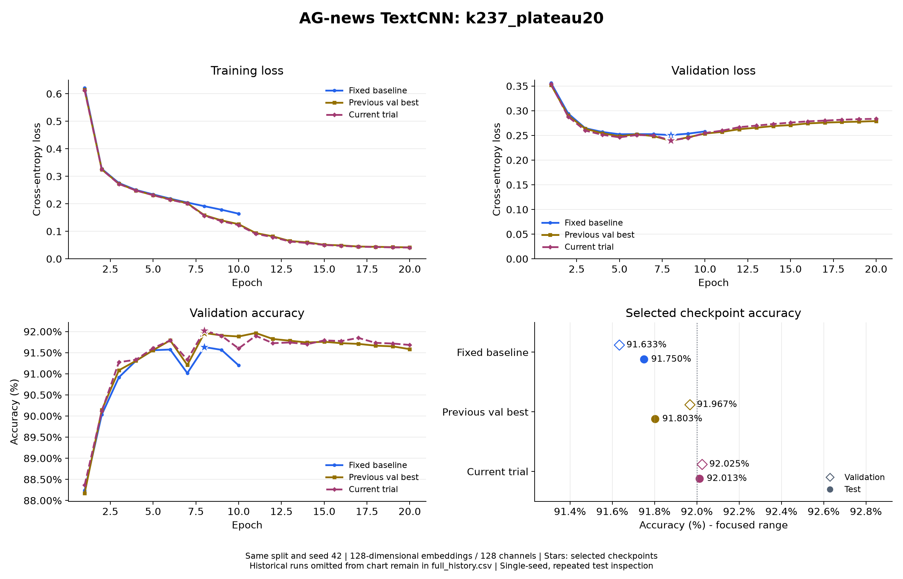

# AG-news TextCNN：k237_plateau20

日期：2026-11-01。配置：[textcnn_ag_news_k237_plateau20.json](../../configs/textcnn_ag_news_k237_plateau20.json)。

相对于此前验证最佳 `textcnn_k246_plateau20`，实际配置变化（不计实验名和输出路径）：`model.kernel_sizes`：`[2, 4, 6]` → `[2, 3, 7]`。

## 设置

词向量和每个卷积分支通道数均为 128，卷积核 2/3/7，参数量 5,625,220。
Dropout=0.5，weight decay=0.0001，初始学习率=0.001，batch size=64，训练 20 轮。
ReduceLROnPlateau 监控验证损失，factor=0.5、patience=1、min_lr=0.00001。随机种子 42，训练/验证/测试样本 108000/12000/7600，词表 42396。
训练进程耗时 143.2 秒。`best_accuracy.pt` 按最高验证准确率选择，同准确率选更低验证损失；`best_loss.pt` 独立保留。每次只评估本轮按验证指标选出的模型。
最低损失模型选中第 8 轮（验证损失 0.239715，准确率 92.025%）；测试结果来自最高准确率模型，不混用两份检查点的数据。

## 完整逐轮输出

```text
Epoch 01/20 | train loss: 0.6125 | train acc: 76.71% | val loss: 0.3540 | val acc: 88.37% | lr: 0.001
Epoch 02/20 | train loss: 0.3248 | train acc: 89.17% | val loss: 0.2880 | val acc: 90.12% | lr: 0.001
Epoch 03/20 | train loss: 0.2722 | train acc: 90.87% | val loss: 0.2599 | val acc: 91.27% | lr: 0.001
Epoch 04/20 | train loss: 0.2486 | train acc: 91.71% | val loss: 0.2513 | val acc: 91.33% | lr: 0.001
Epoch 05/20 | train loss: 0.2315 | train acc: 92.20% | val loss: 0.2462 | val acc: 91.61% | lr: 0.001
Epoch 06/20 | train loss: 0.2148 | train acc: 92.74% | val loss: 0.2508 | val acc: 91.79% | lr: 0.001
Epoch 07/20 | train loss: 0.2012 | train acc: 93.19% | val loss: 0.2502 | val acc: 91.33% | lr: 0.001
Epoch 08/20 | train loss: 0.1569 | train acc: 94.75% | val loss: 0.2397 | val acc: 92.03% | lr: 0.0005
Epoch 09/20 | train loss: 0.1371 | train acc: 95.44% | val loss: 0.2451 | val acc: 91.90% | lr: 0.0005
Epoch 10/20 | train loss: 0.1229 | train acc: 95.89% | val loss: 0.2549 | val acc: 91.60% | lr: 0.0005
Epoch 11/20 | train loss: 0.0911 | train acc: 97.13% | val loss: 0.2598 | val acc: 91.90% | lr: 0.00025
Epoch 12/20 | train loss: 0.0789 | train acc: 97.56% | val loss: 0.2668 | val acc: 91.72% | lr: 0.00025
Epoch 13/20 | train loss: 0.0630 | train acc: 98.15% | val loss: 0.2699 | val acc: 91.74% | lr: 0.000125
Epoch 14/20 | train loss: 0.0576 | train acc: 98.38% | val loss: 0.2732 | val acc: 91.70% | lr: 0.000125
Epoch 15/20 | train loss: 0.0504 | train acc: 98.66% | val loss: 0.2761 | val acc: 91.79% | lr: 6.25e-05
Epoch 16/20 | train loss: 0.0475 | train acc: 98.74% | val loss: 0.2786 | val acc: 91.77% | lr: 6.25e-05
Epoch 17/20 | train loss: 0.0440 | train acc: 98.96% | val loss: 0.2801 | val acc: 91.85% | lr: 3.125e-05
Epoch 18/20 | train loss: 0.0431 | train acc: 98.95% | val loss: 0.2818 | val acc: 91.73% | lr: 3.125e-05
Epoch 19/20 | train loss: 0.0417 | train acc: 99.01% | val loss: 0.2830 | val acc: 91.72% | lr: 1.5625e-05
Epoch 20/20 | train loss: 0.0411 | train acc: 99.07% | val loss: 0.2837 | val acc: 91.68% | lr: 1.5625e-05
```

## 结果与精简对比图

| 对照 | 选定轮次 | 验证损失 | 验证准确率 | 测试准确率 | 测试正确数 |
| --- | --- | --- | --- | --- | --- |
| Fixed baseline (`textcnn_wd1e4`) | 8 | 0.250798 | 91.633% | 91.750% | 6973 / 7600 |
| Previous val best (`textcnn_k246_plateau20`) | 8 | 0.239227 | 91.967% | 91.803% | 6977 / 7600 |
| Current trial (`textcnn_k237_plateau20`) | 8 | 0.239715 | 92.025% | 92.013% | 6993 / 7600 |



每张图最多三组：固定基线、此前最佳、本轮实验，重合时合并；更早实验保留在各自记录和 `.build/task2/comparisons/full_history.csv`，不继续叠加曲线。
固定基线按最低验证损失选择，另外两组按验证准确率选择；固定基线两种指标同在第 8 轮最优。旧 10 轮实验曲线只画实际轮次。

测试准确率为 92.013158%，正确 6993 / 7600；92% 对应至少 6992 条正确，已达到目标。
相对于本轮开始前的历史最高测试成绩 91.8684%（`textcnn_plateau20`，6982 条正确），本次多正确 11 条，提高约 0.1447 个百分点。图中的此前验证最佳为 `textcnn_k246_plateau20`，它与此前测试最高并非同一模型。
本轮验证准确率与此前最佳相比变化 +0.058 个百分点。
这里只运行一个随机种子；测试集已在多轮实验中查看，不能把多轮调参后的成绩视为一次完全未见的最终评估。

## 产物与核对

原始完整控制台（含保存及调度提示）、配置、环境、逐轮全精度 CSV、两种模型和测试指标保存在 `.build/task2/runs/textcnn_k237_plateau20/`。
本轮汇总与 SHA-256 保存在 `.build/task2/comparisons/k237_plateau20/summary.json`、`summary.csv`；完整历史位于 `.build/task2/comparisons/full_history.csv`。
已核对全部 epoch 行、两种检查点选择、参数量、实际配置、调度器逐轮重放、7600 条测试样本，以及本轮开始前 19 份历史模型的权重哈希未变。

独立复核脚本 `.build/task2/verify_goal_checkpoint.py` 重新从官方训练集构造相同划分和词表，再对验证集和官方测试集逐条累计混淆矩阵。验证正确数为 11043 / 12000，测试正确数为 6993 / 7600，与独立评估入口的指标一致。两种最低损失/最高准确率检查点均选中第 8 轮；测试仅使用 `best_accuracy.pt`。

完整复核结果保存在本实验目录的 `independent_verification.json`。模型 SHA-256 为 `1d4ddd8cb68a8462577b9b35519c454513176843ed6b295ddb3e65682441f712`，复核前后未变化。3 项离线测试全部通过，覆盖学习率生效时机、独立检查点、准确率并列时的选择、未知调度器和恢复保存词表后的独立评估。

本轮连续完成了 Dropout 0.4、初始学习率 0.0005、Dropout 0.6、batch size 32、卷积核 2/4/6、2/4/6 配合 weight decay=0.0002，以及最终 2/3/7 共 7 组各 20 轮实验。未达标方案与完整逐轮输出均保留，未覆盖历史模型。本次成绩仅比 92% 门槛多正确 1 条，尚未进行多随机种子重复验证，不据此声称稳定超过 92%。

复现时在项目目录运行，使用新的输出目录保留现有结果：

```powershell
python -m news_classifier.train --config configs/textcnn_ag_news_k237_plateau20.json
python -m news_classifier.evaluate --checkpoint ../.build/task2/runs/textcnn_k237_plateau20/best_accuracy.pt
```
