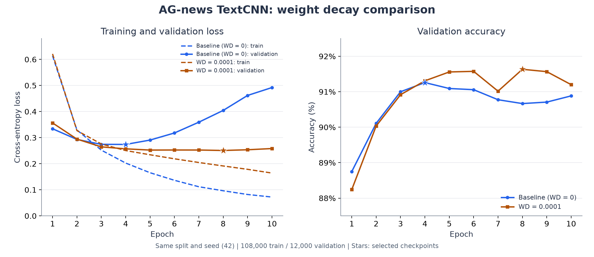

# AG-news TextCNN：基线与权重衰减实验

日期：2026-11-01。比较 Adam 的 `weight_decay=0` 和 `weight_decay=0.0001`，检查后者是否改善基线后期的过拟合表现。

## 配置与模型选择

| 实验 | 配置文件 | weight_decay | 输出目录 |
| --- | --- | --- | --- |
| 基线 | [textcnn_ag_news_baseline.json](../../configs/textcnn_ag_news_baseline.json) | 0 | `.build/task2/runs/textcnn_baseline/` |
| 权重衰减 | [textcnn_ag_news_wd1e4.json](../../configs/textcnn_ag_news_wd1e4.json) | 0.0001 | `.build/task2/runs/textcnn_wd1e4/` |

除实验名称、输出目录和权重衰减系数外，两组实际训练配置一致。比较以各自 `best.pt` 内保存的配置为依据，基线另存了一份可复现配置，避免后续修改默认配置影响实验记录。

共同设置：随机种子 42，训练 10 轮，batch size 64，Adam，固定学习率 0.001，Dropout 0.5，Embedding 维度 128，卷积核宽度 3/4/5，每个分支 128 个输出通道。

两组使用相同的数据划分：108,000 条训练样本、12,000 条验证样本、7,600 条官方测试样本；保存的词表相同，大小均为 42,396。Python 3.12.13、PyTorch 2.13.0+cu130、datasets 5.1.0，使用 NVIDIA GeForce RTX 5070 Ti Laptop GPU。

每组按最低验证损失选择最佳模型。权重衰减实验先根据验证结果选定模型，再进行测试集评估；测试集没有用于选择轮次或调整本次超参数。

## 最佳模型结果

| 实验 | 最佳轮次 | 验证损失 | 验证准确率 | 测试损失 | 测试准确率 | 测试正确数 |
| --- | --- | --- | --- | --- | --- | --- |
| 基线 | 4 | 0.273998 | 91.26% | 0.303767 | 90.67% | 6891 / 7600 |
| weight_decay=0.0001 | 8 | 0.250798 | 91.63% | 0.262044 | 91.75% | 6973 / 7600 |

本次比较中，最佳模型的验证损失下降约 0.0232，验证准确率提高 0.375 个百分点；测试准确率提高约 1.08 个百分点，多正确分类 82 条新闻。

## 训练过程



左图虚线为训练交叉熵，实线为验证交叉熵；右图为验证准确率。星号标记按最低验证损失选择的模型。数据直接来自两组完整的 `metrics.csv`。

基线验证损失在第 4 轮达到最低值后持续上升，第 10 轮为 0.492060。加入权重衰减后，第 3 轮以后的验证损失保持在约 0.25 到 0.26，第 8 轮最低，第 10 轮为 0.258200。

第 10 轮训练准确率由基线的 97.62% 降至 94.42%，同时该轮验证准确率由 90.88% 升至 91.20%。结合验证损失曲线，本次实验支持权重衰减缓解过拟合的判断。

这里只比较了一个随机种子，尚无多种子重复实验或统计不确定性估计，不能把这一次提升视为所有随机初始化下的保证。

## 复现与文件

在 Task 2 项目目录，激活 `d2l-pytorch` 后运行；重新训练时为配置中的 `output.run_dir` 设置新目录，以保留现有结果。

```powershell
$env:HF_HOME = "D:\code\DeepLearning\.build\task2\huggingface"

python -m news_classifier.train --config configs/textcnn_ag_news_baseline.json
python -m news_classifier.train --config configs/textcnn_ag_news_wd1e4.json

python -m news_classifier.evaluate --checkpoint ../.build/task2/runs/textcnn_wd1e4/best.pt
python -m news_classifier.predict --checkpoint ../.build/task2/runs/textcnn_wd1e4/best.pt --text "The team won the championship game."
```

每个实验目录已保存 `metrics.csv`、`best.pt`、`test_metrics.json`、`config.json`、`environment.txt`。后两项由本次结果核对流程补充，尚未接入训练入口的自动保存逻辑。

机器可读的对比表和权重文件 SHA-256 保存在 `.build/task2/comparisons/baseline_vs_wd1e4/summary.csv` 与 `summary.json`；重算与绘图脚本为 `.build/task2/summarize_wd_experiment.py`。

已核对两组各 10 轮日志、保存权重对应的最佳轮次和验证指标、配置差异、词表一致性，以及 7,600 条测试样本的指标。曲线图已检查数值绑定、图例、坐标和标记显示。
